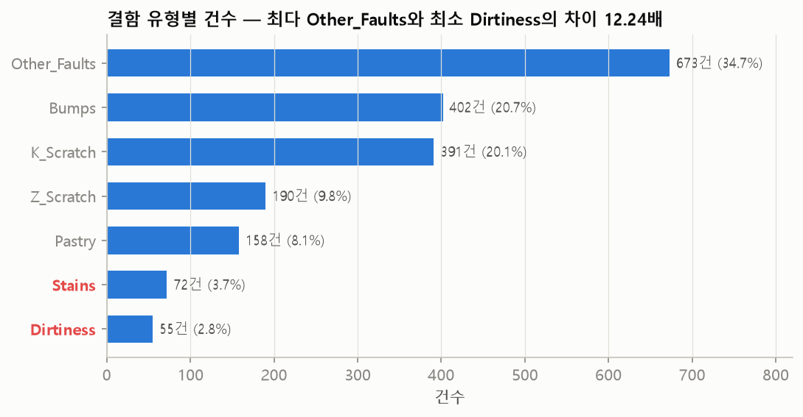
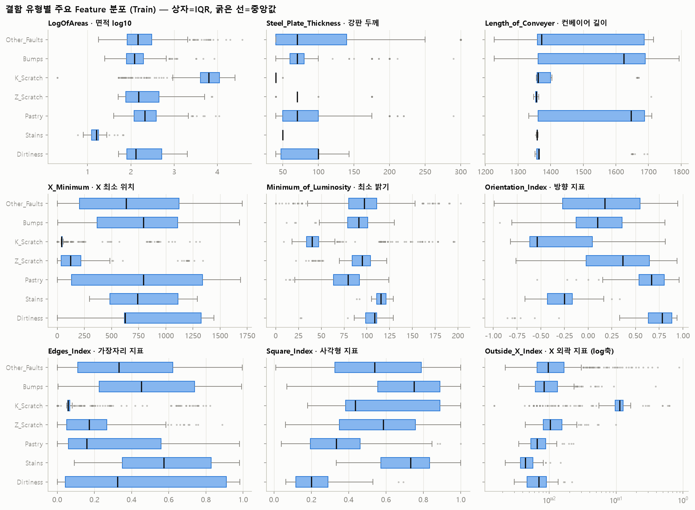
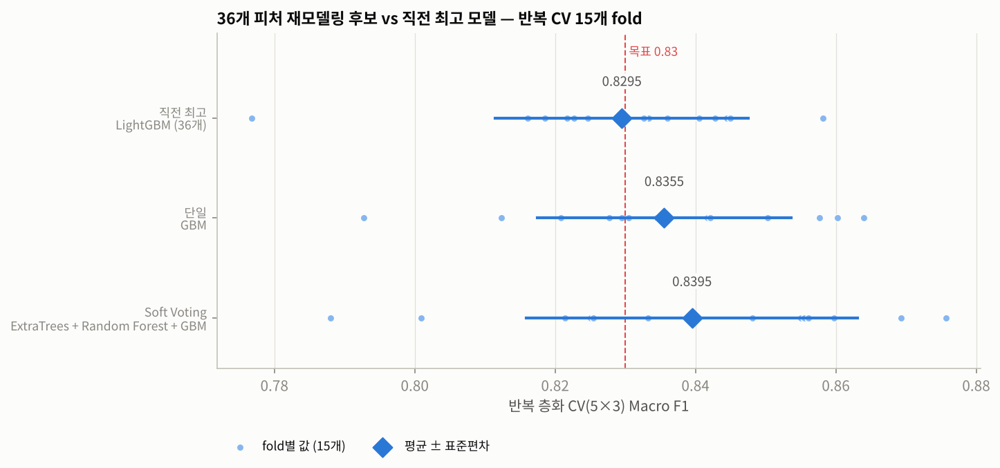
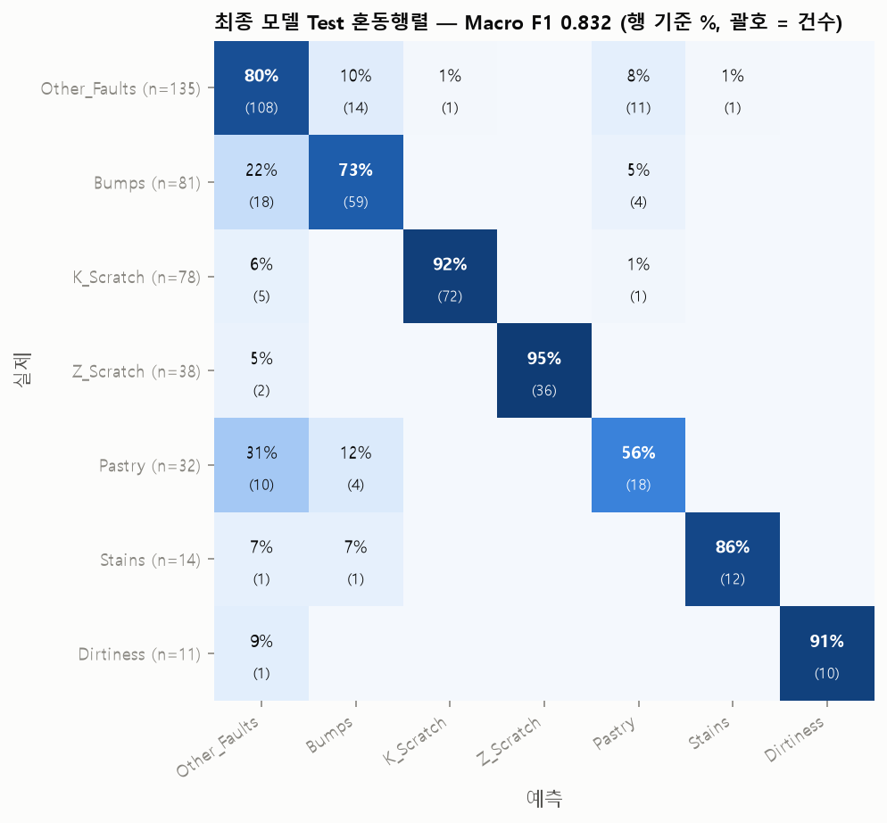
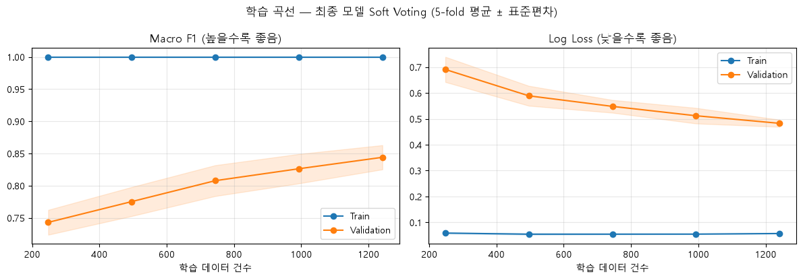
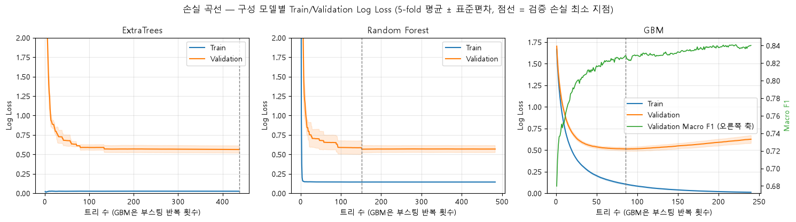
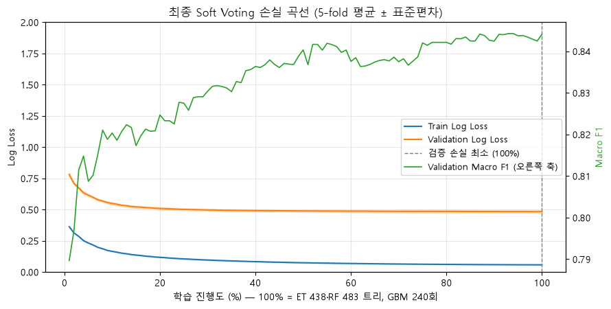
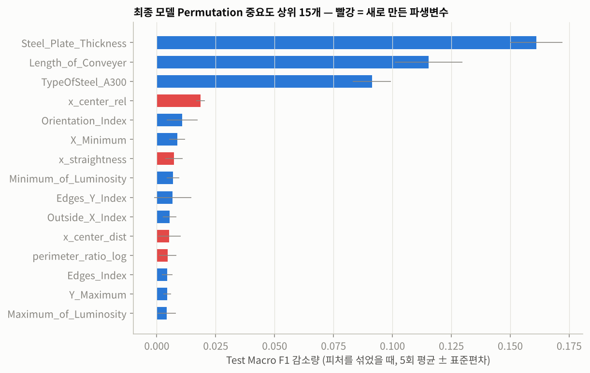

# 강판 결함 유형 분류 (Steel Plates Faults)

강판 표면 검사에서 검출된 결함의 측정값 27개로 **7가지 결함 유형을 분류하는 다중 분류 모델**을 개발했습니다.

클래스 불균형(최대/최소 12.24배)이 있는 데이터에서 소수 유형을 놓치지 않도록 **Macro F1-score**를 핵심 지표로 삼았습니다. Baseline → 불균형 처리 → 튜닝 → 파생변수 → 앙상블 순서로 개선해, 최종 모델 **Soft Voting(ExtraTrees + Random Forest + GBM)** 이 Train 5-fold CV Macro F1 **0.8441**(최고 Baseline 0.8109 대비 +0.0332), Test Macro F1 **0.8324**를 기록했습니다.



---

## 1. 프로젝트 개요

### 1.1 프로젝트 소개

**프로젝트 배경**

- 제조 현장에서는 결함을 발견한 뒤 어떤 유형인지 구분해야 원인 공정을 찾고 조치할 수 있습니다. 측정된 형상·밝기 특성을 활용한 자동 분류는 검사 담당자의 유형 판정을 보조할 수 있습니다.
- 전체 **1,941건 중 Other_Faults가 673건(34.67%)으로 가장 많고, Dirtiness는 55건(2.83%)으로 가장 적습니다.** 다수 유형을 잘 맞혀도 소수 유형의 성능은 낮을 수 있어, 클래스별 Precision·Recall·F1과 혼동행렬을 함께 보고 **불균형 처리 전후의 성능 변화**를 비교했습니다.

**프로젝트 목표**

- 강판 결함 측정 데이터의 구조와 클래스 분포 파악
- 7가지 결함 유형 다중 분류 모델 개발
- 불균형 처리(클래스 가중치·샘플링)와 하이퍼파라미터 튜닝, 파생변수, 앙상블의 효과 비교
- 성능 향상뿐 아니라 오분류 유형, 과적합, 일반화 한계 해석

### 1.2 프로젝트 정보

| 항목 | 내용 |
|---|---|
| 프로젝트 기간 | 2026.10.13 ~ 2026.10.19 |
| 프로젝트 유형 | 팀 프로젝트 (개인 모델링 파트) |
| 데이터 출처 | [Steel Plates Faults (UCI Machine Learning Repository)](https://archive.ics.uci.edu/dataset/198/steel+plates+faults) |
| 주요 기술 | Python, scikit-learn, imbalanced-learn, XGBoost, LightGBM, uv |

### 1.3 주요 성과

| 지표 | 최고 Baseline (XGBoost) | 최종 모델 (Soft Voting) |
|---|---|---|
| Train 5-fold CV Macro F1 | 0.8109 | **0.8441** (+0.0332) |
| 반복 층화 CV(5×3) Macro F1 | — | **0.8389 ± 0.0231** |
| Test Macro F1 | 0.8165 | **0.8324** (95% CI 0.7904 ~ 0.8686) |
| Test Dirtiness F1 | 0.8182 | **0.9524** |

- **모델 성능:** GBM Baseline 0.7958에서 클래스 가중치(+0.0137), 튜닝(+0.0130), 파생변수 + 재튜닝(+0.0176), 앙상블(+0.0040)을 거쳐 0.8441(5-fold)로 개선
- **불균형 처리:** 언더샘플링은 학습 데이터 손실로 크게 악화(−0.1048 ~ −0.1471)되었고, 클래스 가중치와 SMOTENC가 효과적
- **주요 인사이트:** 결함 형상보다 **강판 조건(두께·컨베이어 길이·강종)** 이 가장 강한 신호이며, 같은 강판 조건에서는 같은 결함 유형이 76.6% 반복됨

---

## 2. 프로젝트 구조

```text
steel-plate-fault-classification/
├── README.md
├── pyproject.toml / uv.lock / .python-version
├── data/
│   ├── raw/Faults.csv                      # UCI 원본 (1,941행 × 34열)
│   ├── processed/Faults_processed.csv      # 팀 공통 전처리 결과 (26개 피처 + target)
│   └── split/train_idx.csv, test_idx.csv   # 팀 공통 Train/Test 분할 index
├── src/
│   ├── config.py, load_data.py, make_split.py   # 팀 공통 설정·데이터 로드·분할
│   └── Taegyeom_model_utils.py             # 전처리 Pipeline, 평가, 파생변수, 래퍼 함수
├── notebooks/
│   ├── Taegyeom_01_eda_preprocessing.ipynb
│   ├── Taegyeom_02_baseline.ipynb
│   ├── Taegyeom_03_imbalance.ipynb
│   ├── Taegyeom_04_tuning.ipynb
│   ├── Taegyeom_05_feature_engineering.ipynb
│   ├── Taegyeom_06_ensemble.ipynb
│   ├── Taegyeom_07_final_evaluation.ipynb
│   └── Taegyeom_08_train_final_model.ipynb
├── models/
│   ├── Taegyeom_final_model.pkl            # 07번 노트북 저장 (sklearn Pipeline)
│   └── Taegyeom_final_model_trained.pkl    # 08번 노트북 저장 (세 모델 + 강판 조건 집계)
├── results/                                # 단계별 결과 CSV·JSON·캐시(pkl)
│   └── eda, baseline, imbalance, tuning, feature_engineering, ensemble, final
├── figures/                                # Taegyeom_*.png
└── docs/
    └── Taegyeom_모델링_프로젝트_보고서.docx
```

---

## 3. 설치 및 실행 방법

### 3.1 실행 환경

- Python 3.14.7 (`.python-version`)
- uv
- Jupyter Notebook 또는 VS Code

### 3.2 Repository 다운로드

```bash
git clone <repository-url>
cd steel-plate-fault-classification
```

### 3.3 uv 설치 및 환경 구성

[uv 공식 설치 안내](https://docs.astral.sh/uv/getting-started/installation/)를 참고해 uv를 설치한 뒤, 의존성을 설치합니다.

```bash
uv sync
```

주요 패키지: pandas 3.0, scikit-learn 1.9.1, imbalanced-learn 0.14.2, LightGBM 4.7.0, XGBoost 3.4.1, matplotlib, jupyter

### 3.4 데이터 준비

데이터는 Repository에 포함되어 있습니다.

- `data/raw/Faults.csv`: UCI 원본
- `data/processed/Faults_processed.csv`: 팀 공통 전처리 결과(TypeOfSteel_A400 제외, 정답 7열 → `target`)
- `data/split/train_idx.csv`, `test_idx.csv`: 팀 공통 80:20 층화 분할 index

### 3.5 Jupyter Notebook 실행

1. VS Code에서 프로젝트 폴더를 엽니다.
2. 실행할 `.ipynb` 파일을 엽니다.
3. 우측 상단의 **Select Kernel**에서 프로젝트의 `.venv` Python 환경을 선택합니다.
4. 셀을 위에서부터 순서대로 실행합니다.

### 3.6 분석 및 모델링 실행 순서

| 순서 | 파일 | 주요 내용 |
|---|---|---|
| 1 | `Taegyeom_01_eda_preprocessing.ipynb` | 데이터 품질 점검, EDA, 전처리 검증(팀 공통 결과와 일치 확인) |
| 2 | `Taegyeom_02_baseline.ipynb` | 6개 모델 Baseline 비교 (불균형 처리 없음) |
| 3 | `Taegyeom_03_imbalance.ipynb` | 클래스 가중치·언더샘플링·SMOTENC·SMOTE 비교 (6개 모델 × 10개 조건) |
| 4 | `Taegyeom_04_tuning.ipynb` | RandomizedSearchCV (불균형 처리 방법도 탐색), 반복 CV 재확인 |
| 5 | `Taegyeom_05_feature_engineering.ipynb` | 피처 중요도 분석, 파생변수 10개 설계·비교, 재튜닝 |
| 6 | `Taegyeom_06_ensemble.ipynb` | 36개 피처에서 5개 모델 재튜닝 + Soft Voting·Stacking 비교, 최종 모델 선정 |
| 7 | `Taegyeom_07_final_evaluation.ipynb` | Train 전체 재학습 → Test 평가, 클래스별 지표·혼동행렬·오분류 사례·피처 중요도 |
| 8 | `Taegyeom_08_train_final_model.ipynb` | **단독 실행 가능.** `Faults_processed.csv`만으로 최종 모델 학습 → 5-fold·반복 CV → 과적합 점검·학습 곡선·손실 곡선 → Test 평가 → 모델 저장 |

- 03~06번 노트북은 결과를 `results/*/Taegyeom_*_cache.pkl`에 저장해 두어, `RERUN = False`(기본값)면 몇 분 안에 끝납니다. `True`로 바꾸면 처음부터 다시 계산합니다(06번 기준 약 25분).
- 최종 모델만 확인하려면 08번 노트북만 실행하면 됩니다(반복 CV 포함 약 10분).

**저장된 최종 모델로 예측하기**

```python
import sys; sys.path.insert(0, "../src")      # notebooks 폴더 기준
import joblib
from load_data import load_data
from Taegyeom_model_utils import add_features

X_train, X_test, y_train, y_test = load_data()
model = joblib.load("../models/Taegyeom_final_model.pkl")
pred = model.predict(add_features(X_test))      # 입력: add_features 적용 데이터 (파이프라인 안에서 36개로 확장)
```

---

## 4. 기술 스택

| 구분 | 사용 기술 |
|---|---|
| Language | Python 3.14 |
| Environment & Package Management | uv |
| Data Processing | pandas, NumPy |
| Visualization | Matplotlib |
| Machine Learning | scikit-learn, XGBoost, LightGBM |
| Imbalanced Learning | imbalanced-learn (SMOTENC, SMOTE, RandomUnderSampler) |
| Model Interpretation | Permutation Importance |
| Development | Jupyter Notebook, VS Code, Git |

---

## 5. 데이터셋

### 5.1 데이터 개요

**데이터 출처:** [Steel Plates Faults (UCI Machine Learning Repository)](https://archive.ics.uci.edu/dataset/198/steel+plates+faults)

| 항목 | 내용 |
|---|---|
| 데이터 수 | 1,941건 (Train 1,552 / Test 389, 층화 80:20) |
| Feature 수 | 원본 27개 → 26개 사용(TypeOfSteel_A400 제외) → 최종 모델은 파생변수 10개 추가 36개 |
| Target 변수 | `target` (원-핫 정답 7열을 단일 라벨로 변환, 오타 K_Scatch → K_Scratch 수정) |
| 문제 유형 | 다중 클래스 분류 (7-class) |
| 클래스 비율 | Other_Faults 34.67% ~ Dirtiness 2.83% (최대/최소 12.24배) |

### 5.2 데이터 특징

- **데이터 품질:** 결측 0건, 중복 0건. 도메인 논리 검증(최소 ≤ 최대, 위치 ≤ 컨베이어 길이, 면적 > 0, A300 + A400 = 1)을 모두 통과
- **변수 구성:** 위치(4), 크기·둘레(7), 밝기(4), 형상·가장자리 지표(8), 공정·강판 정보(4). 모두 수치형
- **분포:** 면적·둘레·밝기 합은 왜도 약 3의 강한 우편향. 이상치의 약 83%가 K_Scratch(대형 긁힘)로 측정 오류가 아닌 유형 고유 특성이라 제거하지 않음

**Target 클래스 분포**

| 유형 | 건수 | 비율 |
|---|---|---|
| Other_Faults | 673 | 34.67% |
| Bumps | 402 | 20.71% |
| K_Scratch | 391 | 20.14% |
| Z_Scratch | 190 | 9.79% |
| Pastry | 158 | 8.14% |
| Stains | 72 | 3.71% |
| Dirtiness | 55 | 2.83% |

**모델링에서 고려한 사항**

- **데이터 누수 방지:** 정답 7열은 X에서 제외. 결측 대체·스케일링·샘플링·클래스 가중치·강판 조건 집계 변수는 모두 Pipeline 안에서 CV의 학습 fold로만 계산
- **층화 분할:** Train/Test 분할과 CV 모두 클래스 비율을 유지(`StratifiedKFold`)
- **Test 사용:** Test는 학습·모델 선택에 쓰지 않고 평가에만 사용. 모델 선택은 Train 내부 CV로만 진행
- **희소 클래스:** Test에 Dirtiness 11건, Stains 14건뿐이라 1건 오분류가 Recall을 7~9%p 좌우 → 부트스트랩 95% 신뢰구간을 함께 보고

---

## 6. 데이터 분석 및 전처리

### 6.1 탐색적 데이터 분석 (EDA)

**주요 분석 내용**

- 데이터 구조·품질(결측·중복·도메인 논리) 점검
- 변수 분포(왜도·이상치), 변수 간 상관관계
- Target 클래스 분포와 유형별 변수 차이, Mutual Information

**주요 발견 사항**

1. **크기·위치·강종만으로 K_Scratch·Stains·Z_Scratch가 상당 부분 분리됩니다.** K_Scratch는 면적이 한 자릿수 이상 크고 X축 가장자리에 위치하며 Train에서 100% A400입니다. 실제 모델 Test F1도 0.8889~0.9730으로 높습니다.
2. **Other_Faults는 거의 모든 변수에서 다른 유형과 범위가 겹치는 이질적 집합**이라, Bumps·Pastry와의 혼동이 최대 오류원이 됩니다.
3. **결함 형상보다 강판·생산 조건이 가장 강한 신호입니다.** Mutual Information 상위가 강판 두께(0.5600)·컨베이어 길이(0.5523)이고, 강판 조건 239개 그룹 안에서 같은 유형이 76.6% 반복됩니다. 반대로 처음 보는 강판 조건에서는 성능이 낮아질 수 있습니다.

**분석 결과 시각화**



### 6.2 데이터 전처리

| 처리 항목 | 적용 방법 | 선택 이유 |
|---|---|---|
| 결측치 처리 | 결측 0건. Pipeline에 SimpleImputer(연속형 중앙값, 이산형 최빈값) 포함 | 신규 데이터 결측 대비, 학습 fold 기준으로만 학습 |
| 이상치 처리 | 제거·클리핑하지 않음 | 이상치 대부분이 K_Scratch 고유 특성, 제거 시 구분 정보 손실 |
| 중복 변수 | TypeOfSteel_A400 제외 | A300과 정의상 완전 중복(r = −1.00) |
| 범주형 인코딩 | 불필요 | 강종(0/1)·Outside_Global_Index(0/0.5/1)는 이미 숫자. SMOTENC의 범주형 열로 지정해 존재할 수 없는 값(예: 강종 0.37) 생성 방지 |
| 스케일링 | Logistic Regression만 StandardScaler(연속형만) | 트리 계열은 스케일에 무관 (팀 공통 기준) |
| Feature Engineering | 파생변수 10개 추가 (아래) | 피처 중요도 상위(강판 정보·위치·형상)와 EDA 결과 기반 |

**파생변수 10개**

| 그룹 | 파생변수 | 의미 |
|---|---|---|
| 형상 | `compactness`, `perimeter_ratio_log`, `x_straightness` | 둘레 대비 면적, 가로/세로 둘레 비, 가로 윤곽의 굴곡 |
| 밝기 | `lum_range`, `lum_contrast`, `lum_mean_position` | 밝기 범위·대비, 평균 밝기의 위치 |
| 위치 | `x_center_rel`, `x_center_dist` | 컨베이어 폭 대비 결함 중심 위치, 중앙에서 떨어진 정도 |
| 강판 맥락 | `plate_defect_count`, `thickness_per_conveyer` | 같은 강판 조건의 결함 수(학습 fold로만 집계), 두께/컨베이어 길이 |

**전처리 과정에서 고려한 사항**

- 팀 공통 index 기반 80:20 층화 분할, Train 내부 `StratifiedKFold(5, shuffle=True, random_state=42)`
- 전처리 결과가 팀 공통 `Faults_processed.csv`와 행·열·값·순서까지 일치함을 검증
- 파생변수만 추가하고 기존 하이퍼파라미터를 그대로 쓰면 오히려 하락(전체 36개 −0.0047, 최대 −0.0077) → **파생변수에 맞춰 재튜닝해야 효과**가 나타남

---

## 7. 머신러닝 모델링

### 7.1 Baseline 모델

**사용 모델:** Logistic Regression, Decision Tree, Random Forest, GBM, XGBoost, LightGBM (모두 기본값, 불균형 처리 없음)

**결과 (Train 5-fold CV Macro F1)**

| 모델 | Macro F1 |
|---|---|
| XGBoost | **0.8109 ± 0.0308** |
| LightGBM | 0.8044 ± 0.0360 |
| GBM | 0.7958 ± 0.0106 (fold 간 편차 최소) |
| Random Forest | 0.7899 ± 0.0312 |
| Decision Tree | 0.7207 ± 0.0259 |
| Logistic Regression | 0.7191 ± 0.0275 |

- 선형 모델(LR)은 과소적합(Train 0.7488), 트리 모델은 Train 1.0으로 과적합 경향
- Boosting 계열이 상위권이며, 모든 모델에서 Pastry·Bumps·Other_Faults 혼동이 주요 오류

### 7.2 모델 비교 및 성능 개선

**적용한 모델:** Logistic Regression, Decision Tree, Random Forest, ExtraTrees, GBM, XGBoost, LightGBM, Soft Voting, Stacking

**주요 실험과 개선 흐름 (GBM 경로, Train 5-fold CV Macro F1)**

| 단계 | 한 일 | Macro F1 | 변화 |
|---|---|---|---|
| ① Baseline | GBM 기본값, 원본 26개 | 0.7958 | — |
| ② 불균형 처리 | 클래스 가중치(소수 유형 가중 ↑) | 0.8095 | +0.0137 |
| ③ 하이퍼파라미터 튜닝 | RandomizedSearchCV (가중치 강도 포함) | 0.8225 | +0.0130 |
| ④ 파생변수 + 재튜닝 | 36개 피처, 처음부터 다시 튜닝 | 0.8401 | +0.0176 |
| ⑤ 앙상블 | ExtraTrees + RF + GBM Soft Voting | **0.8441** | +0.0040 |

- **튜닝:** 샘플러(SMOTENC/없음)와 클래스 가중치도 탐색 공간에 넣어 불균형 처리 방식까지 함께 선택
- **검증:** 튜닝 최고값(5-fold)은 여러 설정 중 1등을 고른 값이라 낙관적이므로, 상위 후보는 **반복 층화 CV(5×3, 15 fold)** 로 다시 평가해 최종 판단
- **앙상블:** 튜닝된 모델들의 OOF 확률로 26가지 Soft Voting 조합과 Stacking을 같은 fold에서 비교

### 7.3 불균형 데이터 처리

**적용한 방법 (6개 모델 × 10개 조건 비교)**

- Class Weight (α = 0.5 / 1)
- Random Under Sampling (최대/최소 비율 IR ≤ 7 / 3.5 / 1)
- SMOTENC (IR ≤ 7 / 3.5 / 1), 일반 SMOTE (IR = 1)

**결과와 선택**

- **언더샘플링 균등화:** 학습 데이터가 1,242 → 245건으로 줄어 Macro F1 −0.1048 ~ −0.1471로 크게 악화
- **SMOTENC 균등화:** 원본 26개 피처의 Boosting 계열(LightGBM 0.8044 → 0.8268)에서 가장 효과적
- **클래스 가중치:** GBM에서 효과적(0.7958 → 0.8095). GBM은 `class_weight` 인자가 없어 균형 `sample_weight`를 넣는 래퍼(`BalancedWeightClassifier`)로 적용
- **최종 모델:** 샘플러 없이 클래스 가중치 사용(ExtraTrees `class_weight='balanced'`, GBM 균형 가중치, RF는 가중치 없음). 튜닝에서 "샘플러 없음"이 선택됨

**실험 시 고려 사항**

- 샘플링·가중치는 imblearn Pipeline으로 **CV의 학습 fold 안에서만** 적용, 검증 fold와 Test는 실제 분포 유지
- 동일한 fold에서 처리 전후 비교, 소수 유형 놓침과 오경보 건수를 함께 추적

### 7.4 모델 성능 비교

| 모델 / 실험 | CV 5-fold Macro F1 | 반복 CV(5×3) | Test Macro F1 | Test Macro Precision | Test Macro Recall | Test Macro ROC-AUC |
|---|---|---|---|---|---|---|
| Baseline Logistic Regression | 0.7191 | — | 0.7387 | 0.7595 | 0.7261 | 0.9384 |
| Baseline GBM | 0.7958 | — | 0.8068 | 0.8527 | 0.7756 | 0.9619 |
| Baseline XGBoost (최고 Baseline) | 0.8109 | — | 0.8165 | 0.8272 | 0.8072 | 0.9648 |
| LightGBM + SMOTENC + 튜닝 (원본 26개) | 0.8298 | 0.8260 | 0.8252 | 0.8254 | 0.8259 | 0.9705 |
| LightGBM + 파생변수 36개 + 재튜닝 | 0.8317 | 0.8295 | 0.8226 | 0.8137 | 0.8336 | 0.9702 |
| **최종: Soft Voting (ET + RF + GBM, 36개)** | **0.8441** | **0.8389** | **0.8324** | **0.8486** | 0.8182 | 0.9686 |

**성능 비교 결과**



**주요 분석 결과**

- **성능이 가장 우수했던 모델:** Soft Voting(ExtraTrees + RF + GBM). 5-fold·반복 CV 모두 최고이며, 직전 단계 LightGBM(반복 CV 0.8295) 대비 +0.0094, 15 fold 중 10개에서 개선
- **불균형 데이터 처리 전후 성능 변화:** 최고 Baseline 대비 Dirtiness F1 0.8182 → 0.9524로 크게 개선. 반면 Pastry F1은 0.5846 → 0.5455로 여전히 가장 약함
- **모델별 성능 차이의 원인:** 부스팅(GBM)과 배깅(ExtraTrees·RF)은 오류 패턴이 달라 확률 평균 시 실수를 상쇄(다양성 효과). 비슷한 부스팅끼리의 조합(LightGBM + XGBoost + GBM, 0.8385)은 GBM 단독(0.8401)보다 낮았음. Stacking(최고 0.8301)은 데이터가 적어 메타 모델이 불안정
- **참고:** ExtraTrees + GBM 2개 조합도 사실상 같은 성능(반복 CV 0.8391)이라, 향상의 대부분은 ExtraTrees·GBM 조합에서 나오고 RF의 추가 기여는 미미
- **선정 경위(투명성):** 단계별 최고 모델을 그 시점마다 Test로 1회씩 평가해 Test는 총 3회 사용(0.8252 → 0.8226 → 0.8324). 모델 갱신 판단은 반복 CV 평균과 15 fold 중 과반 개선 기준으로만 했고 Test 결과는 사용하지 않음

---

## 8. 최종 모델 및 결과 분석

### 8.1 최종 모델 선정

- **최종 모델:** Soft Voting — ExtraTrees + Random Forest + GBM의 예측 확률 평균 (파생변수 포함 36개 피처)
- **적용한 불균형 처리 방법:** 샘플러 없이 클래스 가중치 (ExtraTrees `class_weight='balanced'`, GBM 균형 `sample_weight`, RF 가중치 없음)
- **주요 하이퍼파라미터:**
  - ExtraTrees: 438 trees, max_depth 15, max_features 0.7
  - Random Forest: 483 trees, max_depth 제한 없음, max_features 0.3
  - GBM: 240회, learning_rate 0.0879, max_depth 4, subsample 0.9079, max_features 0.5, min_samples_leaf 5
- **선정 이유:** Train 5-fold CV 0.8441 ± 0.0188, 반복 CV 0.8389 ± 0.0231로 후보 중 최고. Test를 보기 전에 정한 기준("반복 CV 평균이 더 높고 15 fold 중 과반에서 개선")을 충족

### 8.2 최종 모델 평가

**Test 성능 (389건)**

| Macro F1 | Accuracy | Macro Precision | Macro Recall | Weighted F1 | Macro ROC-AUC |
|---|---|---|---|---|---|
| **0.8324** (95% CI 0.7904 ~ 0.8686) | 0.8098 | 0.8486 | 0.8182 | 0.8123 | 0.9686 |

| 유형 | Other_Faults | Bumps | K_Scratch | Z_Scratch | Pastry | Stains | Dirtiness |
|---|---|---|---|---|---|---|---|
| F1 | 0.7714 | 0.7421 | 0.9536 | 0.9730 | **0.5455** | 0.8889 | 0.9524 |

**Confusion Matrix**



**평가 결과 해석**

- **CV와 Test 일치:** CV 5-fold 0.8441 → Test 0.8324, 차이 0.0117로 신뢰구간 안
- **주요 오류:** 오분류 74건 중 **Bumps ↔ Other_Faults 32건(43%)**, Other_Faults ↔ Pastry 21건
- **소수 유형:** 놓침(소수 유형 → Other_Faults·Bumps) 17건, 오경보(Other_Faults → 소수 유형) 12건. 확률 평균 모델이라 Precision(0.8486)이 Recall(0.8182)보다 높음
- **실제 문제에서 중요한 오류:** 소수 유형이 기타로 흡수되면 특정 공정의 이상 신호를 놓치므로, Pastry·Bumps·Other_Faults로 예측되거나 확률이 낮은 건은 검사자 재확인이 필요
- **일반화 한계:** Train에 없던 강판 조건의 결함은 24건 중 7건(29%) 오분류로 전체(19%)보다 높음

**과적합 점검 (Train 5-fold)**

| 모델 | Train F1 | Validation F1 | Gap |
|---|---|---|---|
| ExtraTrees | 1.0000 | 0.8180 | 0.1820 |
| Random Forest | 1.0000 | 0.8125 | 0.1875 |
| GBM | 1.0000 | 0.8401 | 0.1599 |
| **Soft Voting** | 1.0000 | **0.8441** | **0.1559** |



- **학습 곡선:** 학습 데이터를 20% → 100%로 늘리면 검증 Macro F1 0.7430 → 0.8441, 검증 Log Loss 0.6907 → 0.4827로 계속 개선되고 Gap은 0.2570 → 0.1559로 감소 → 검증 성능을 해치는 과적합이 아니라 **데이터가 늘면 더 좋아질 여지가 있는 분산이 큰 상태**



- **구성 모델 손실 곡선:** ExtraTrees·RF는 트리 수를 늘려도 검증 손실이 다시 오르지 않음. GBM은 86회 이후 검증 손실이 0.5118 → 0.6250으로 오르지만(확률 과신), 검증 Macro F1은 0.8284 → 0.8401로 계속 상승



- **최종 Soft Voting 손실 곡선:** 세 모델을 같은 비율로 키우며 그리면 검증 손실이 **학습 완료 시점까지 계속 감소**해 최종 0.4827이 최소이고, 검증 F1도 같은 지점에서 최고(0.8441) → GBM의 확률 과신이 앙상블에서 상쇄되어 **최종 모델 수준에서는 과적합 신호가 없음**

### 8.3 Feature Importance 및 모델 해석



**주요 분석 결과 (Permutation 중요도: 피처를 섞었을 때 Test Macro F1 감소량)**

- **강판 두께(0.1702)·컨베이어 길이(0.1160)·강종(0.1006)** 이 압도적 상위
- 파생변수 중 **`x_center_rel`(컨베이어 폭 대비 결함 위치)이 4위(0.0244)**, `compactness`·`perimeter_ratio_log`·`x_straightness`도 상위 15위 안
- 강판 맥락 파생변수(`plate_defect_count`, `thickness_per_conveyer`)는 파이프라인 안에서 두께·컨베이어 길이로 계산되므로 그 효과가 두 원본 변수의 중요도에 함께 반영됨
- **인사이트:** 결함 형상보다 "어느 강판·생산 조건에서 나온 결함인가"가 가장 강한 신호. 중요도는 인과관계가 아니라 모델이 해당 변수를 얼마나 활용하는지를 나타냄

---

## 9. Streamlit 대시보드

구축 예정입니다. 계획한 주요 기능은 다음과 같습니다.

- 데이터 및 Target 클래스 분포 시각화
- 단계별·모델별 Macro F1 비교, 불균형 처리 전후 클래스별 Precision·Recall
- 최종 모델 혼동행렬과 오분류 사례

---

## 10. 결론 및 회고

### 10.1 프로젝트 주요 결과

- 최종 모델 Soft Voting(ExtraTrees + RF + GBM)이 Train 5-fold CV Macro F1 **0.8441**, 반복 CV **0.8389**, Test **0.8324**를 기록 (최고 Baseline 대비 CV +0.0332, Test +0.0159)
- 가장 큰 단일 개선은 **강판 조건 기반 파생변수 + 재튜닝**(+0.0176), 다음은 클래스 가중치(+0.0137)와 튜닝(+0.0130)
- 불균형 처리는 언더샘플링보다 클래스 가중치·SMOTENC가 효과적이었고, Dirtiness F1이 0.8182 → 0.9524로 개선
- 같은 강판 조건에서 같은 결함 유형이 반복된다는 EDA 인사이트가 피처 중요도와 파생변수 효과로 확인됨

### 10.2 한계점 및 개선 방향

- **Pastry가 가장 약한 유형**(Test F1 0.5455) — Pastry 구분 형상 변수 설계, 소수 유형 확률 보정(중첩 CV로 검증)
- **Bumps ↔ Other_Faults 혼동**이 오분류의 43% — 두 유형 전용 2단계 분류기 검토
- **강판 조건 의존** — 처음 보는 조건에서 오분류율 29%. 강판 조건 단위 분할(StratifiedGroupKFold) 검증과 신규 조건 데이터 확보 필요
- **분산이 큰 상태(Train 1.0000, Gap 0.1559)** — 학습 곡선상 데이터 추가가 가장 효과적
- **희소 클래스 표본 부족**(Test Dirtiness 11건·Stains 14건)으로 클래스별 지표 불확실성이 큼
- **실행 환경 차이:** 운영체제·라이브러리 빌드에 따라 소수점 넷째 자리가 달라질 수 있음(예: 반복 CV Windows 0.8389 / Linux 0.8395). 이 README의 03~05단계 수치는 저장된 결과, 앙상블·최종 평가 수치는 팀 환경(Windows) 실행 결과

### 10.3 프로젝트를 통해 배운 점

- 튜닝에서 고른 최고 점수는 낙관적이므로, **다른 분할로 다시 평가(반복 CV)** 해야 모델 간 작은 차이를 공정하게 판단할 수 있음
- 파생변수는 그 자체보다 **파생변수에 맞춘 재튜닝**과 함께일 때 효과가 나타남
- 과적합 판단은 Train 점수만으로 하지 않고 **학습 곡선·손실 곡선·CV와 Test의 일치**를 함께 봐야 함. 단일 모델의 과적합 신호가 앙상블에서는 사라질 수 있음
- Test를 여러 번 보게 되는 상황에서는 모델 선택 기준을 미리 정하고 그 경위를 투명하게 기록하는 것이 중요함
