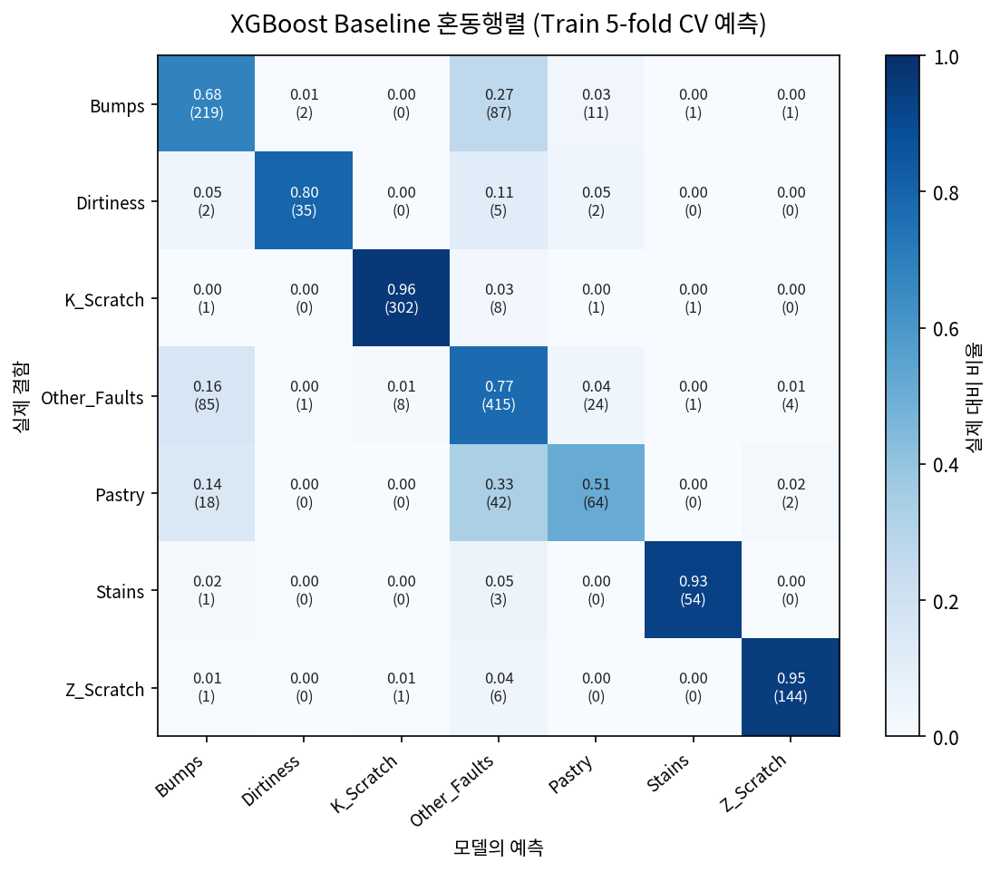
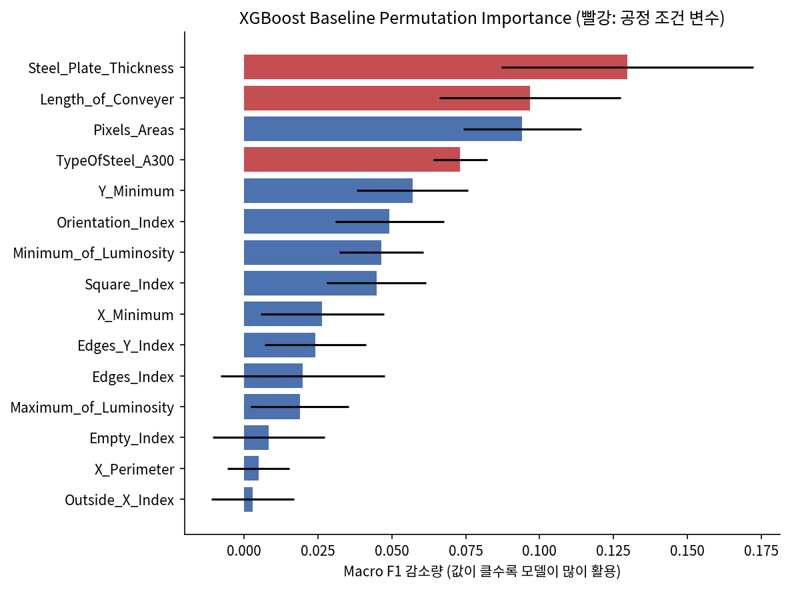
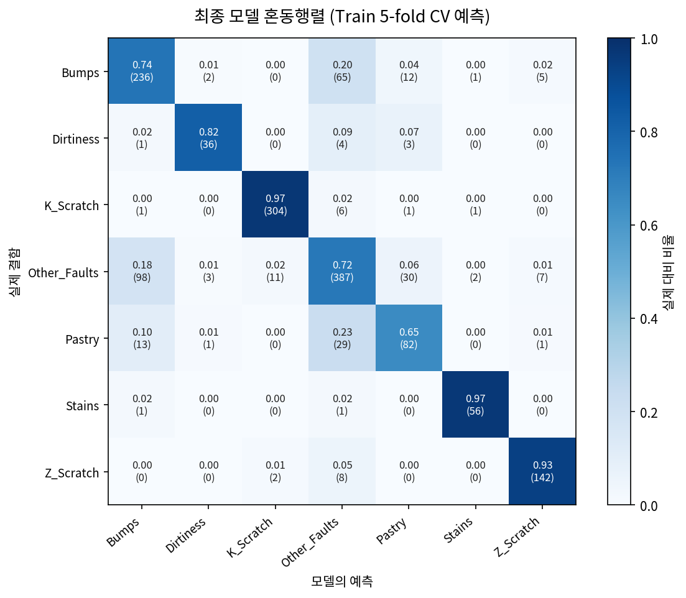

# 강판 결함 유형 다중 분류 (Steel Plate Fault Classification)

강판 표면 결함의 형상·밝기·공정 정보를 이용해 7가지 결함 유형을 분류하고, 클래스 불균형이 유형별 예측에 미치는 영향을 실험으로 확인한 프로젝트입니다.

UCI Steel Plates Faults 데이터(1,941건)는 가장 많은 유형과 가장 적은 유형의 건수 차이가 약 12배입니다. Accuracy 대신 **Macro F1**을 핵심 지표로 두고 Baseline → 불균형 처리 → 앙상블 → Ablation 순으로 실험했습니다. 최종 모델로 **GradientBoosting + XGBoost Soft Voting (BorderlineSMOTE)**을 선정했으며, 가장 약했던 Pastry의 Recall을 **0.508 → 0.651**로 개선했습니다. 동시에 두 가지 한계도 확인했습니다. 첫째, Macro F1 개선(0.814 → 0.824)은 **CV 분할을 바꿔 반복하면 재현되지 않았습니다.** 둘째, **강종·두께·컨베이어 길이 조합의 그룹 구조** 때문에 일반적인 Stratified CV가 처음 보는 공정 조건에 대한 성능을 과대평가합니다.


> 📌 **팀 공유용 초안**
> - 모든 수치는 정리된 노트북(`notebooks/01~04`)을 재실행한 결과입니다. Test 데이터는 아직 사용하지 않았습니다.
> - 최종 모델은 **공식 CV 기준 최고 성능 모델로 가정**했습니다. 반복 CV 결과를 고려한 최종 확정은 팀 논의가 필요합니다 ([8.1](#81-최종-모델-선정)).
> - `🚧` 표시는 Test 평가·대시보드·팀원별 작성이 필요한 부분입니다.

---

## 1. 프로젝트 개요

### 1.1 프로젝트 소개

**프로젝트 배경**

제조 현장에서는 결함을 발견한 뒤 어떤 유형인지 구분하는 작업이 필요합니다. 측정된 형상·밝기 등의 특성을 활용한 분류 결과는 검사 담당자가 결함 유형 후보를 검토하는 데 도움을 줄 수 있습니다. 본 과제는 이러한 분류 과정을 데이터로 실습하는 프로젝트입니다.

전체 **1,941건 중 Other_Faults가 673건(34.67%)으로 가장 많고, Dirtiness는 55건(2.83%)**으로 가장 적습니다. 최대·최소 클래스의 건수 차이는 약 12.24배입니다. 다수 유형을 잘 맞히더라도 소수 유형의 예측 성능은 낮을 수 있습니다.

따라서 Precision, Recall, F1-score, Confusion Matrix 등을 함께 확인하고, **불균형 데이터 처리 전후에 결함 유형별 예측 성능이 어떻게 변화하는지 비교**했습니다.

**문제 정의**

| 항목 | 내용 |
|---|---|
| Target | 결함 유형 `target` (Pastry, Z_Scratch, K_Scratch, Stains, Dirtiness, Bumps, Other_Faults) |
| 문제 유형 | 7-class 다중 분류 (각 결함은 정확히 하나의 유형에 속함 — 원-핫 합계가 1이 아닌 행 0건 확인) |
| Positive Class | 단일 Positive Class 없음. 모든 유형을 동등하게 중요한 분류 대상으로 간주 |
| 활용 방식 | 검사 담당자에게 결함 유형 후보를 제시하는 보조 도구 (자동 판정 대체 아님) |

**오분류의 의미 (유형 k 기준)**

- **FN (유형 k를 다른 유형으로 예측):** 해당 결함에 맞는 후속 조치·원인 분석이 늦어질 수 있음
- **FP (다른 유형을 k로 예측):** 해당 유형에 대한 불필요한 검토가 발생할 수 있음

데이터에는 유형별 오분류 비용 정보가 없어 특정 유형의 오류를 더 중요하게 볼 근거가 없었습니다. 그래서 **모든 유형의 F1을 같은 비중으로 평균하는 Macro F1**을 핵심 지표로 정했습니다. (실제 현장에서 유형별 비용이 다르다면 가중 지표나 Threshold 조정을 검토해야 하며, 이는 본 프로젝트의 가정입니다.)

**프로젝트 목표**

- 강판 결함 측정 데이터의 구조와 클래스 분포 파악
- 머신러닝을 활용한 강판 결함 유형 다중 분류 모델 개발
- 데이터 전처리·Feature Engineering·모델 조정 효과 비교
- 샘플링 방법에 따른 결함 유형별 예측 성능 변화 분석
- 성능 향상뿐 아니라 오분류 변화, 과적합 및 일반화 한계 해석

### 1.2 프로젝트 정보

| 항목 | 내용 |
|---|---|
| 프로젝트 기간 | 2026.10.13 ~ 2026.10.19 |
| 프로젝트 유형 | 팀 프로젝트 |
| 데이터 출처 | [Steel Plates Faults (UCI Machine Learning Repository)](https://archive.ics.uci.edu/dataset/198/steel+plates+faults) |
| 주요 기술 | Python, Scikit-learn, XGBoost, Imbalanced-learn, Streamlit, uv |

### 1.3 주요 성과 (Train 5-fold CV 기준)

- **약점 유형 개선:** Pastry Recall **0.508 → 0.651** (F1 0.561 → 0.646), Bumps → Other_Faults 오분류 **87 → 65건**
- **Macro F1:** 공식 CV(seed 42)에서 0.814 → **0.824**. 단, CV seed 3개로 반복하면 차이가 +0.001로 사라져 **Macro F1 개선은 확정하지 않음**
- **불균형 처리 인사이트:** 건수가 가장 적은 유형(Stains, Dirtiness)은 Baseline부터 F1 0.8 이상이었고, 실제 약점은 Pastry·Bumps와 Other_Faults의 경계였음. 희귀 유형만 늘린 SMOTE(+0.005)보다 경계 부근을 보강하는 BorderlineSMOTE(+0.021, GB 기준)가 효과적이었음
- **Ablation:** 개선 요인을 분리한 결과 XGBoost 하이퍼파라미터 변경은 기여하지 않았고(−0.004), BorderlineSMOTE와 앙상블이 각각 소폭 기여
- **일반화 점검:** 공정 조건 조합을 그룹으로 묶은 Group CV에서 성능이 Baseline 0.811 → 0.720으로 하락. 이 조건에서는 BorderlineSMOTE 적용 모델이 Baseline보다 약 +0.02 높았음

---

## 2. 프로젝트 구조

```text
steel-plate-fault-classification/
├── README.md
├── pyproject.toml
├── uv.lock
├── .python-version
├── .gitignore
│
├── data/
│   ├── raw/
│   │   └── Faults.csv                # 원본 데이터 (34열)
│   ├── processed/
│   │   └── Faults_processed.csv      # 전처리 결과 (26 Feature + target)
│   └── split/
│       ├── train_idx.csv             # 공통 Train 인덱스 (1,552건)
│       └── test_idx.csv              # 공통 Test 인덱스 (389건)
│
├── src/
│   ├── config.py                     # RANDOM_STATE, TEST_SIZE, CV, SCORING 공통 설정
│   ├── make_split.py                 # 층화 Train/Test 인덱스 생성
│   ├── load_data.py                  # 공통 분할 기준 데이터 로더
│   ├── cv_utils.py                   # CV 공용 함수 (fold 평균 + CV 예측 지표 동시 계산)
│   ├── evaluate.py                   # 실험 결과 기록 (log_result, results_table)
│   └── plotting.py                   # 혼동행렬 시각화 (노트북·대시보드 공용)
│
├── notebooks/
│   ├── 01_eda.ipynb
│   ├── 02_preprocessing.ipynb
│   ├── 03_modeling.ipynb
│   └── 04_imbalance_ensemble.ipynb
│
├── results/
│   └── model_scores.csv              # 실험 결과 누적표 (log_result가 기록)
│
├── models/
│   └── final_model.pkl               # 🚧 Test 평가 시 생성
│
├── figures/
│   ├── target_distribution.png
│   ├── eda_result.png
│   ├── cv_confusion_matrix_baseline_xgb.png
│   ├── feature_importance_baseline_xgb.png
│   ├── model_comparison.png
│   ├── cv_confusion_matrix_final.png
│   ├── feature_importance.png
│   └── confusion_matrix.png          # 🚧 Test 평가 시 생성
│
└── app.py                            # 🚧 Streamlit 대시보드
```

**주요 디렉터리 및 파일 설명**

| 파일 / 디렉터리 | 설명 |
|---|---|
| `pyproject.toml`, `uv.lock` | 프로젝트 의존성 및 버전 고정 |
| `data/raw/` | UCI 원본 데이터 |
| `data/processed/` | Target 단일화·강종 변수 정리를 마친 데이터 |
| `data/split/` | 팀 공통 Train/Test 인덱스 (모든 실험이 동일한 분할 사용) |
| `src/` | 팀 공통 설정·분할·로더·CV·평가·시각화 코드 |
| `notebooks/` | EDA, 전처리, 모델링 실험 |
| `results/` | 실험별 성능 기록 |
| `figures/` | 분석 결과 시각화 이미지 |
| `app.py` | Streamlit 대시보드 |

---

## 3. 설치 및 실행 방법

본 프로젝트는 **uv + Jupyter Notebook** 환경을 기반으로 수행되었습니다.

### 3.1 실행 환경

- Python 3.x (🚧 `.python-version` 기준 버전 기입)
- uv
- Jupyter Notebook 또는 VS Code
- Streamlit

> 라이브러리 버전에 따라 결과가 소수점 셋째 자리에서 달라질 수 있습니다. 본 README의 수치는 scikit-learn 1.8, XGBoost 3.4, imbalanced-learn 0.14, pandas 3.0 환경에서 재실행한 값입니다.

### 3.2 Repository 다운로드

```bash
git clone <repository-url>
cd steel-plate-fault-classification
```

### 3.3 uv 설치 및 환경 구성

[uv 공식 설치 안내](https://docs.astral.sh/uv/getting-started/installation/)를 참고하여 uv를 설치한 뒤 의존성을 설치합니다.

```bash
uv sync
```

### 3.4 데이터 준비

1. [UCI Steel Plates Faults](https://archive.ics.uci.edu/dataset/198/steel+plates+faults)에서 데이터를 받아 `data/raw/Faults.csv`로 저장합니다.
2. 공통 Train/Test 인덱스를 생성합니다. (Repository에 `data/split/`이 포함되어 있다면 생략)

   ```bash
   cd src
   uv run python make_split.py
   ```

3. 아래 순서로 Notebook을 실행합니다. 모든 Notebook은 `src/load_data.py`의 `load_data()` 또는 `data/split/` 인덱스로 같은 분할을 사용합니다.

### 3.5 Jupyter Notebook 실행 (VS Code)

1. VS Code에서 프로젝트 폴더를 엽니다.
2. 실행할 `.ipynb` 파일을 엽니다.
3. 우측 상단의 **Select Kernel** → 프로젝트의 `.venv` Python 환경을 선택합니다.
4. Notebook 셀을 순서대로 실행합니다.

### 3.6 분석 및 모델링 실행 순서

| 순서 | 파일 | 주요 내용 | 소요 시간(1코어 기준) |
|---|---|---|---|
| 0 | `src/make_split.py` | 층화 Train/Test 인덱스 생성 | 수 초 |
| 1 | `01_eda.ipynb` | 원본 데이터의 Train 행 기준 EDA, 전처리 결정 | 수 초 |
| 2 | `02_preprocessing.ipynb` | Target 단일화, 표기 수정, 강종 변수 정리, 분할 검증 | 수 초 |
| 3 | `03_modeling.ipynb` | Baseline 비교, 오분류 분석, 그룹 구조 점검, Feature Engineering | 약 3분 |
| 4 | `04_imbalance_ensemble.ipynb` | 불균형 처리, 앙상블, Ablation, 최종 모델 해석, Test 평가(잠금) | 약 15분 |

### 3.7 Streamlit 실행

```bash
uv run streamlit run app.py
```

실행 후 브라우저에서 `http://localhost:8501`로 접속합니다. 별도 웹 배포 없이 로컬 환경에서 실행할 수 있습니다.

---

## 4. 기술 스택

| 구분 | 사용 기술 |
|---|---|
| Language | Python |
| Environment & Package Management | uv |
| Data Processing | Pandas, NumPy |
| Statistics | SciPy (Kruskal-Wallis 검정) |
| Visualization | Matplotlib, Seaborn |
| Machine Learning | Scikit-learn, XGBoost |
| Imbalanced Learning | Imbalanced-learn |
| Dashboard | Streamlit |
| Development | Jupyter Notebook, VS Code, Git |

---

## 5. 데이터셋

### 5.1 데이터 개요

| 항목 | 내용 |
|---|---|
| 데이터 수 | 1,941건 |
| Feature 수 | 원본 27개 → 전처리 후 26개 (위치, 크기, 둘레, 밝기, 강종, 두께, 형상 지표 등) |
| Target 변수 | `target` (원-핫 정답 열 7개를 단일 라벨로 변환) |
| 문제 유형 | 다중 클래스 분류 (Multiclass Classification) |
| 클래스 비율 | `Other_Faults` (34.67%) ~ `Dirtiness` (2.83%), 최대/최소 12.24배 |

### 5.2 데이터 특징

**Feature 구성**

- 모든 입력 변수는 수치형이며, 결함 위치(`X_Minimum`, `Y_Minimum` 등), 크기(`Pixels_Areas`, 둘레), 밝기(`Sum_of_Luminosity` 등), 형상 지표(`Edges_Index`, `Square_Index`, `Orientation_Index` 등), 공정 정보(`Steel_Plate_Thickness`, `Length_of_Conveyer`, `TypeOfSteel_A300`)로 구성됩니다.
- 결측치와 중복 행은 0건입니다.

**Target 클래스 분포**

| 결함 유형 | 전체 | 비율 | Train | Test |
|---|---:|---:|---:|---:|
| Other_Faults | 673 | 34.67% | 538 | 135 |
| Bumps | 402 | 20.71% | 321 | 81 |
| K_Scratch | 391 | 20.14% | 313 | 78 |
| Z_Scratch | 190 | 9.79% | 152 | 38 |
| Pastry | 158 | 8.14% | 126 | 32 |
| Stains | 72 | 3.71% | 58 | 14 |
| Dirtiness | 55 | 2.83% | 44 | 11 |


**불균형 데이터에서 고려한 사항**

- **지표:** Accuracy는 다수 유형(상위 3개 유형이 약 75.5%)의 성능에 좌우되므로 Macro F1을 핵심 지표로 사용하고, 유형별 Precision·Recall·F1과 Confusion Matrix를 함께 확인했습니다.
- **층화 분할:** Train/Test 분할과 CV 모두 클래스 비율을 유지하는 층화 방식을 사용했습니다.
- **Sampling은 Training Fold 내부에서만:** SMOTE 계열은 `imblearn` Pipeline으로 모델과 묶어 각 Training Fold 안에서만 수행했습니다.
- **Test 소수 유형의 불안정성:** Test의 Stains는 14건, Dirtiness는 11건이므로 1건 차이로 Recall이 각각 0.071, 0.091씩 움직입니다.

---

## 6. 데이터 분석 및 전처리

### 6.1 탐색적 데이터 분석 (EDA)

EDA는 **원본 데이터의 Train 행(1,552건)만** 사용했습니다. 전처리 결정의 근거를 찾는 단계이므로 원본을 보되, Test 정보가 판단에 섞이지 않도록 하기 위함입니다.

**주요 발견 사항**

1. **크기·밝기 관련 Feature의 강한 오른쪽 꼬리**
   `Outside_X_Index`(왜도 5.26), `Sum_of_Luminosity`(3.25), `Pixels_Areas`(3.11), `X_Perimeter`(2.85) 등에서 높은 양의 왜도가 확인되었습니다. 측정 오류라고 볼 근거는 없었고 결함 크기의 자연스러운 차이일 가능성이 있어 극단값을 제거하지 않았습니다.

2. **Feature 간 높은 중복성**
   `TypeOfSteel_A300`↔`A400`(r = −1.000), `Y_Minimum`↔`Y_Maximum`(1.000), `Pixels_Areas`↔`Sum_of_Luminosity`(0.997) 등 위치·크기 계열 Feature 사이에 매우 높은 상관이 있었습니다. `Pixels_Areas`↔`LogOfAreas`는 Pearson 0.80이지만 Spearman 1.00으로, 로그 변환일 뿐 같은 순서 정보를 담고 있습니다.

3. **단일 Feature로는 일부 유형만 구분됨**
   Kruskal-Wallis 검정에서 27개 Feature 모두 유형 간 분포 차이를 보였지만(p < 0.001), Feature마다 구분되는 유형이 달랐습니다.
   - 면적(`LogOfAreas`): K_Scratch는 크고 Stains는 작음, 나머지 유형은 상당 부분 겹침
   - 방향(`Orientation_Index`): Pastry·Dirtiness는 양수, K_Scratch·Stains는 음수 쪽에 집중
   - 위치(`X_Minimum`): K_Scratch는 매우 낮은 X 위치에 집중

   → 여러 Feature를 함께 활용하는 비선형 모델이 필요하다고 판단했습니다.

4. **강종과 결함 유형의 뚜렷한 연관**
   Train에서 K_Scratch와 Stains는 100% A400, Z_Scratch는 90.1%가 A300이었습니다.

5. **Other_Faults의 넓은 분포**
   Other_Faults는 Feature별 유형 내 IQR(전체 IQR 대비)의 중앙값이 0.98로 7개 유형 중 가장 컸으며, 특히 `Length_of_Conveyer`, `Steel_Plate_Thickness`에서 넓게 퍼져 있었습니다. 이 결과만으로 내부에 별도 하위 유형이 있다고 판단할 수는 없어 가설로 남겨두었습니다.


### 6.2 데이터 전처리

| 처리 항목 | 확인 결과 | 적용 방법 | 선택 이유 |
|---|---|---|---|
| Target 형식 | 원-핫 7개 열, 모든 행의 합이 1 | `idxmax`로 단일 라벨 생성 후 원-핫 열 제거 | 정답 열이 입력 Feature에 남으면 데이터 누수 |
| 컬럼명 오타 | `K_Scatch` | `K_Scratch`로 수정 | 결과 표·대시보드 표기 일관성 |
| 결측치 | 0건 | 처리 없음 | 확인 결과 문제 없음 |
| 중복 데이터 | 0건 | 처리 없음 | 확인 결과 문제 없음 |
| 이상치 | 왜도 높은 Feature 존재 | 제거하지 않고 유지 | 측정 오류 근거 없음, 결함 크기 자체의 특성일 가능성 |
| 강종 변수 | A300·A400 완전 상호배타 (A400 1,164 / A300 777) | `TypeOfSteel_A400` 제거 (1 = A300, 0 = A400) | 같은 정보를 중복 표현 |
| 범주형 인코딩 | 입력 Feature 모두 수치형 | 불필요. Target은 XGBoost용 `LabelEncoder` 적용 | XGBoost는 정수 라벨 필요 |
| 스케일링 | Feature 간 범위 차이 큼 | Logistic Regression만 `StandardScaler`를 Pipeline 안에서 적용 | 최종 모델(트리 기반)에는 불필요 |
| 상관 높은 Feature | 위치·크기 계열 다수 | 유지 | 트리 모델은 중복 Feature에 비교적 강건, 제거 근거 부족 |
| Feature Engineering | 3개 세트 실험 | 최종 모델에는 미적용 | [7.6](#76-feature-engineering) 참고 |

**데이터 분할 및 누수 방지**

| 항목 | 설정 |
|---|---|
| Train/Test | 80:20 Stratified Split, `random_state=42` (Train 1,552 / Test 389) |
| 분할 검증 | Train·Test 중복 0건, 누락 0건, 원본 대비 유형별 비율 차이 최대 0.0011 |
| Cross Validation | `StratifiedKFold(n_splits=5, shuffle=True, random_state=42)` (`config.CV`) |
| 지표 계산 | `cv_utils.cv_run`으로 한 번의 CV에서 **fold 평균 ± 표준편차**와 **CV 예측 기준**(모든 fold 예측을 모아 계산)을 함께 산출 |
| Test 사용 원칙 | 모델·불균형 처리·하이퍼파라미터 선택은 모두 Train CV로 하고, Test는 최종 모델 확정 후 1회만 평가 |
| Fold 내부 처리 | Scaling·Sampling은 Pipeline으로 묶어 각 Training Fold에서만 학습/적용 |

---

## 7. 머신러닝 모델링

### 7.1 Baseline 모델

불균형 처리를 하지 않은 상태에서 서로 다른 성격의 5개 모델을 같은 조건(Train 5-fold Stratified CV, 기본 하이퍼파라미터)으로 비교했습니다.

| 모델 | 선택 이유 |
|---|---|
| Logistic Regression | 선형 모델 기준점, 해석 용이 (StandardScaler 적용) |
| Decision Tree | 단일 트리 기준점 |
| Random Forest | Bagging 계열 |
| Gradient Boosting | Boosting 계열 (sklearn) |
| XGBoost | Boosting 계열, 정규화 포함 |

**Baseline 결과**

| 모델 | Accuracy | Macro Precision | Macro Recall | Macro F1 (fold 평균) | Macro F1 (CV 예측) |
|---|---:|---:|---:|---:|---:|
| **XGBoost** | 0.794 | 0.835 | 0.800 | **0.811 ± 0.031** | **0.814** |
| GradientBoosting | 0.779 | 0.817 | 0.781 | 0.795 ± 0.017 | 0.797 |
| RandomForest | 0.764 | 0.813 | 0.758 | 0.779 ± 0.025 | 0.781 |
| LogReg | 0.715 | 0.733 | 0.719 | 0.721 ± 0.024 | 0.724 |
| DecisionTree | 0.711 | 0.714 | 0.732 | 0.720 ± 0.029 | 0.721 |

Boosting 계열이 상위권이었고, 선형 모델과 단일 트리는 크게 낮았습니다. 여러 Feature를 비선형으로 조합해야 유형이 구분된다는 EDA 결과와 일치합니다. XGBoost와 GradientBoosting을 이후 실험의 주요 후보로 선정했습니다.

**XGBoost Baseline의 유형별 성능**

| 유형 | Precision | Recall | F1 | Support |
|---|---:|---:|---:|---:|
| K_Scratch | 0.971 | 0.965 | 0.968 | 313 |
| Z_Scratch | 0.954 | 0.947 | 0.950 | 152 |
| Stains | 0.947 | 0.931 | 0.939 | 58 |
| Dirtiness | 0.921 | 0.795 | 0.854 | 44 |
| Other_Faults | 0.733 | 0.771 | 0.752 | 538 |
| Bumps | 0.670 | 0.682 | 0.676 | 321 |
| **Pastry** | 0.627 | **0.508** | **0.561** | 126 |



**Baseline에서 발견한 문제**

- **소수 유형이 곧 어려운 유형은 아니었습니다.** 가장 적은 Stains(58건)·Dirtiness(44건)는 F1 0.85 이상이었고, 가장 낮은 F1은 중간 규모의 **Pastry(0.561)**와 다수 유형인 **Bumps(0.676)**였습니다.
- **오분류가 Other_Faults와의 경계에 집중되었습니다.** 전체 오분류 319건 중 Bumps → Other_Faults 87건, Other_Faults → Bumps 85건, Pastry → Other_Faults 42건, Other_Faults → Pastry 24건으로 상위 4개 쌍이 **74.6%**를 차지했습니다.
- Pastry는 Recall이 0.508로, 실제 Pastry의 절반가량을 놓쳤습니다.

**개선 목표:** 건수가 적은 유형을 늘리기보다 ① Pastry Recall 개선, ② Bumps ↔ Other_Faults 혼동 감소에 집중하기로 했습니다.

### 7.2 실험 흐름

1. Baseline 5개 모델 비교 → XGBoost, GradientBoosting 선정 (7.1)
2. Feature Importance에서 공정 조건 변수 의존을 발견 → 그룹 구조와 Group CV 점검 (7.5)
3. 혼동 쌍을 겨냥한 Feature Engineering (7.6)
4. GradientBoosting으로 불균형 처리 방법 비교 (7.3)
5. BorderlineSMOTE를 GB·XGBoost에 적용해 Soft Voting으로 결합 (7.4)
6. Ablation과 반복 CV로 개선 요인과 재현성 확인 (7.7)

### 7.3 불균형 데이터 처리

**적용한 방법과 선택 이유**

| 방법 | 실험 이유 |
|---|---|
| 희귀 2종(Stains, Dirtiness)만 SMOTE | 건수가 가장 적은 유형을 보강하면 Macro F1이 오르는지 확인 |
| 전체 유형 SMOTE | 모든 유형을 최다 유형 수준으로 맞추는 방식과 비교 |
| Pastry만 SMOTE | 가장 약한 유형 하나만 보강 |
| 저성능 유형(Pastry, Bumps, Dirtiness) 선택적 SMOTE | Baseline에서 F1이 낮았던 유형을 함께 보강 |
| BorderlineSMOTE | 오분류가 유형 간 경계에 집중되어, 경계 부근 샘플을 중심으로 합성하는 방식이 적합한지 확인 |

하이퍼파라미터가 고정된 하나의 모델에서 처리 방법만 바꿔야 효과를 비교할 수 있으므로 GradientBoosting(기본값)으로 비교했습니다. SMOTE는 Train fold 하나의 Dirtiness가 약 35건뿐이어서 `k_neighbors=3`으로 설정했습니다.

**실험 결과 (GradientBoosting, Train 5-fold CV)**

| 실험 | Macro F1 (CV 예측) | fold std | Pastry | Bumps | Other | Z_Scratch | Stains | Dirtiness |
|---|---:|---:|---:|---:|---:|---:|---:|---:|
| 처리 없음 | 0.797 | 0.017 | 0.563 | 0.658 | 0.733 | 0.936 | 0.920 | 0.810 |
| 희귀 2종 → 각 80건 | 0.802 | 0.014 | 0.563 | 0.654 | 0.730 | 0.940 | 0.914 | 0.857 |
| 희귀 2종 → 각 120건 | 0.802 | 0.019 | 0.568 | 0.650 | 0.720 | 0.943 | 0.897 | 0.878 |
| 희귀 2종 → 각 180건 | 0.802 | 0.021 | 0.565 | 0.660 | 0.727 | 0.946 | 0.931 | 0.824 |
| 전체 SMOTE | 0.809 | 0.012 | 0.635 | 0.682 | 0.724 | 0.907 | 0.940 | 0.826 |
| Pastry → 200건 | 0.808 | 0.012 | 0.639 | 0.660 | 0.729 | 0.939 | 0.929 | 0.805 |
| Pastry → 250건 | 0.804 | 0.007 | 0.657 | 0.654 | 0.719 | 0.935 | 0.930 | 0.773 |
| 저성능 3종 | 0.814 | 0.022 | 0.584 | 0.679 | 0.743 | 0.947 | 0.920 | 0.860 |
| **BorderlineSMOTE** | **0.818** | **0.009** | **0.659** | **0.690** | 0.725 | 0.915 | 0.940 | 0.829 |

**해석**

- **개선된 부분:** BorderlineSMOTE에서 Pastry F1 +0.096, Bumps +0.032로 Baseline의 핵심 약점이 가장 크게 개선되었고, fold 간 표준편차도 가장 작았습니다.
- **악화된 부분:** 효과가 컸던 방법일수록 Z_Scratch(−0.021 ~ −0.029)와 Other_Faults가 소폭 하락했습니다. 합성 샘플이 기존에 잘 분리되던 경계를 일부 흐렸을 가능성이 있습니다(가설).
- **희귀 2종 보강의 한계:** Dirtiness F1은 최대 +0.069 올랐지만 Macro F1 개선은 +0.005 수준이었습니다. **"적은 유형"보다 "약한 유형·경계"를 보강하는 것이 중요**하다는 점을 확인했습니다.
- **주의:** 방법 간 차이(0.005 ~ 0.02)는 fold 간 변동(0.007 ~ 0.022)과 비슷한 크기입니다.

**결정:** 이후 실험에는 BorderlineSMOTE를 사용합니다.

### 7.4 모델 성능 비교

GradientBoosting과 XGBoost에 각각 BorderlineSMOTE를 적용한 뒤 Soft Voting(예측 확률 평균)으로 결합했습니다.

**비교표 (Train 5-fold Stratified CV, seed 42)**

| 모델 / 실험 | 불균형 처리 | Accuracy | Macro F1 (CV 예측) | Macro F1 (fold 평균) |
|---|---|---:|---:|---:|
| GradientBoosting (Baseline) | 없음 | 0.779 | 0.797 | 0.795 ± 0.017 |
| XGBoost (Baseline) | 없음 | 0.794 | 0.814 | 0.811 ± 0.031 |
| GradientBoosting | 전체 SMOTE | 0.782 | 0.809 | 0.808 ± 0.012 |
| GradientBoosting | BorderlineSMOTE | 0.790 | 0.818 | 0.818 ± 0.009 |
| XGBoost (튜닝값) | BorderlineSMOTE | 0.799 | 0.816 | 0.815 ± 0.015 |
| GB + XGBoost Soft Voting | 없음 | 0.798 | 0.818 | 0.815 ± 0.026 |
| **GB + XGBoost Soft Voting (최종)** | **BorderlineSMOTE** | **0.801** | **0.824** | **0.824 ± 0.010** |


*왼쪽 그래프의 세로축은 0.75부터 시작하므로 막대 차이가 실제보다 크게 보입니다. 7.7의 반복 CV 결과와 함께 해석해야 합니다.*

**유형별 변화 (XGBoost Baseline → 최종 모델)**

| 유형 | Baseline F1 | 최종 F1 | 변화 | Baseline Recall | 최종 Recall |
|---|---:|---:|---:|---:|---:|
| Pastry | 0.561 | 0.646 | **+0.084** | 0.508 | **0.651** |
| Bumps | 0.676 | 0.703 | +0.028 | 0.682 | 0.735 |
| Stains | 0.939 | 0.949 | +0.010 | 0.931 | 0.966 |
| K_Scratch | 0.968 | 0.965 | −0.003 | 0.965 | 0.971 |
| Other_Faults | 0.752 | 0.746 | −0.006 | 0.771 | **0.719** |
| Dirtiness | 0.854 | 0.837 | −0.016 | 0.795 | 0.818 |
| Z_Scratch | 0.950 | 0.925 | **−0.025** | 0.947 | 0.934 |

**주요 오분류 변화**

| 실제 → 예측 | Baseline | 최종 | 변화 |
|---|---:|---:|---:|
| Bumps → Other_Faults | 87 | 65 | −22 |
| Pastry → Other_Faults | 42 | 29 | −13 |
| Other_Faults → Bumps | 85 | 98 | +13 |
| Other_Faults → Pastry | 24 | 30 | +6 |

**해석**

- **개선:** 개선 목표였던 Pastry(Recall +0.143)와 Bumps(Recall +0.053)가 가장 크게 좋아졌습니다. Bumps·Pastry를 Other_Faults로 놓치는 경우가 35건 줄었습니다.
- **악화:** 반대 방향으로 Other_Faults를 Bumps·Pastry로 잘못 보는 경우는 19건 늘었습니다. 모델이 Bumps·Pastry를 더 적극적으로 예측하게 되면서 Other_Faults의 Recall이 0.771 → 0.719로 내려갔습니다. Z_Scratch·Dirtiness F1도 소폭 하락했습니다.
- **Trade-off 판단:** 하락한 유형은 대부분 Baseline에서 이미 F1 0.85 이상이었고 하락폭도 0.03 이내입니다. 반면 Pastry는 0.56 → 0.65로 크게 개선되어, 모든 유형을 동등하게 보는 Macro F1 관점에서 받아들일 수 있는 Trade-off로 판단했습니다. 다만 Other_Faults ↔ Bumps 경계 자체는 줄지 않고 **방향만 바뀐 것**에 가깝습니다.

### 7.5 일반화 성능 점검: 공정 조건 그룹 구조

Baseline XGBoost의 Permutation Importance 상위권에 `Steel_Plate_Thickness`(1위), `Length_of_Conveyer`(2위), `TypeOfSteel_A300`(4위)이 있었습니다. 이 변수들은 결함 형상이 아니라 **어떤 강판·생산 조건에서 나왔는지**를 나타내므로, 모델이 공정 조건을 지름길로 쓰고 있을 가능성을 검증했습니다.



**데이터에서 확인한 사실**

- Train에서 (강종, 두께, 컨베이어 길이) 조합은 218개이며, 조합당 중앙값 3건, 최대 108건입니다.
- 조합 안에서 가장 많은 유형이 차지하는 비율(가중 평균)은 **0.763**입니다. 라벨을 무작위로 섞어 50회 계산하면 평균 0.431, 최대 0.446으로, 우연으로 보기 어렵습니다.
- Test에 등장하는 조합의 **84.4%가 Train에도 있습니다.** (Test 라벨은 보지 않고 Feature 조합만 확인)
- 같은 조합이 Train/Validation에 함께 들어가지 않도록 `StratifiedGroupKFold`를 쓰면 XGBoost Macro F1(fold 평균)이 **0.811 → 0.720**으로 떨어졌습니다. Dirtiness(−0.116), Z_Scratch(−0.107), Other_Faults(−0.082)의 하락이 컸습니다.

**최종 후보의 Group CV 성능 (fold 평균)**

| 모델 | Stratified (CV 예측) | Group (fold 평균) | Group fold std |
|---|---:|---:|---:|
| XGBoost Baseline | 0.814 | 0.720 | 0.044 |
| XGBoost 튜닝값 + BorderlineSMOTE | 0.816 | 0.739 | 0.018 |
| **앙상블 + BorderlineSMOTE (최종)** | 0.824 | **0.742** | 0.028 |

**해석과 가설**

- 데이터에 강판 ID가 없어 확정할 수는 없지만, 같은 조합의 결함은 같은 강판·생산 조건에서 나왔을 가능성이 있습니다.
- Stratified CV는 "이미 본 공정 조건의 다른 결함", Group CV는 "처음 보는 공정 조건의 결함"에 대한 성능에 가깝습니다.
- 처음 보는 공정 조건에서는 BorderlineSMOTE를 적용한 모델이 Baseline보다 약 +0.02 높았습니다. 공정 조건 지름길을 쓸 수 없을 때 경계 부근 보강이 더 도움이 되었을 가능성이 있습니다(가설, Group CV는 seed 하나의 결과).
- 그래도 모든 모델이 Stratified 대비 0.07 ~ 0.09 하락하므로 (fold 평균 기준), **새 공정 조건에 대한 과대평가 문제는 모델 선택으로 해결되지 않습니다.**
- Group CV는 그룹 크기가 제각각이라 fold 구성이 고르지 않습니다. 이 때문에 CV 예측 기준 값(Baseline 0.754)과 fold 평균(0.720)의 차이가 크며, 하락폭을 보수적으로 보기 위해 fold 평균을 기준으로 보고했습니다.

### 7.6 Feature Engineering

Bumps·Pastry와 Other_Faults의 혼동을 줄이는 것이 목적이었습니다. 두 유형 쌍을 구분하는 Feature별 AUC를 먼저 확인한 결과, Bumps vs Other_Faults는 가장 좋은 Feature도 AUC 0.67 수준으로 단일 Feature로는 거의 구분되지 않았습니다.

| 세트 | 추가 Feature | 의도 |
|---|---|---|
| FE3 | `Luminosity_Range`, `Dark_Depth`, `Compactness` | 밝기 대비, 평균 대비 어두운 정도, 둘레 대비 면적 |
| FE8 | FE3 + `Perimeter_Ratio`, `Log_X/Y_Perimeter`, `Rel_X_Center`, `Lum_Contrast` | 형상 비율, 둘레의 왜도 완화, 컨베이어 대비 상대 위치 |
| Position | `x_rel`, `edge_dist_px`, `left_side`, `edge_band10` | 강판 가장자리와의 거리 |

모든 파생 변수는 한 행 안의 값만으로 계산하므로 데이터 누수가 없습니다.

**결과 (XGBoost, Macro F1 fold 평균)**

| CV | Baseline | +FE3 | +FE8 |
|---|---:|---:|---:|
| Stratified | 0.811 ± 0.031 | 0.814 ± 0.020 | 0.817 ± 0.013 |
| Group | 0.720 ± 0.044 | 0.732 ± 0.032 | 0.741 ± 0.031 |

| 비교 (CV seed 3개 × 5 fold) | Stratified | Group |
|---|---:|---:|
| XGBoost +FE8 | +0.004 (10/15 우세) | +0.017 (11/15 우세) |
| XGBoost +Position | −0.000 (7/15) | +0.000 (8/15) |
| LogReg +Position | +0.008 (11/15) | +0.015 (10/15) |

- FE3·FE8은 Pastry → Other_Faults 오분류를 줄였지만(Stratified 42 → 37/36건, Group 45 → 41/32건), Bumps ↔ Other_Faults 혼동은 줄이지 못했고 Group CV의 FE8에서는 오히려 196 → 212건으로 늘었습니다.
- 신규 Feature는 기존 Feature와 상관이 0.8 이상이어서 완전히 새로운 정보는 아니었습니다.

**결정:** 공식 기준(Stratified CV)에서 개선폭(+0.004)이 fold 간 변동보다 작으므로 **최종 모델에는 원본 26개 Feature만 사용**했습니다. Group CV에서의 개선(+0.017)은 향후 과제로 남겼습니다.

### 7.7 Ablation: 개선은 어디서 왔는가?

최종 모델은 XGBoost Baseline과 비교해 ① XGBoost 하이퍼파라미터(기본값 → `n_estimators=500, learning_rate=0.1`), ② BorderlineSMOTE, ③ GB와의 Soft Voting **세 가지가 동시에** 다릅니다. 요소를 하나씩 바꿔 기여도를 분리했습니다.

**단일 CV (seed 42, CV 예측 기준 Macro F1)**

| 실험 | XGB 파라미터 | BSMOTE | GB 결합 | Macro F1 |
|---|---|:---:|:---:|---:|
| A. XGB 기본값 (Baseline) | 기본값 | | | 0.814 |
| B. XGB 튜닝값 | 500 / 0.1 | | | 0.810 |
| C. XGB 튜닝값 + BSMOTE | 500 / 0.1 | ✓ | | 0.816 |
| D. GB (Baseline) | – | | GB 단독 | 0.797 |
| E. GB + BSMOTE | – | ✓ | GB 단독 | 0.818 |
| F. 앙상블 | 500 / 0.1 | | ✓ | 0.818 |
| **G. 앙상블 + BSMOTE (최종)** | 500 / 0.1 | ✓ | ✓ | **0.824** |

| 요소 | 비교 | 변화 |
|---|---|---:|
| XGB 하이퍼파라미터 변경 | B − A | **−0.004** |
| BorderlineSMOTE (XGB / GB / 앙상블) | C−B / E−D / G−F | +0.006 / +0.021 / +0.007 |
| GB 결합 (Sampling 없음 / 적용 후) | F−B / G−C | +0.008 / +0.009 |
| 전체 | G − A | +0.010 |

**반복 CV (seed 0·1·2 × 5 fold = 15회, fold별 짝 비교)**

| 모델 | 15 fold 평균 | 표준편차 |
|---|---:|---:|
| A. XGB 기본값 | 0.815 | 0.020 |
| B. XGB 튜닝값 | 0.810 | 0.025 |
| C. XGB 튜닝값 + BSMOTE | 0.816 | 0.021 |
| G. 앙상블 + BSMOTE | 0.816 | 0.023 |

| 비교 | 평균 차이 | 우세 fold |
|---|---:|---:|
| 하이퍼파라미터 (B − A) | −0.005 | 6/15 |
| BSMOTE on XGB (C − B) | +0.006 | 7/15 |
| GB 결합 (G − C) | **−0.000** | 6/15 |
| 전체 (G − A) | **+0.001** | 8/15 |

**해석**

- **하이퍼파라미터 변경은 개선 요인이 아니었습니다.** 단일·반복 CV 모두에서 소폭 하락했습니다.
- seed 42에서 보인 **+0.010 개선은 다른 CV 분할에서 재현되지 않았습니다.** 15회 평균으로 A·C·G는 0.815 ~ 0.816으로 사실상 같고, fold 간 표준편차(0.020 ~ 0.025)가 모델 간 차이보다 10배 이상 큽니다.
- 따라서 **Stratified CV의 Macro F1 기준으로는 최종 모델이 Baseline보다 낫다고 말할 근거가 약합니다.** 가장 일관된 효과는 BorderlineSMOTE에 의한 **유형별 균형 변화**(Pastry·Bumps 개선, 다른 유형 소폭 하락)이며, Macro F1 합계에서는 상쇄됩니다.
- 이 실험이 없었다면 seed 하나의 결과로 "앙상블이 1%p 개선했다"고 결론 내렸을 것입니다. **단일 CV 점수 차이를 개선으로 해석하기 전에 재현성을 확인해야 한다**는 점이 이 프로젝트의 중요한 교훈입니다.

---

## 8. 최종 모델 및 결과 분석

### 8.1 최종 모델 선정

- **최종 모델 (팀 공유용 가정):** GradientBoosting + XGBoost Soft Voting (`VotingClassifier`, `voting="soft"`, 동일 가중치)
- **적용한 불균형 처리 방법:** BorderlineSMOTE (각 모델의 `imblearn` Pipeline 안에서 Training Fold에만 적용)
- **주요 하이퍼파라미터:**

| 구성 요소 | 설정 |
|---|---|
| BorderlineSMOTE | `k_neighbors=3`, `m_neighbors=5`, `sampling_strategy="auto"`(최다 유형 건수까지 보강), `random_state=42` |
| GradientBoosting | 기본값, `random_state=42` |
| XGBoost | `n_estimators=500`, `learning_rate=0.1`, `max_depth=6`, `eval_metric="mlogloss"`, `random_state=42` |
| 입력 Feature | 전처리된 원본 26개 (FE 미적용) |

**선정 근거**

1. **공식 기준 최고 성능:** 팀 공통 CV(Stratified 5-fold, seed 42)에서 Macro F1 0.824로 가장 높고, fold 간 표준편차(0.010)도 작았습니다.
2. **개선 목표 달성:** Pastry Recall 0.508 → 0.651, Bumps → Other_Faults 오분류 87 → 65건.
3. **새 공정 조건에서도 상대적으로 우수:** Group CV에서 0.742로 후보 중 가장 높았습니다.
4. **불균형 처리 방식의 근거:** 오분류가 유형 간 경계에 집중되어 있었으므로, 경계 부근을 중심으로 합성하는 BorderlineSMOTE가 문제의 구조와 맞습니다.

> ⚠️ **팀 논의 필요: 선정 근거의 한계**
> - 반복 CV(15회)에서 Baseline XGBoost와의 Macro F1 차이는 +0.001, XGBoost 튜닝값 + BSMOTE(C)와는 −0.000이었습니다.
> - Group CV에서도 C(0.739)와 최종 모델(0.742)의 차이는 fold 간 변동보다 작습니다.
> - 성능이 같다면 **더 단순한 C(XGBoost 단독 + BorderlineSMOTE)**가 학습 시간(약 1/3)·해석·대시보드 설명 면에서 유리합니다. 또한 XGBoost 하이퍼파라미터 변경은 근거 없이 도입된 부분이므로 기본값으로 되돌리는 것도 검토할 수 있습니다.
>
> → 최종 모델을 유지할지, C로 바꿀지는 **Test 평가 전에** 팀에서 결정해야 합니다.

### 8.2 최종 모델 평가

**Train CV 기준 결과**



> 🚧 **Test 평가 필요** — `04_imbalance_ensemble.ipynb`의 마지막 셀은 `RUN_TEST = False`로 잠겨 있습니다. 최종 모델을 팀에서 확정한 뒤 `True`로 바꿔 **한 번만** 실행합니다. 실행하면 Train 전체로 재학습 → Test 평가 → `models/final_model.pkl`, `figures/confusion_matrix.png` 저장 → `results/model_scores.csv` 기록이 이루어집니다.

| 구분 | Accuracy | Macro Precision | Macro Recall | Macro F1 |
|---|---:|---:|---:|---:|
| Train 5-fold CV (seed 42) | 0.801 | 0.822 | 0.828 | 0.824 |
| Train 반복 CV (15 fold 평균) | – | – | – | 0.816 ± 0.023 |
| Train Group CV (fold 평균) | – | – | – | 0.742 ± 0.028 |
| **Test** | 🚧 | 🚧 | 🚧 | 🚧 |

**Confusion Matrix (Test)**


**평가 결과 해석 시 확인할 것**

- 🚧 Test Macro F1이 반복 CV 범위(약 0.79 ~ 0.84) 안에 있는지
- 🚧 Pastry Recall 개선과 Other_Faults ↔ Bumps 오분류 방향 변화가 Test에서도 나타나는지
- Stains(14건)·Dirtiness(11건)는 1건당 Recall 변동이 각각 0.071, 0.091이므로 수치만으로 단정하지 않습니다.
- Test 조합의 84.4%가 Train에도 있어, Test 점수는 새로운 공정 조건에 대한 성능(Group CV 약 0.74)보다 높게 나올 가능성이 있습니다.

**실제 문제에서 중요하게 고려할 오류**

가장 빈번한 오류는 Bumps·Pastry와 Other_Faults 사이의 혼동이며, 최종 모델에서도 이 경계의 오류는 방향만 바뀌었을 뿐 남아 있습니다. Other_Faults는 "기타" 유형이므로, 모델이 Other_Faults 또는 Bumps로 예측한 결함은 검사 담당자가 두 유형의 가능성을 함께 검토하도록 안내하는 방식이 적합합니다.

### 8.3 Feature Importance 및 모델 해석

**최종 모델 Permutation Importance (각 Validation Fold에서 Macro F1 감소량)**

| 순위 | Feature | 평균 | 표준편차 | Baseline XGBoost 대비 |
|---:|---|---:|---:|---|
| 1 | Steel_Plate_Thickness | 0.149 | 0.025 | 1위 유지 |
| 2 | Length_of_Conveyer | 0.109 | 0.012 | 2위 유지 |
| 3 | Y_Minimum | 0.047 | 0.018 | 5위 → 3위 |
| 4 | Minimum_of_Luminosity | 0.046 | 0.014 | 7위 → 4위 |
| 5 | Orientation_Index | 0.046 | 0.016 | 6위 → 5위 |
| 6 | Edges_Index | 0.030 | 0.033 | |
| 7 | LogOfAreas | 0.030 | 0.045 | Baseline에서는 0 |
| 8 | TypeOfSteel_A300 | 0.019 | 0.009 | 4위(0.073) → 8위 |


**주요 분석 결과**

- 최종 모델도 **공정 조건 변수(두께, 컨베이어 길이)를 예측에 가장 크게 활용**했습니다. 공정 조건 지름길 문제는 불균형 처리나 앙상블로 사라지지 않았으며, 7.5의 Group CV 하락과 일관된 결과입니다.
- Baseline과 비교하면 강종(`TypeOfSteel_A300`)의 중요도가 크게 줄고, 방향·밝기 등 형상 Feature가 상대적으로 올라왔습니다.
- `LogOfAreas`는 표준편차가 평균보다 커서 fold마다 중요도가 크게 달라집니다. 거의 같은 정보를 가진 `Pixels_Areas`와 중요도를 나눠 갖기 때문일 수 있으며, 상관이 높은 Feature에서는 Permutation Importance 해석에 주의가 필요합니다.
- 중요도는 "모델이 해당 변수를 예측에 활용한 정도"이며, 그 변수가 결함의 원인이라는 의미가 아닙니다.

---

## 9. Streamlit 대시보드

분석 과정의 핵심 결과와 최종 모델 선정 근거를 확인할 수 있는 결과 공유용 대시보드입니다.

### 9.1 주요 기능

- Target 클래스 분포 (`figures/target_distribution.png`)
- 불균형 처리 전후 모델별 Macro F1 및 유형별 F1 비교 (`results/model_scores.csv`, `figures/model_comparison.png`)
- 최종 모델의 Confusion Matrix (`src/plotting.py` 공용 함수)
- Ablation·반복 CV 결과와 그 의미
- Stratified CV vs Group CV 성능 차이와 활용 시 주의사항

### 9.2 실행 화면

> 🚧 대시보드 구현 후 캡처 첨부


---

## 10. 결론 및 회고

### 10.1 프로젝트 주요 결과

- 클래스 불균형(최대/최소 12.24배)은 존재했지만, **가장 적은 유형이 가장 어려운 유형은 아니었습니다.** 실제 문제는 Pastry·Bumps와 Other_Faults의 경계였습니다.
- 이에 따라 "건수가 적은 유형"보다 "경계 부근"을 보강하는 BorderlineSMOTE가 효과적이었고, 최종 모델은 Pastry Recall을 0.508 → 0.651로 개선했습니다.
- 공식 CV에서는 Macro F1이 0.814 → 0.824로 올랐지만, **반복 CV에서는 재현되지 않았습니다.** 최종 모델의 실질적인 효과는 Macro F1 상승보다 **유형 간 성능 균형의 변화**에 가깝습니다.
- 공정 조건 조합의 그룹 구조로 인해 **Stratified CV가 새 공정 조건에 대한 성능을 약 0.07 ~ 0.09 과대평가**할 수 있음을 확인했습니다.
- 🚧 최종 Test 성능

### 10.2 한계점 및 개선 방향

**데이터 측면**

- **강판 ID 부재:** 그룹 구조를 공정 변수 조합으로 추정했을 뿐, 실제 같은 강판인지는 확인할 수 없습니다.
- **Other_Faults의 정의:** "기타" 유형이라 내부가 이질적일 가능성이 있고, Bumps·Pastry 혼동의 주된 상대입니다.
- **작은 Test 소수 유형:** Stains 14건, Dirtiness 11건으로 Test 지표의 변동 폭이 큽니다.
- **오분류 비용 정보 부재:** 모든 유형을 동등하게 가정했으며, 실제 비용을 알면 지표와 Threshold를 달리 설정해야 합니다.

**모델 측면**

- 최종 모델의 Macro F1 우위는 반복 CV에서 확인되지 않았습니다.
- 체계적인 하이퍼파라미터 튜닝과 Class Weight 비교는 수행하지 못했습니다.
- 모델이 여전히 공정 조건 변수에 크게 의존합니다.

**추가로 시도하고 싶은 것**

- Group CV를 보조 기준으로 둔 하이퍼파라미터 튜닝, FE8과 BorderlineSMOTE 결합 검증
- 공정 조건 변수를 제외하거나 약화한 모델과의 비교 (새 공정 조건 일반화 목적)
- Class Weight와 BorderlineSMOTE 비교
- Bumps vs Other_Faults 경계에 대한 Threshold 조정 실험
- 최종 모델 기준 SHAP으로 Pastry·Bumps 오분류 사례 분석

### 10.3 프로젝트를 통해 배운 점

> 🚧 팀원별로 작성

---

## 11. 팀원 및 역할

| 이름 | 담당 내용 | GitHub |
|---|---|---|
| 박태상 | 분할 검증, GradientBoosting 기반 불균형 처리(SMOTE·BorderlineSMOTE) 및 Soft Voting 앙상블 실험 | |
| 🚧 (yunha) | Train 데이터 EDA (분포·상관·유형별 Feature 비교, Other_Faults 탐색) | |
| 🚧 | 공통 코드(`src/`), 전처리, Baseline 모델 비교, Feature Engineering, CV 전략 검토 | |

---

## 부록. 주요 의사결정 기록

| 결정 | 근거 | 결과 / 주의사항 |
|---|---|---|
| Macro F1을 핵심 지표로 사용 | 유형별 오분류 비용 정보 없음, 상위 3개 유형이 75.5% | 유형별 F1·Confusion Matrix를 함께 확인 |
| 원-핫 정답 열 제거, 단일 Target 생성 | 정답 열이 입력에 남으면 누수 | 모든 행의 원-핫 합 = 1 확인 |
| `TypeOfSteel_A400` 제거 | A300과 완전 상호배타 (r = −1) | 정보 손실 없음 |
| 극단값 유지 | 측정 오류 근거 없음 | 트리 기반 모델 중심으로 실험 |
| 공통 분할·CV·지표 계산을 `src/`로 고정 | 팀원 간 결과를 같은 조건으로 비교하기 위함 | `config.CV`, `data/split/`, `cv_utils.cv_run` |
| Sampling은 Training Fold 내부에서만 | Validation 정보가 합성 샘플에 섞이는 것 방지 | `imblearn` Pipeline 사용 |
| 불균형 처리 대상을 "적은 유형"보다 "약한 유형·경계"에 집중 | 소수 유형은 이미 F1 0.8↑, 약점은 Pastry·Bumps | BorderlineSMOTE 채택 |
| FE 미적용 | Stratified CV 개선폭 +0.004로 미미 | Group CV에서는 +0.017 → 향후 과제 |
| Ablation·반복 CV 수행 | 최종 후보가 세 요소를 동시에 바꿈 | 하이퍼파라미터는 기여 없음, Macro F1 우위 재현 안 됨 |
| 최종 모델: GB + XGBoost Soft Voting + BSMOTE (가정) | 공식 CV 최고, Pastry·Bumps 개선, Group CV 최고 | 🚧 반복 CV 결과를 고려해 C(XGB + BSMOTE)와 비교 후 확정 |
| 모델 선정은 Stratified CV 기준, Group CV는 보조 | 프로젝트 공식 기준 | Group CV 하락(0.07 ~ 0.09)을 한계로 명시 |
