# 강판 표면 결함 7종 자동 분류

강판 결함을 찍은 카메라 측정값만으로 결함의 종류를 맞히는 모델을 만들고, 그 성능이 **어디에서 나오고 어디까지 믿을 수 있는지** 검증한 팀 프로젝트입니다.

공개된 제철소 강판 결함 데이터로 일곱 가지 결함을 구분하는 분류 모델을 만들었습니다. 유형별 건수 차이가 커서 모든 유형을 똑같이 중요하게 보는 Macro F1을 기준으로 삼았고, 불균형 처리·파생변수·앙상블을 거쳐 Baseline보다 높은 성능을 얻었습니다. 동시에 모델이 결함의 생김새뿐 아니라 **강종·두께·폭으로 표현되는 생산 조건을 예측에 크게 활용하고 있어**, 처음 보는 생산 조건에서는 성능이 크게 떨어진다는 한계도 실험으로 확인했습니다.

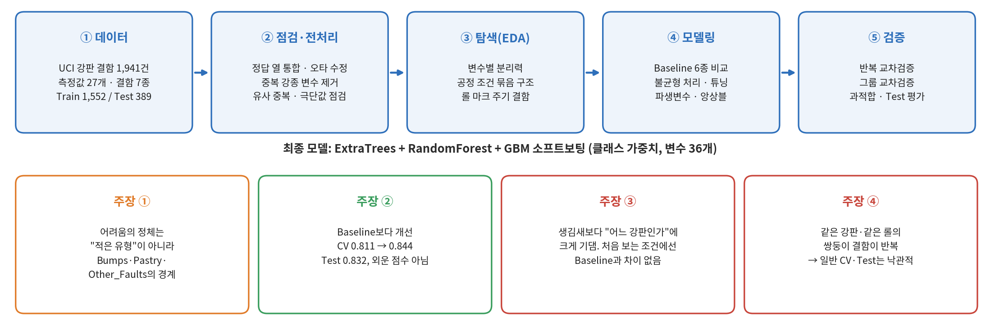

---

## 1. 프로젝트 개요

### 1.1 프로젝트 소개

**프로젝트 배경**

- 강판은 압연(뜨거운 금속을 롤 사이로 눌러 얇게 펴는 공정)을 거치며 표면에 여러 종류의 결함이 생깁니다. 결함 종류마다 원인이 되는 설비가 다르기 때문에, "불량이다"에서 끝나지 않고 **"어떤 불량이냐"** 를 알아야 어느 설비를 손볼지 정할 수 있습니다.
- 지금은 이 판정을 사람이 눈으로 합니다. 검사자의 숙련도에 따라 판정이 달라지고, 빠르게 돌아가는 생산 라인을 따라가기도 어렵습니다.
- 카메라는 이미 결함의 위치·크기·둘레·밝기 같은 수치를 자동으로 뽑아내고 있습니다. 다만 이 수치들과 결함 종류 사이의 관계는 변수가 많고 서로 얽혀 있어서 사람이 "면적이 얼마 이상이면 긁힘" 같은 규칙으로 일일이 적기 어렵습니다. 그래서 데이터에서 규칙을 스스로 찾는 **머신러닝**으로 접근했습니다.

**분류해야 할 결함 일곱 가지**

데이터 제공처가 유형별 정의를 공개하지 않았기 때문에, 아래 설명은 일반적인 강판 결함 용어를 기준으로 정리한 것입니다.

| 데이터 속 이름 | 우리말 이름 | 생김새 |
|---|---|---|
| Pastry | 박리 | 표면 일부가 얇게 들뜨거나 벗겨진 자국 |
| Z_Scratch | Z형 긁힘 | 긁힌 자국 (K형과 방향·형태가 다른 긁힘) |
| K_Scratch | K형 긁힘 | 긁힌 자국 (원본 데이터에는 `K_Scatch`로 오타 표기) |
| Stains | 얼룩 | 주변과 색·밝기가 다른 얼룩 |
| Dirtiness | 오염 | 이물질이 묻은 자국 |
| Bumps | 융기 | 표면이 볼록하게 솟은 부분 |
| Other_Faults | 기타 | 위 여섯 가지에 속하지 않는 결함을 한데 모은 범주 |

**프로젝트 목표**

| 항목 | 내용 |
|---|---|
| 예측 대상 | 결함 하나가 일곱 가지 유형 중 무엇인지 (`target`) |
| 문제 유형 | 다중 분류 (결함 하나는 정확히 한 유형에만 속함) |
| 핵심 평가 지표 | Macro F1 |
| 함께 본 지표 | 유형별 Precision·Recall·F1, Confusion Matrix, Accuracy |
| 불균형 처리 비교 | 처리 전후를 같은 분할·같은 조건에서 비교 |
| 활용 방식 | 검사자에게 결함 유형 후보를 알려 주는 **보조 도구** (사람의 판정을 완전히 대체하지 않음) |

**왜 Macro F1인가**

정확도(Accuracy)는 "전체 중 몇 개를 맞혔나"만 봅니다. 이 데이터는 가장 흔한 유형이 전체의 상당 부분을 차지하기 때문에, 흔한 유형만 잘 맞혀도 정확도가 높게 나옵니다. Macro F1은 일곱 유형의 점수를 각각 따로 계산한 뒤 **똑같은 비중으로 평균**합니다. 그래서 드문 유형을 놓치면 바로 점수가 깎입니다. 데이터에 "어떤 결함을 틀리면 얼마나 손해인지"에 대한 정보가 없었으므로, 모든 유형을 똑같이 중요하게 보는 이 지표가 가장 공정하다고 판단했습니다.

### 1.2 프로젝트 정보

| 항목 | 내용 |
|---|---|
| 프로젝트 기간 | 2026.10.13 ~ 2026.10.19 |
| 프로젝트 유형 | 팀 프로젝트 (5인) |
| 데이터 출처 | [Steel Plates Faults (UCI Machine Learning Repository)](https://archive.ics.uci.edu/dataset/198/steel+plates+faults) |
| 주요 기술 | Python, Scikit-learn, XGBoost, LightGBM, Imbalanced-learn, Streamlit, uv |

### 1.3 주요 성과

**성능 요약**

| 평가 방식 | 무엇을 재는가 | Baseline (XGBoost 기본값) | 최종 모델 (ET + RF + GBM 소프트보팅) | 개선안: 최종 모델 − `plate_defect_count` ※ |
|---|---|---:|---:|---:|
| 교차검증 (Train 5-fold) | 이미 본 생산 조건의 다른 결함 | 0.8109 | **0.8441** | 0.8385 ※ |
| 반복 교차검증 (5-fold × 3회) | 분할 운에 흔들리지 않는 평균 | 0.8143 ※ | **0.8389** | 0.8397 ※ |
| Test (한 번도 안 본 389건) | 학습에 사용하지 않은 고정 평가 데이터 | 0.8165 | **0.8324** | 미평가 |
| 그룹 교차검증 (생산 조건 단위로 분리) | **처음 보는** 생산 조건의 결함 | 0.7277 ※ | 0.7400 ※ | **0.7802** ※ |

※ 표시는 최종 모델 코드를 그대로 써서 팀 검증 단계에서 측정한 값입니다(8.4절, `notebooks/05_team_verification.ipynb`). 개선안은 처음 보는 생산 조건에서의 약점을 추적하다 찾은 구성으로, 아직 재학습과 Test 평가를 거치지 않아 공식 최종 모델로 바꾸지는 않았습니다(10.2절). 모든 수치는 Macro F1입니다.

**보고서의 핵심 주장**

| 번호 | 주장 | 근거 |
|---|---|---|
| ① | 이 문제의 어려움은 "건수가 적은 유형"이 아니라 **서로 닮은 세 유형(Bumps·Pastry·Other_Faults)의 경계**에 있다 | 5.2, 6.1, 7.1, 8.2절 |
| ② | 불균형 처리·파생변수·앙상블을 통해 Baseline보다 성능이 개선되었고, 이 개선은 반복 교차검증에서도 유지되었다. | 7.2 ~ 7.6절 |
| ③ | 모델은 **강종·두께·폭으로 표현되는 생산 조건에 크게 의존한다.** 그래서 처음 보는 생산 조건에서는 성능이 크게 떨어지고, 모델 사이의 우열도 흐려진다 | 6.1, 8.3, 8.4절 |
| ④ | 이 데이터의 결함들은 서로 독립적이지 않다. **같은 생산 조건에서 유사한 결함이 반복되는 구조가 확인**되므로, 일반 교차검증 점수는 "이미 본 조건" 기준의 성능으로 읽어야 한다 | 6.1, 6.3, 8.4절 |

---

## 2. 프로젝트 구조

```text
steel-plate-fault-classification/
├── README.md
├── pyproject.toml · uv.lock · .python-version · .gitignore
│
├── data/
│   ├── raw/Faults.csv                          # UCI 원본 (34열)
│   ├── processed/Faults_processed.csv          # 팀 공통 전처리 결과 (변수 26개 + target)
│   └── split/train_idx.csv, test_idx.csv       # 팀 공통 Train/Test 인덱스
│
├── src/
│   ├── config.py                               # 난수 시드, 분할 비율, 교차검증, 평가지표
│   ├── make_split.py                           # 층화 Train/Test 인덱스 생성 (분할 파일이 없을 때만 실행)
│   ├── load_data.py                            # 공통 분할 기준 데이터 로더
│   ├── evaluate.py                             # 실험 결과 기록 → results/model_scores.csv
│   ├── plotting.py                             # 혼동행렬 시각화
│   ├── cv_utils.py                             # 교차검증 실행·요약 (03에서 사용)
│   ├── Taegyeom_model_utils.py                 # 전처리 Pipeline, 불균형 처리, CV 평가 (Taegyeom 노트북에서 사용)
│   ├── features.py                             # 파생변수 19개 (LightGBM+XGBoost+ExtraTrees 후보용)
│   ├── run_ensemble.py                         # LightGBM+XGBoost+ExtraTrees 후보 재현
│   ├── experiments.py                          # 과적합·누수 점검, 기각 실험 등 보조 분석
│   └── make_figures.py                         # README 그림 15장 재생성
│
├── notebooks/
│   ├── 01_eda.ipynb                            # Train 기준 탐색적 데이터 분석
│   ├── 02_preprocessing.ipynb                  # 전처리, 유사 중복 점검, 분할 검증
│   ├── 03_modeling.ipynb                       # Baseline 비교, 생산 조건 그룹 구조 점검, 파생변수 비교
│   ├── 04_macro_f1_improvement.ipynb           # 클래스 가중치·튜닝·임계값·Stacking·리샘플링 비교
│   ├── 05_team_verification.ipynb              # 그룹 교차검증, 변수 묶음 제거, 불균형 처리 반복 비교 등 취합 검증
│   ├── 06_target_084_fixed.ipynb               # 2단계 전문 모델 등 구조 변경 실험
│   ├── 07_final_model.ipynb                    # 최종 모델 학습, 과적합 점검, Test 평가, 모델 저장
│   ├── Taegyeom_01_eda_preprocessing.ipynb     # ┐
│   ├── Taegyeom_02_baseline.ipynb              # │
│   ├── Taegyeom_03_imbalance.ipynb             # │ 최종 모델 개발 과정
│   ├── Taegyeom_04_tuning.ipynb                # │ (Baseline 6종 → 불균형 처리 → 튜닝
│   ├── Taegyeom_05_feature_engineering.ipynb   # │  → 파생변수 10개 + 재튜닝 → 앙상블 → 최종 평가)
│   ├── Taegyeom_06_ensemble.ipynb              # │
│   └── Taegyeom_07_final_evaluation.ipynb      # ┘
│
├── models/
│   └── Taegyeom_final_model_trained.pkl        # 최종 모델 (ET + RF + GBM, 07에서 저장)
│
├── results/
│   ├── model_scores.csv                        # 팀원별 주요 실험 결과 기록
│   ├── eda/                                    # Taegyeom_01 산출물
│   ├── baseline/                               # Taegyeom_02 산출물 (Baseline 6종 CV 결과)
│   ├── imbalance/                              # Taegyeom_03 산출물 (불균형 처리 전후 비교)
│   ├── tuning/                                 # Taegyeom_04 산출물 (하이퍼파라미터 탐색)
│   ├── feature_engineering/                    # Taegyeom_05 산출물 (파생변수·재튜닝 비교)
│   ├── ensemble/                               # Taegyeom_06 산출물 (Soft Voting·Stacking 비교)
│   ├── final/                                  # Taegyeom_07 산출물 (Test 성능, 신뢰구간, 오분류 사례)
│   └── figure_data/                            # make_figures.py가 읽는 실험 결과 캐시 (05·07 기준)
│
├── figures/                                    # README 그림 15장
└── app.py                                   # Streamlit 대시보드 (제작 중)
```

| 파일 / 디렉터리 | 설명 |
|---|---|
| `pyproject.toml`, `uv.lock` | 의존성 목록과 버전 고정 |
| `data/split/` | 팀원 전원이 같은 Train/Test를 쓰도록 고정한 인덱스 |
| `src/` | 공통 설정·분할·로더·평가 코드와 실험·그림 재생성 스크립트 |
| `notebooks/` | 01-07은 팀 공통 흐름, Taegyeom_01-07은 최종 모델 개발 과정 |
| `models/` | 학습이 끝난 최종 모델 |
| `results/` | 노트북별 실험 결과 파일과 그림용 캐시 |
| `figures/` | 보고서 그림 |
| `app.py` | README 그림 (src/make_figures.py로 재생성 가능) |

---

## 3. 설치 및 실행 방법

본 프로젝트는 **uv + Jupyter Notebook** 환경에서 수행했습니다.

### 3.1 실행 환경

| 항목 | 버전 |
|---|---|
| Python | 3.14 (`.python-version` 기준) |
| 패키지 관리 | uv |
| 주요 라이브러리 | pandas 3.0, scikit-learn 1.9, XGBoost 3.4, LightGBM 4.7, imbalanced-learn 0.14 |
| 편집기 | VS Code (Jupyter 확장) |
| 대시보드 | Streamlit |

운영체제나 라이브러리 버전에 따라 결과가 소수점 넷째 자리에서 조금 달라질 수 있습니다.

### 3.2 Repository 다운로드

```bash
git clone https://github.com/takkoyakki143/steel-plate-fault-classification.git
cd steel-plate-fault-classification
```

### 3.3 uv 설치 및 환경 구성

[uv 공식 설치 안내](https://docs.astral.sh/uv/getting-started/installation/)를 참고해 uv를 설치한 뒤, 의존성을 설치합니다.

```bash
uv sync
```

### 3.4 데이터 준비

원본 데이터, 전처리 결과, 공통 Train/Test 인덱스가 모두 Repository에 들어 있어 따로 받을 필요가 없습니다.

| 경로 | 내용 |
|---|---|
| `data/raw/Faults.csv` | UCI 원본 |
| `data/processed/Faults_processed.csv` | 정답 열 통합, 오타 수정, 중복 강종 변수 제거를 마친 데이터 |
| `data/split/train_idx.csv`, `test_idx.csv` | 팀 공통 Train/Test 인덱스 |

`src/make_split.py`를 다시 실행하면 분할이 바뀌어 기존 실험과 비교할 수 없게 되므로, 분할 파일이 없을 때만 실행합니다.

### 3.5 Jupyter Notebook 실행 (VS Code)

1. VS Code에서 프로젝트 폴더를 엽니다.
2. 실행할 `.ipynb` 파일을 엽니다.
3. 오른쪽 위 **Select Kernel**을 눌러 프로젝트의 `.venv` Python 환경을 선택합니다.
4. 셀을 위에서부터 순서대로 실행합니다.

### 3.6 분석 및 모델링 실행 순서

| 순서 | 파일 | 주요 내용 |
|---|---|---|
| 1 | `notebooks/01_eda.ipynb` | Train 데이터 기준 탐색적 분석 |
| 2 | `notebooks/02_preprocessing.ipynb` | 전처리, 분할 검증 |
| 3 | `notebooks/03_modeling.ipynb` | Baseline 비교, 생산 조건 그룹 구조 점검 |
| 4 | `notebooks/04_macro_f1_improvement.ipynb` | 불균형 처리 비교, 앙상블, Ablation |
| 5 | `notebooks/06_target_084_fixed.ipynb` | Macro F1 0.84를 목표로 3가지 실험 진행 |
| 6 | `notebooks/07.final_model.ipynb` | 최종 모델 학습, 과적합 점검, Test 평가, 모델 저장 |
| 7 | `notebooks/05_team_verification.ipynb` | 그룹 교차검증, 변수 묶음 제거 실험 등 취합 단계 검증 |

최종 모델만 확인하려면 5번만 실행하면 됩니다.

### 3.7 Streamlit 실행

```bash
uv run streamlit run app.py
```

실행 후 브라우저에서 `http://localhost:8501`로 접속합니다. 별도 웹 배포 없이 로컬에서 실행됩니다. 대시보드는 현재 제작 중입니다(9장).

---

## 4. 기술 스택

| 구분 | 사용 기술 |
|---|---|
| Language | Python |
| Environment & Package Management | uv |
| Data Processing | Pandas, NumPy |
| Statistics | SciPy (Kruskal–Wallis 검정) |
| Visualization | Matplotlib |
| Machine Learning | Scikit-learn, XGBoost, LightGBM |
| Imbalanced Learning | Imbalanced-learn (SMOTE, BorderlineSMOTE, SMOTENC, RandomUnderSampler) |
| Model Interpretation | Permutation Importance |
| Dashboard | Streamlit |
| Development | Jupyter Notebook, VS Code, Git |

---

## 5. 데이터셋

### 5.1 데이터 개요

**데이터 출처:** [Steel Plates Faults — UCI Machine Learning Repository](https://archive.ics.uci.edu/dataset/198/steel+plates+faults)

| 항목 | 내용 |
|---|---|
| 데이터 수 | 1,941건 (Train 1,552 / Test 389) |
| 원본 열 수 | 34열 (설명 변수 27 + 정답 표시 열 7) |
| 모델 입력 변수 수 | 전처리 후 26개 → 최종 모델은 파생변수 10개를 더해 36개 |
| Target 변수 | `target` (결함 유형 7종) |
| 문제 유형 | 다중 분류 |
| 클래스 비율 | 가장 많은 유형 34.67% (Other_Faults) ~ 가장 적은 유형 2.83% (Dirtiness), 12.24배 차이 |
| 결측치 / 완전 중복 | 없음 / 없음 |

### 5.2 데이터 특징

**변수는 다섯 묶음으로 나뉩니다**

| 묶음 | 변수 | 의미 |
|---|---|---|
| 위치 | `X_Minimum`, `X_Maximum`, `Y_Minimum`, `Y_Maximum` | 결함을 둘러싼 네모 칸의 좌표. X는 강판의 가로, Y는 강판이 흘러가는 길이 방향 |
| 크기 | `Pixels_Areas`, `X_Perimeter`, `Y_Perimeter`, `LogOfAreas`, `Log_X_Index`, `Log_Y_Index`, `SigmoidOfAreas`, `Sum_of_Luminosity` | 결함의 넓이와 둘레 |
| 모양 | `Edges_Index`, `Empty_Index`, `Square_Index`, `Outside_X_Index`, `Edges_X_Index`, `Edges_Y_Index`, `Outside_Global_Index`, `Orientation_Index` | 네모 칸을 얼마나 채웠는지, 정사각형에 가까운지, 어느 방향으로 길쭉한지 |
| 밝기 | `Minimum_of_Luminosity`, `Maximum_of_Luminosity`, `Luminosity_Index` | 결함 부분의 어둡고 밝은 정도 |
| 공정 조건 | `TypeOfSteel_A300`, `Steel_Plate_Thickness`, `Length_of_Conveyer` | 그 결함이 나온 강판의 강종·두께·폭 |

**공식 설명서가 없어서 직접 확인한 사실**

| 확인한 것 | 확인 방법 | 결과 | 보고서에서 의미 |
|---|---|---|---|
| `Length_of_Conveyer`는 이름과 달리 **강판(검사 영역)의 가로 폭**이다 | 결함 오른쪽 끝 좌표가 이 값을 넘는 행이 있는지 | 모든 행에서 넘지 않음 | 이름이 헷갈리지만 **원본 컬럼명 `Length_of_Conveyer` 그대로** 표기함 |
| `Sum_of_Luminosity`는 밝기가 아니라 **사실상 크기 변수**다 | 면적과의 순위 상관(Spearman) | 0.98 | 밝기 변수로 해석하면 안 됨 |
| 원본에 이미 **비율·모양 지표 13개**가 계산되어 들어 있다 | 각 지표를 원래 측정값으로 다시 계산 | 일치 | 우리가 만든 파생변수의 추가 효과가 작은 이유 (7.5절) |
| `TypeOfSteel_A300`과 `A400`은 **한쪽이 정해지면 다른 쪽도 정해진다** | 두 열의 합 | 모든 행에서 1 | 한 열만 남김 (6.2절) |

**Target 클래스 분포**

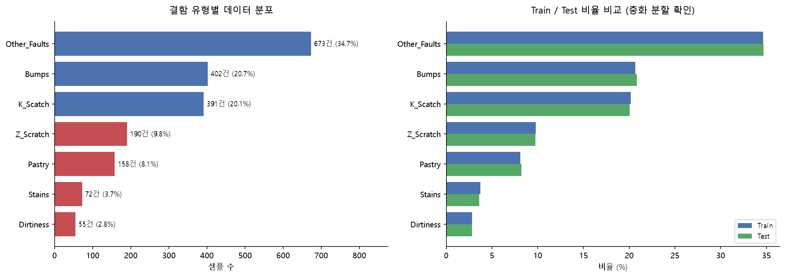

왼쪽 그림처럼 유형별 건수 차이가 크기 때문에, 정확도만 보면 모델이 흔한 유형만 맞혀도 좋아 보이는 착시가 생깁니다. 그래서 Macro F1을 핵심 지표로 정했습니다.

그런데 오른쪽 그림이 더 중요한 사실을 보여 줍니다. **건수가 가장 적은 Stains와 Dirtiness는 처음부터 잘 맞혔고, 가장 못 맞힌 것은 중간 규모의 Pastry와 건수가 많은 Bumps·Other_Faults였습니다.** 즉 이 데이터의 진짜 문제는 "데이터가 적은 유형"이 아니라 "서로 닮은 유형"입니다. 이 사실은 불균형 처리 방법을 고를 때(7.3절)와 오류를 해석할 때(8.2절) 계속 기준이 됩니다.

> **→ 주장 ①을 뒷받침합니다.**

---

## 6. 데이터 분석 및 전처리

### 6.1 탐색적 데이터 분석 (EDA)

EDA는 **Train 데이터만** 사용했습니다. 전처리 방법을 정하는 단계에서 Test 데이터를 보면, Test의 정보가 판단에 섞여 Test 점수를 믿을 수 없게 되기 때문입니다. 다만 데이터 구조가 평가 점수에 주는 영향을 확인한 분석(발견 2의 ②~④, 발견 3, 발견 4)에는 Test도 함께 썼고, 이 결과는 모델이나 설정을 고르는 데 쓰지 않았습니다.

**주요 분석 내용**

| 확인한 것 | 방법 |
|---|---|
| 데이터 구조와 변수 유형 | 열 정의 역산, 값의 범위 점검 |
| 결측치·중복 | 결측 개수, 완전 중복, 측정값이 거의 같은 유사 중복 |
| 변수 분포 | 치우침(왜도), 극단값 |
| 변수 하나의 분리력 | Kruskal–Wallis 검정 |
| 공정 조건과 결함 유형의 관계 | 같은 생산 조건 묶음 안의 유형 쏠림, 무작위 비교 |
| 모양만으로 구분되는 정도 | 가장 닮은 이웃 찾기 (k-최근접 이웃) |
| 결함이 반복되는 구조 | 같은 위치 결함의 간격 분석 |

**발견 1. 변수 하나로는 일부 유형만 갈린다**

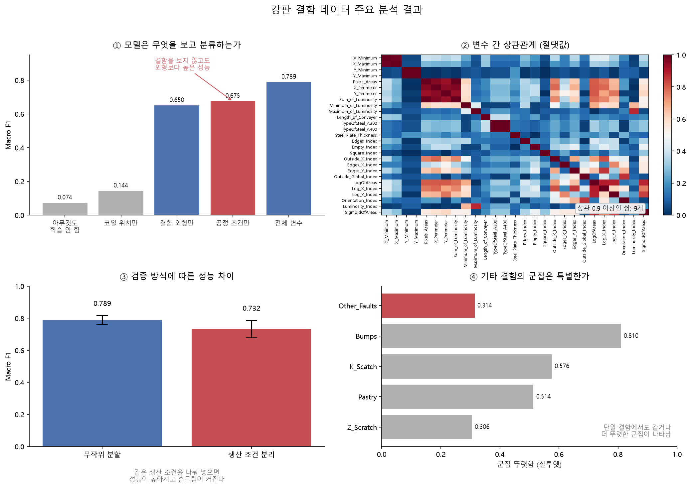

변수 하나에서 결함 유형별 분포 차이가 얼마나 뚜렷한지 **Kruskal–Wallis 검정**으로 쟀습니다. 이 데이터는 값이 한쪽으로 심하게 몰려 있고 극단값이 많아서, 평균을 비교하는 분산분석(ANOVA)은 결과가 극단값에 휘둘립니다. Kruskal–Wallis 검정은 값 대신 **순위**를 비교하므로 이런 데이터에 더 적합합니다.

왼쪽 그림에서 상위권은 대부분 **크기** 변수입니다. 결함이 얼마나 큰지가 유형을 가르는 첫 번째 기준이라는 뜻입니다. 하지만 오른쪽 그림처럼 면적만으로 확실히 갈리는 것은 크기가 유난히 큰 K_Scratch와 유난히 작은 Stains뿐이고, 나머지 다섯 유형은 같은 구간에 겹쳐 있습니다. **여러 변수를 함께 조합해서 판단하는 모델이 필요하다**는 근거입니다.

눈여겨볼 점이 하나 더 있습니다. `Length_of_Conveyer`(강판 폭)는 변수 하나로서의 분리력은 중간 정도인데, 뒤에서 보듯 모델 안에서는 가장 중요한 변수 중 하나가 됩니다(8.3절). 이 변수는 혼자서는 약하지만 **강종·두께와 묶이면 "어느 강판인지"를 알려 주는 이름표**가 되기 때문입니다. 발견 2가 그 내용입니다.

> **→ 주장 ①을 뒷받침합니다.**

**발견 2. 같은 생산 조건에서는 같은 결함이 반복된다**

강종·두께·폭이 모두 같은 결함들을 하나의 "생산 조건 묶음"으로 보고 분석했습니다. 데이터에 강판 번호가 없어서, 이 세 값이 같으면 같은 강판이거나 같은 규격으로 함께 생산된 강판일 가능성이 높다고 본 것입니다.

| 항목 | Train 기준 값 |
|---|---:|
| 생산 조건 묶음 수 | 218개 |
| 묶음 하나당 결함 수 (중앙값 / 최대) | 3건 / 108건 |
| 묶음 안에서 가장 많은 유형이 차지하는 비율 (실제) | 0.763 |
| 같은 계산을 정답을 무작위로 섞어서 했을 때 (200회 평균 / 최대) | 0.431 / 0.453 |
| Test 결함 중 Train에 같은 묶음이 있는 비율 | 93.8% |

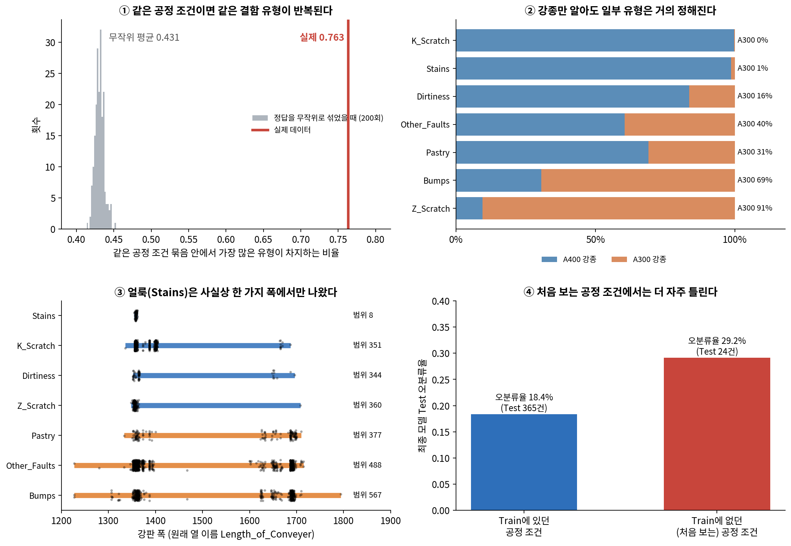

①은 같은 생산 조건 안에서 같은 결함이 몰려 나온다는 것이 **우연으로는 도저히 나올 수 없는 수준**임을 보여 줍니다. ②와 ③은 그 결과로 생기는 현상입니다. 강종만 알아도 K_Scratch·Stains와 Z_Scratch는 거의 정해지고, Stains는 사실상 한 가지 폭의 강판에서만 나왔습니다. 제철소는 같은 규격의 제품을 한꺼번에 몰아서 생산하기 때문에, 그때 생긴 결함들이 같은 조건에 함께 묶여 기록된 것으로 보입니다.

이것이 왜 중요할까요? 모델 입장에서는 결함의 생김새를 꼼꼼히 배우지 않아도 **"이 강판에서는 보통 이 결함이 나온다"** 는 지름길만 외워도 점수를 낼 수 있습니다. 그리고 Train과 Test를 무작위로 나누면 같은 묶음의 결함이 양쪽에 섞이므로, 이 지름길이 Test에서도 그대로 통합니다. ④는 그 지름길이 통하지 않는 경우, 즉 **Train에 없던 생산 조건에서 나온 결함은 최종 모델이 더 자주 틀린다**는 것을 보여 줍니다. 해당하는 Test 건수가 적어 이것만으로 결론 내리지 않고, 8.4절에서 더 큰 규모로 다시 확인했습니다.

> **→ 주장 ③, ④를 뒷받침합니다.**

**발견 3. 모양만으로는 헷갈리는 유형이 많고, Z_Scratch는 공정 조건 덕분에 구분된다**

위치·공정 정보를 빼고 **모양·밝기 특징만으로** 결함끼리 얼마나 닮았는지 계산했습니다. 각 결함마다 가장 닮은 이웃 결함들을 찾아, 그중 같은 유형이 얼마나 되는지 본 것입니다. 이어서 공정 조건(강종·두께·폭)을 더해 같은 계산을 반복했습니다.

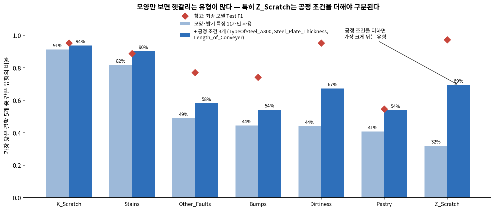

K_Scratch와 Stains는 모양만으로도 이웃 대부분이 같은 유형이라 생김새 자체가 뚜렷합니다. 반면 Bumps·Pastry·Other_Faults는 모양이 닮은 이웃의 절반 이상이 다른 유형이어서, 생김새만으로는 서로 구분이 잘 안 됩니다.

가장 놀라운 것은 **Z_Scratch**입니다. 모양만 보면 일곱 유형 중 가장 헷갈리는 유형인데, 최종 모델은 Z_Scratch를 가장 잘 맞힙니다. 공정 조건을 더하자마자 같은 유형 비율이 가장 크게 뛰는 것을 보면, 모델이 Z_Scratch를 생김새가 아니라 **"주로 A300 강종에서 나오는 결함"** 으로 알아보고 있을 가능성이 높습니다. Dirtiness도 비슷한 양상입니다.

> **→ 주장 ①(헷갈리는 세 유형), 주장 ③(공정 조건 의존)을 뒷받침합니다.**

**발견 4. K_Scratch 일부는 같은 자리에서 일정한 간격으로 반복된다**

같은 생산 조건 묶음 안에서, 같은 가로 위치에 있고 모양이 비슷한 결함이 여러 개 있는지 찾아봤습니다.

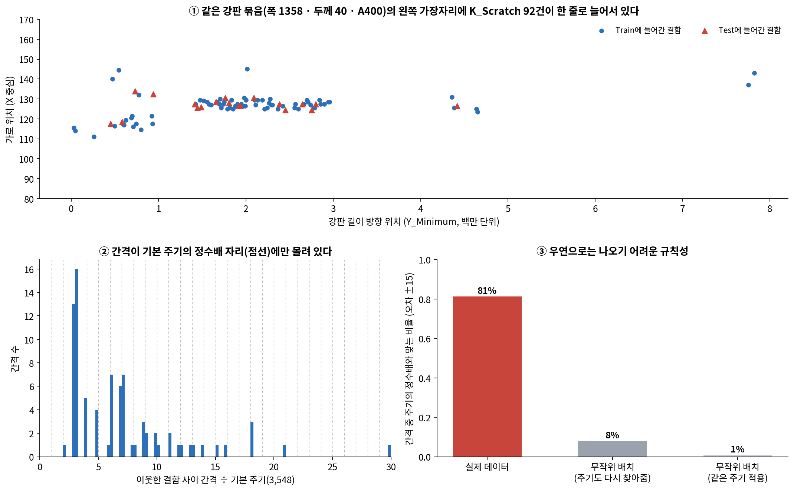

| 강판 묶음 (폭 · 두께 · 강종) | 가로 위치 | 결함 수 | 유형 | 기본 주기의 정수배와 맞는 간격 비율 |
|---|---|---:|---|---:|
| 1358 · 40 · A400 (위 그림) | 왼쪽 가장자리 | 92 | K_Scratch | 81% |
| 1356 · 40 · A400 | 80 ~ 120 | 8 | K_Scratch | 100% |
| 1356 · 40 · A400 | 120 ~ 160 | 44 | K_Scratch | 84% |
| 1358 · 40 · A400 | 80 ~ 120 | 13 | K_Scratch | 83% |
| 1360 · 40 · A400 | 80 ~ 120 | 18 | K_Scratch | 76% |
| 1373 · 40 · A400 | 0 ~ 40 | 11 | Other_Faults | 10% |
| 1692 · 300 · A400 | 1560 ~ 1600 | 9 | Other_Faults | 12% |

①처럼 한 강판 묶음의 왼쪽 가장자리를 따라 K_Scratch가 길게 줄지어 있고, ②처럼 이웃한 결함 사이의 간격이 **하나의 기본 길이의 정수배**에만 몰려 있습니다. ③에서 같은 개수의 점을 무작위로 뿌린 뒤 **주기까지 다시 찾아 주는 유리한 조건**으로 비교해도 이런 규칙성은 거의 나오지 않습니다.

이 패턴은 **롤 마크**의 전형적인 모습과 같습니다. 압연할 때 강판은 둥근 롤 사이를 지나가는데, 롤 표면 한 곳에 흠이 있으면 롤이 한 바퀴 돌 때마다 강판의 같은 가로 위치에 같은 모양의 흠이 찍힙니다. 그래서 결함이 롤 둘레 길이마다 반복됩니다. 같은 주기가 폭이 조금씩 다른 세 묶음에서 함께 나온다는 것은, 이 세 폭이 **같은 롤을 거친 같은 생산 라인**이고 폭 값에 약간의 측정 오차가 있다는 뜻으로 보입니다. 다른 유형에서는 이 주기가 거의 나오지 않았습니다.

이 발견이 보고서에서 중요한 이유는 두 가지입니다.

- **결함들이 서로 독립적이지 않다는 직접 증거입니다.** 같은 롤 흠에서 찍혀 나온 거의 똑같은 결함들이 무작위 분할 때문에 Train과 Test 양쪽에 나뉘어 들어갔습니다(①의 빨간 삼각형). 모델은 Test에서 "처음 보는 결함"이 아니라 "이미 본 결함의 쌍둥이"를 맞히는 셈이므로, 일반 교차검증과 Test 점수는 실제보다 좋게 나올 수 있습니다.
- **Y 좌표가 실제 길이 방향의 거리라는 근거입니다.** 주기가 이렇게 정확히 맞으려면 Y가 강판을 따라 잰 실제 거리여야 합니다. Y 좌표는 변수 하나로서의 분리력은 가장 낮은데도(발견 1) 모델에서 빼면 성능이 떨어지는데, 그 이유가 "결함의 생김새"가 아니라 **"같은 강판의 어느 구간인지"를 알려 주는 정보**이기 때문일 수 있다고 보고 8.4절에서 실험했습니다. 다만 Y를 뺐을 때 이미 본 조건과 처음 보는 조건에서 떨어지는 폭이 거의 같아, 이 가설은 뒷받침되지 않았습니다.

**조심할 점**

| 한계 | 이유 |
|---|---|
| 주기가 실제로 몇 mm인지는 알 수 없음 | 좌표의 단위(픽셀 크기)가 공개되지 않아 롤 지름을 계산할 수 없음 |
| K_Scratch가 롤 마크라고 확정할 수 없음 | 유형 정의가 없음. "롤 마크의 전형적 패턴과 일치한다"까지가 말할 수 있는 범위 |

> **→ 주장 ④를 뒷받침합니다.**

### 6.2 데이터 전처리

| 처리 항목 | 확인 결과 | 적용 방법 | 선택 이유 |
|---|---|---|---|
| 정답 형식 | 정답 표시 열 7개, 모든 행에서 정확히 하나만 1 | 하나의 `target` 열로 합치고 원래 열 7개는 삭제 | 여러 유형을 동시에 가진 결함이 없으므로 다중 분류 문제임. 정답 열이 입력에 남으면 정답을 보고 맞히는 셈(데이터 누수) |
| 컬럼명 오타 | `K_Scatch` | `K_Scratch`로 수정 | 표와 그림의 표기 통일 |
| 결측치 | 없음 | 처리 없음 (최종 모델 Pipeline에는 새 데이터 대비용 결측 대체 단계 포함) | 고칠 것이 없음 |
| 완전 중복 | 없음 | 처리 없음 | 고칠 것이 없음 |
| 유사 중복 | 의심 1쌍, 판단 보류 1쌍 (아래 표) | **두 쌍 모두 제거하지 않음** | 아래 설명 |
| 중복 강종 변수 | A300과 A400의 합이 항상 1 | `TypeOfSteel_A400` 삭제 (A300이 1이면 A300, 0이면 A400) | 같은 정보를 두 번 넣는 것일 뿐 새 정보가 없음 |
| 극단값 | 크기 계열 변수가 오른쪽으로 길게 치우침 | 지우지 않고 그대로 사용 | 아래 설명 |
| 범주형 인코딩 | 입력 변수가 모두 숫자 | 하지 않음 (정답만 XGBoost용으로 숫자 변환) | 강종은 이미 0/1 |
| 스케일링 | 변수마다 값의 범위가 크게 다름 | 트리 계열에는 하지 않음, 로지스틱 회귀에만 Pipeline 안에서 표준화 | 아래 설명 |
| 서로 비슷한 변수 | 위치·크기 계열끼리 상관이 매우 높음 | 그대로 둠 | 상관이 높더라도 위치·크기 등 서로 다른 물리적 특성을 나타내므로 정보 중복이라고 단정하기 어려워 유지. A300/A400처럼 동일한 정보를 나타내는 경우만 제거 |
| 파생변수 | — | 최종 모델에 10개 추가 | 7.5절 |

**유사 중복 점검**

완전히 똑같은 행은 없었지만, 측정값에는 작은 오차가 있을 수 있으므로 모양·밝기·위치가 **거의 같은 행**을 추가로 찾았습니다.

| 행 번호 | 같은 것 | 다른 것 | 분할 위치 | 판단 |
|---|---|---|---|---|
| 1775 · 1776 | 길이 방향 좌표, 면적, 둘레, 밝기 네 값, 모양 지표 대부분, 유형(Other_Faults) | `Length_of_Conveyer`(2 차이), 가로 좌표(6 차이), `Edges_Index`(소수점 셋째 자리) | 1775 Test · 1776 Train | 같은 결함의 이중 기록으로 **의심** (확정은 못 함) |
| 529 · 678 | 가로 시작 좌표, 길이 방향 좌표(8 이내), 유형(K_Scratch) | `Length_of_Conveyer`(42 차이), 모양 지표 몇 퍼센트 차이 | 둘 다 Train | 이중 기록인지, 같은 롤에서 반복된 결함인지 판단 불가 → 유지 |

1775·1776을 의심한 근거는 **밝기처럼 조금만 달라도 값이 바뀌는 변수들이 모두 같다**는 점입니다. 최소·최대 밝기, 밝기 합, 면적, 둘레, 길이 방향 좌표가 전부 일치하고, 차이가 나는 것은 `Length_of_Conveyer`와 가로 좌표뿐입니다. 서로 다른 결함이라면 밝기 값까지 똑같이 나오기는 어렵습니다. 폭 기준점이 조금 다르게 잡히면서 가로 좌표가 함께 밀린 것으로 보입니다.

그래도 **지우지 않았습니다.** 확정할 방법이 없기 때문입니다. 강판 번호가 없어서 같은 결함인지 확인할 수 없고, 6.1절 발견 4처럼 같은 자리에 비슷한 결함이 실제로 반복되는 경우도 있습니다. 특히 강판을 자르는 구간처럼 같은 지점이 두 번 기록될 수 있는 상황이라면, 두 행 모두 실제로 일어난 일을 적은 것일 수 있습니다. 근거 없이 데이터를 지우는 것보다, **이 데이터가 사람이 설계한 깔끔한 표가 아니라 현장에서 측정된 기록**이라는 점을 보여 주는 사례로 남겨 두는 쪽을 택했습니다. 다만 이 쌍이 Train과 Test에 하나씩 들어가 있어서 Test 한 건이 사실상 이미 본 결함일 수 있다는 점은 한계로 적어 둡니다.

529·678은 폭 차이가 측정 오차로 보기에는 크고, 모양 지표도 몇 퍼센트 어긋나서 같은 결함이라고 보기 더 어렵습니다.

**극단값을 지우지 않은 이유**

| 확인한 것 | 결과 |
|---|---|
| 면적 기준 극단값(사분위 범위 1.5배 밖) 중 K_Scratch 비율 | 약 83% |
| 크기 계열 변수의 치우침(왜도) | 약 2.8 ~ 3.3 |

극단값 대부분이 **K_Scratch**였습니다. 길게 이어진 긁힘은 원래 면적이 크고, 그 "큼"이 바로 K_Scratch를 알아보는 단서입니다. 측정 오류라는 근거도 없었습니다. 이것을 지우면 가장 잘 맞히던 유형을 못 맞히게 됩니다. 게다가 최종 모델로 쓴 트리 계열 모델은 "면적이 얼마보다 큰가?"처럼 기준선으로 나누기만 하므로 극단값에 흔들리지 않습니다.

**스케일링을 모델마다 다르게 적용한 이유**

스케일링은 변수마다 값의 범위가 크게 다를 때 학습 조건을 맞춰 주는 작업입니다. 특히 로지스틱 회귀처럼 계수에 정규화를 적용하는 모델에서는 변수의 스케일이 다르면 같은 크기의 계수에 대한 패널티가 변수마다 다르게 작용할 수 있습니다. 반면 트리 모델은 값의 크기 자체보다 기준값을 기준으로 데이터를 나누므로 스케일 변화의 영향을 거의 받지 않습니다. 그래서 **트리 계열에는 스케일링을 하지 않았고**, 로지스틱 회귀에만 적용했습니다.

### 6.3 데이터 분할과 데이터 누수 방지

**데이터 누수**란 모델이 학습할 때 원래 몰라야 할 정보(평가용 데이터나 정답)를 미리 보게 되는 것입니다. 누수가 있으면 점수는 좋게 나오지만 실제로 쓰면 그만큼 나오지 않습니다.

| 항목 | 설정 | 이유 |
|---|---|---|
| Train / Test 분할 | 8:2 층화 분할, 난수 시드 42 | 층화: Train과 Test의 유형 비율을 원본과 같게 유지 |
| 분할 검증 | Train·Test 겹침 없음, 누락 없음, 유형 비율 차이 최대 0.0011 | 분할이 제대로 되었는지 확인 |
| 교차검증 | Train 안에서 5-fold 층화 교차검증, 난수 시드 42 | 모델·설정 선택은 Train 안에서만 |
| 반복 교차검증 | 위 교차검증을 난수 시드를 바꿔 3회 (총 15번 평가) | 한 번 나눈 결과는 운에 따라 흔들리므로 |
| 그룹 교차검증 | 같은 생산 조건 묶음이 학습·검증 양쪽에 들어가지 않게 나눔 (StratifiedGroupKFold) | 처음 보는 생산 조건에서의 성능 확인 (주장 ③, ④) |
| 전처리·불균형 처리 위치 | 스케일링, 오버샘플링, 클래스 가중치, 파생변수 집계를 모두 Pipeline에 넣어 **학습 fold 안에서만** 계산 | 검증 데이터의 정보가 학습에 섞이지 않도록 |
| Test 사용 | 모델·설정을 **먼저 확정한 뒤에만** 평가. 선택 과정에는 전혀 사용하지 않음 | 아래 설명 |

**Test 사용 기록 (투명성)**

Test는 **모델 선택이 끝난 다음에만** 썼습니다. 어떤 모델을 쓸지, 어떤 설정을 쓸지, 파생변수를 넣을지는 모두 Train 안의 교차검증으로 정했고, 기준도 미리 정해 두었습니다. 반복 교차검증 평균이 더 높고 열다섯 번 중 과반에서 이기면 교체한다는 기준입니다.

Test는 그렇게 확정된 모델이 실제로 어느 정도인지 확인하는 용도로만 열었습니다. 단계별로 확정된 모델이 있었으므로 Test를 연 횟수는 한 번이 아니지만, **Test 점수를 보고 모델이나 설정을 되돌린 적은 없습니다.** 그래도 같은 Test를 여러 번 본 것 자체는 점수를 약간 낙관적으로 만들 수 있어 한계로 남깁니다.

**그래도 남는 누수 위험: 결함들 사이의 연결**

위 장치들은 "같은 행"이 학습과 평가에 동시에 쓰이는 것을 막습니다. 하지만 6.1절 발견 2와 4에서 보았듯 **서로 다른 행이라도 같은 생산 조건에서 나온 것으로 추정되는 유사한 결함**이 있고, 무작위 분할은 이들을 Train과 Test에 나눠 넣습니다. 그래서 일반 교차검증과 Test 점수는 "이미 본 생산 조건의 다른 결함"을 맞히는 성능으로 읽어야 하며, 처음 보는 조건의 성능은 그룹 교차검증으로 따로 확인했습니다(8.4절).

> **→ 주장 ④를 뒷받침합니다.**

---
## 7. 머신러닝 모델링

### 7.1 Baseline 모델

불균형 처리를 하지 않은 상태에서, 성격이 서로 다른 모델들을 같은 조건(Train 층화 교차검증, 기본 설정)으로 비교했습니다.

| 모델 | 계열 | 고른 이유 | Macro F1 (fold 평균 ± 표준편차) |
|---|---|---|---:|
| **XGBoost** | 부스팅 | 부스팅 계열, 과적합 억제 장치 포함 | **0.8109 ± 0.0308** |
| LightGBM | 부스팅 | 부스팅 계열, 빠른 학습 | 0.8044 ± 0.0360 |
| GradientBoosting (GBM) | 부스팅 | scikit-learn 기본 부스팅 | 0.7958 ± 0.0106 |
| Random Forest | 배깅 | 여러 트리의 투표 | 0.7899 ± 0.0312 |
| Decision Tree | 단일 트리 | 트리 하나의 기준점 | 0.7207 ± 0.0259 |
| Logistic Regression | 선형 | 가장 단순한 기준점 (표준화 적용) | 0.7191 ± 0.0275 |

부스팅 계열이 상위권이고, 선형 모델과 트리 하나짜리 모델은 크게 뒤처집니다. 부스팅은 앞선 트리가 틀린 결함에 집중해 다음 트리를 만들기 때문에, 쉽게 갈리는 결함과 끝까지 헷갈리는 결함이 섞인 이 데이터에 잘 맞습니다. 6.1절 발견 1에서 본 것처럼 **여러 변수를 조합해야 유형이 갈리는 데이터**라는 점과도 맞아떨어집니다. 가장 높은 XGBoost를 이후 모든 비교의 Baseline으로 정했습니다.

**Baseline(XGBoost)의 유형별 성능**

| 유형 | Precision | Recall | F1 | Train 건수 |
|---|---:|---:|---:|---:|
| K_Scratch | 0.971 | 0.965 | 0.968 | 313 |
| Z_Scratch | 0.954 | 0.947 | 0.950 | 152 |
| Stains | 0.947 | 0.931 | 0.939 | 58 |
| Dirtiness | 0.921 | 0.795 | 0.854 | 44 |
| Other_Faults | 0.733 | 0.771 | 0.752 | 538 |
| Bumps | 0.670 | 0.682 | 0.676 | 321 |
| **Pastry** | 0.627 | **0.508** | **0.561** | 126 |

**가장 많이 헷갈린 쌍**

| 실제 → 예측 | 건수 |
|---|---:|
| Bumps → Other_Faults | 87 |
| Other_Faults → Bumps | 85 |
| Pastry → Other_Faults | 42 |
| Other_Faults → Pastry | 24 |
| 위 네 쌍이 전체 오분류(319건)에서 차지하는 비율 | 74.6% |

두 표를 함께 보면 이 문제의 약점이 분명해집니다. **건수가 가장 적은 Stains·Dirtiness는 이미 잘 맞히고 있고, 실제 약점은 Pastry와 Bumps**입니다. 그리고 틀린 결함의 대부분이 **Bumps·Pastry가 Other_Faults와 서로 뒤바뀌는 경우**에 몰려 있습니다. 그래서 개선 목표를 "적은 유형의 데이터 늘리기"가 아니라 **"Pastry 놓침 줄이기"와 "Bumps·Pastry·Other_Faults 세 유형의 경계 다듬기"** 로 정했습니다.

> **→ 주장 ①을 뒷받침합니다.**

### 7.2 모델 비교 및 성능 개선

**팀원별 탐색 방향**

모든 팀원이 같은 Train/Test 분할과 같은 교차검증 설정으로 실험해, 결과를 바로 비교할 수 있게 했습니다.

| 담당 | 탐색한 방향 | 대표 모델 |
|---|---|---|
| 박태상 · 서윤하 | 불균형 처리 방법 비교, 경계 부근 오버샘플링, Ablation(요소별 효과 분리), 반복·그룹 교차검증 | GB + XGBoost 소프트보팅 + BorderlineSMOTE |
| 박태상 | 부스팅·배깅 계열 비교, 파생변수 19개, 과적합 검증, 기각 실험 | LightGBM + XGBoost + ExtraTrees 소프트보팅 |
| 김태겸 | 6개 모델 × 10개 불균형 조건, 튜닝, 파생변수 10개, 앙상블 조합 비교 | **ExtraTrees + RandomForest + GBM 소프트보팅 (최종)** |
| 안동진 | 데이터 품질과 구조 분석 | 유사 중복, 형상 유사도, 주기 결함 |

**적용한 모델**

| 계열 | 모델 | 특징 |
|---|---|---|
| 선형 | Logistic Regression | 변수들을 더하고 빼는 직선 관계로 판단 |
| 단일 트리 | Decision Tree | "면적이 얼마보다 큰가?" 같은 질문을 이어 붙여 판단 |
| 배깅 | Random Forest, ExtraTrees | 여러 트리를 따로 만들어 투표 (ExtraTrees는 기준선까지 무작위로 정해 더 다양함) |
| 부스팅 | GBM, XGBoost, LightGBM | 앞 트리가 틀린 것을 다음 트리가 집중해서 학습 |
| 앙상블 | Soft Voting, Stacking | 여러 모델의 예측 확률을 평균하거나, 또 다른 모델로 묶음 |

**최종 모델까지의 개선 과정**

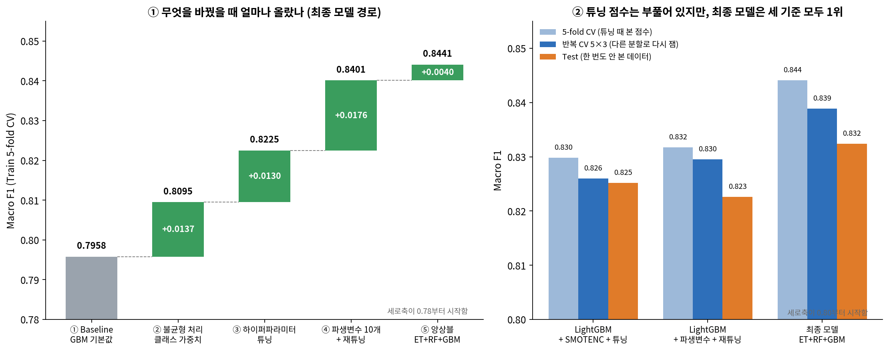

| 단계 | 바꾼 것 | Macro F1 (Train 5-fold CV) |
|---|---|---:|
| ① 개발 시작점 | GBM 기본값, 원본 변수 26개 | 0.7958 |
| ② 불균형 처리 | 유형별 균형 가중치 | 0.8095 |
| ③ 하이퍼파라미터 튜닝 | 무작위 탐색 (가중치 강도·오버샘플링 여부도 함께 탐색) | 0.8225 |
| ④ 파생변수 + 재튜닝 | 변수 36개로 늘리고 처음부터 다시 튜닝 | 0.8401 |
| ⑤ 앙상블 | ExtraTrees + RF + GBM 소프트보팅 | **0.8441** |

①을 보면 각 단계가 조금씩 성능을 쌓았고, 가장 큰 한 걸음은 **파생변수를 더하고 설정을 처음부터 다시 맞춘 단계**였습니다(+0.0176). 파생변수와 재튜닝 중 무엇이 기여했는지는 7.5절에서 따로 확인했습니다. 앙상블의 추가 이득은 작았습니다.

②는 이 점수들을 얼마나 믿을 수 있는지를 보여 줍니다. 튜닝 때 본 점수는 여러 설정 중 1등을 고른 값이라 항상 조금 부풀어 있고, 다른 분할로 다시 재거나(반복 교차검증) 한 번도 안 본 데이터(Test)로 재면 낮아집니다. 그래서 **모델을 바꿀지 말지는 튜닝 점수가 아니라 반복 교차검증으로 판단**했습니다. 선정 기준인 일반 CV와 반복 교차검증에서 가장 높은 모델을 최종 모델로 선택했고, 선정 후 확인한 Test에서도 성능 우위가 유지되었습니다.

> **→ 주장 ②를 뒷받침합니다.**

### 7.3 불균형 데이터 처리

**적용한 방법**

| 방법 | 원리 | 실험한 이유 |
|---|---|---|
| 클래스 가중치 | 건수가 적은 유형을 틀리면 벌점을 크게 매김 | 데이터를 새로 만들지 않고 모델의 관심만 조정 |
| SMOTE | 같은 유형 결함 사이에 가상의 결함을 만들어 건수를 늘림 | 가장 널리 쓰이는 오버샘플링 |
| BorderlineSMOTE | 다른 유형과 맞닿은 **경계 근처 결함**을 중심으로만 가상의 결함을 만듦 | 오류가 경계에 몰려 있었으므로 (7.1절) |
| SMOTENC | SMOTE와 같지만 강종처럼 0/1인 값은 섞지 않음 | "강종 0.37" 같은 있을 수 없는 값 방지 |
| 언더샘플링 | 많은 유형의 결함을 버려서 건수를 맞춤 | 비교 기준 |

**같은 모델에서 방법만 바꿔 비교 (GBM 기본값, 반복 교차검증)**

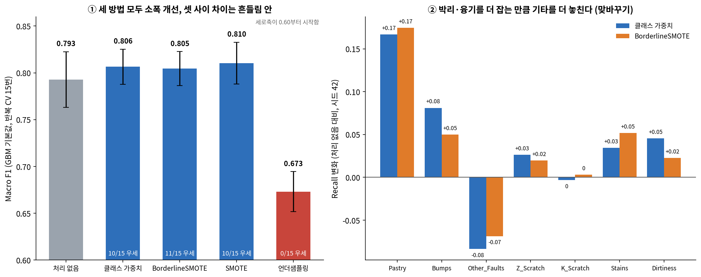

| 방법 | 한 번만 나눴을 때 (시드 42) | 반복 CV 평균 ± 표준편차 | 처리 없음과의 차이 (반복 평균) | 15번 중 처리 없음보다 높은 횟수 |
|---|---:|---:|---:|---:|
| 처리 없음 | 0.7955 | 0.7928 ± 0.0297 | — | — |
| 클래스 가중치 | 0.8100 | 0.8065 ± 0.0189 | +0.0136 | 10 |
| BorderlineSMOTE | **0.8167** | 0.8046 ± 0.0182 | +0.0117 | 11 |
| SMOTE | 0.8056 | **0.8104** ± 0.0224 | +0.0175 | 10 |
| 언더샘플링 | 0.6769 | 0.6731 ± 0.0215 | −0.1197 | 0 |

| 유형 | 처리 없음 Recall | 클래스 가중치 Recall | BorderlineSMOTE Recall |
|---|---:|---:|---:|
| Pastry | 0.516 | 0.683 | 0.690 |
| Bumps | 0.660 | 0.741 | 0.710 |
| Other_Faults | 0.758 | 0.675 | 0.690 |
| Z_Scratch | 0.914 | 0.941 | 0.934 |
| K_Scratch | 0.955 | 0.952 | 0.958 |
| Stains | 0.897 | 0.931 | 0.948 |
| Dirtiness | 0.773 | 0.818 | 0.795 |

**더 넓은 범위의 비교 (여러 모델 × 여러 불균형 조건)**

| 방법 | 대표 결과 |
|---|---|
| 언더샘플링으로 건수를 완전히 맞춤 | 학습 데이터가 1,242건에서 245건으로 줄며 Macro F1이 0.10 ~ 0.15 하락 |
| SMOTENC로 건수를 맞춤 | LightGBM 0.8044 → 0.8268 |
| 클래스 가중치 | GBM 0.7958 → 0.8095 |
| 튜닝에서 "오버샘플링 없음 / SMOTENC"를 함께 탐색 | 최종 모델 구성 모델들은 모두 **오버샘플링 없음**이 선택됨 |

**해석**

한 번만 나눈 교차검증에서는 BorderlineSMOTE가 가장 높아 보였습니다. 그런데 분할을 바꿔 반복하면 1등이 바뀌고, 세 방법(클래스 가중치·SMOTE·BorderlineSMOTE) 사이의 차이는 분할에 따른 흔들림보다 작아집니다. 확실하게 말할 수 있는 것은 **"세 방법 모두 처리하지 않은 것보다 대체로 낫다"** 까지입니다. 한 번의 점수 차이로 방법을 고르면 운을 실력으로 착각할 수 있다는 사례입니다.

**팀의 결론: 오버샘플링의 주된 효과는 판별력 증가보다는 판정 경계 이동으로 나타났습니다.**

근거는 오른쪽 그림과 Recall 표입니다. Pastry와 Bumps를 더 잡게 된 만큼 **Other_Faults를 거의 같은 폭으로 더 놓쳤습니다.** 모델이 새롭게 구분할 수 있는 정보가 크게 늘었다기보다는, 헷갈리는 세 유형 사이의 판정 경계가 Pastry·Bumps 쪽으로 이동한 효과가 주로 나타났습니다.

팀 안에서 "오버샘플링은 경계를 흐린다"와 "경계 부근을 보강하는 것이 효과적이다"라는 상반된 의견이 있었는데, 두 의견은 같은 현상의 다른 면을 본 것이었습니다. 경계 보강은 Pastry를 놓치는 경우를 줄였지만, 그 대가로 Other_Faults를 잘못 분류하는 경우가 늘었습니다. 따라서 이번 실험에서 오버샘플링의 주된 효과는 새로운 분리 정보를 만들어 냈다기보다, 헷갈리는 유형 사이의 판정 경계를 조정하는 형태로 나타났습니다. Macro F1의 소폭 상승 역시 이러한 Trade-off와 함께 해석할 필요가 있습니다. 이 해석은 8.5절의 임계값 조정 실험이 모두 실패한 것과도 맞아떨어집니다. 금을 어디에 긋든 금 자체가 흐리면 한쪽이 좋아진 만큼 다른 쪽이 나빠집니다.

건수가 가장 적은 Stains·Dirtiness는 처음부터 잘 맞혀서 변화가 크지 않았습니다. 언더샘플링은 많은 유형의 데이터를 버리기 때문에 학습 재료 자체가 줄어 크게 손해를 봤습니다.

**최종 선택: 클래스 가중치**

| 고려한 점 | 판단 |
|---|---|
| 성능 | 오버샘플링과 클래스 가중치의 차이가 분할에 따른 흔들림보다 작음 |
| 부작용 | 가상의 결함을 만들지 않으므로 헷갈리는 세 유형 사이에 애매한 데이터가 더해질 위험이 없음 |
| 단순함 | 모델 안의 설정 하나로 끝나서 교차검증 안에서 자연스럽게 처리됨 |
| 튜닝 결과 | 오버샘플링 여부를 함께 탐색했을 때 "없음"이 선택됨 |

최종 모델에서는 ExtraTrees와 GBM에 클래스 가중치를 적용했고, Random Forest는 튜닝 결과 가중치 없이 쓰는 쪽이 선택되었습니다.

**실험에서 가장 좋아 보였던 BorderlineSMOTE를 왜 최종 모델에 넣지 않았나**

한 번만 나눈 교차검증에서는 BorderlineSMOTE가 가장 높았기 때문에, 발표에서 가장 먼저 나올 질문입니다. 네 가지 이유로 넣지 않았습니다.

| 이유 | 내용 |
|---|---|
| ① 반복하면 1등이 바뀐다 | 분할을 바꿔 열다섯 번 재면 클래스 가중치·SMOTE와의 차이가 흔들림 폭 안으로 들어옴. 한 번의 1등은 분할 운일 수 있음 |
| ② 개선의 성격이 다르다 | 위에서 본 대로 판별력의 뚜렷한 증가보다는 판정 경계 이동 효과가 주로 나타남. 같은 효과를 클래스 가중치로도 얻을 수 있고, 그쪽이 가상 데이터를 만들지 않아 부작용이 적음 |
| ③ 검증한 모델이 다르다 | BorderlineSMOTE의 우위는 GB + XGBoost 조합에서 확인된 것. 최종 모델(ExtraTrees + RF + GBM)에 그대로 옮겨 적용하고 다시 튜닝하는 실험은 하지 못함 |
| ④ 튜닝이 "없음"을 골랐다 | 최종 모델 튜닝에서 오버샘플링 여부를 함께 탐색했을 때 세 구성 모델 모두 "오버샘플링 없음"이 선택됨 |

③은 **이번 프로젝트의 실제 한계**입니다. 최종 모델의 튜닝 탐색 범위에 SMOTENC는 들어갔지만 BorderlineSMOTE는 들어가지 않았습니다. 같은 조건에서 비교하지 못한 선택지가 하나 남아 있는 셈이라, 10.2절에 개선 과제로 적었습니다.

**실험 시 지킨 원칙**

| 원칙 | 이유 |
|---|---|
| 오버샘플링·가중치는 각 교차검증의 **학습 fold 안에서만** 적용 | 검증 데이터로 가상의 결함을 만들면 정답이 새어 들어감 |
| 검증 fold와 Test는 원래 비율 그대로 | 실제 현장의 비율과 같아야 점수가 의미 있음 |
| 처리 전후를 같은 분할·같은 난수에서 비교 | 차이가 방법 때문인지 분할 운 때문인지 구분하기 위해 |
| 유형별 Precision·Recall·F1을 함께 확인 | Macro F1 하나로는 "누가 좋아지고 누가 나빠졌는지"가 보이지 않음 |

> **→ 주장 ①, ②를 뒷받침합니다.**

### 7.4 모델 성능 비교

**최종 모델 경로의 성능 (Test 포함)**

| 모델 / 실험 | CV Macro F1 | 반복 CV (5×3) | Test Macro F1 | Test Macro Precision | Test Macro Recall | Test Macro ROC-AUC |
|---|---:|---:|---:|---:|---:|---:|
| Baseline Logistic Regression | 0.7191 | — | 0.7387 | 0.7595 | 0.7261 | 0.9384 |
| Baseline GBM | 0.7958 | — | 0.8068 | 0.8527 | 0.7756 | 0.9619 |
| Baseline XGBoost | 0.8109 | — | 0.8165 | 0.8272 | 0.8072 | 0.9648 |
| LightGBM + SMOTENC + 튜닝 (변수 26개) | 0.8298 | 0.8260 | 0.8252 | 0.8254 | 0.8259 | 0.9705 |
| LightGBM + 파생변수 + 재튜닝 (변수 36개) | 0.8317 | 0.8295 | 0.8226 | 0.8137 | 0.8336 | 0.9702 |
| **최종: ET + RF + GBM 소프트보팅 (변수 36개)** | **0.8441** | **0.8389** | **0.8324** | **0.8486** | 0.8182 | 0.9686 |

PR-AUC는 측정하지 않았고, 유형 구분 능력 전체를 보는 지표로 ROC-AUC를 함께 기록했습니다.

**팀원별 대표 모델 비교**

| 후보 | 담당 | 불균형 처리 | 입력 변수 | 5-fold CV | 반복 CV | 그룹 CV (처음 보는 생산 조건) |
|---|---|---|---:|---:|---:|---:|
| XGBoost 기본값 (Baseline) | 공통 | 없음 | 26 | 0.8109 | 0.8143 | 0.7277 |
| GB + XGBoost 소프트보팅 | 박태상 · 서윤하 | BorderlineSMOTE | 26 | 0.8271 | 0.8219 | 0.7440 |
| LightGBM + XGBoost + ExtraTrees 소프트보팅 | 박태상 | 클래스 가중치 | 45 | 0.8329 | 미측정 | 미측정 |
| **ET + RF + GBM 소프트보팅 (최종)** | 김태겸 | 클래스 가중치 | 36 | **0.8441** | **0.8389** | 0.7400 |
| 개선안: 최종 모델 − `plate_defect_count` | 취합 단계 | 클래스 가중치 | 35 | 0.8385 | 0.8397 | **0.7802** |

최종 모델의 5-fold CV·반복 CV·Test는 태겸님 노트북의 공식 값이고, 그룹 CV와 나머지 후보의 반복 CV는 같은 최종 코드를 그대로 써서 팀 검증 단계에서 측정한 값입니다(8.4절).

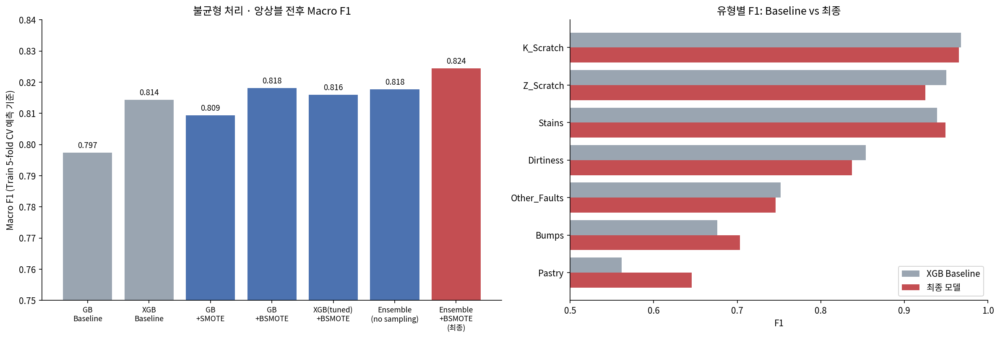

이미 본 생산 조건 기준에서는 최종 모델이 다른 후보들보다 확실히 앞섭니다. 그런데 처음 보는 생산 조건 기준으로 바꾸면 순위가 흔들립니다. 최종 모델은 Baseline보다는 여전히 낫지만 차이가 크게 줄어들고, BorderlineSMOTE를 쓴 GB + XGBoost 후보와 비슷한 수준이 됩니다. 즉 **"가장 좋은 모델"은 어떤 상황을 기준으로 삼느냐에 따라 달라집니다.**

팀은 프로젝트의 공식 기준(이미 본 조건)으로 최종 모델을 정했습니다. 그리고 처음 보는 조건에서 차이가 줄어드는 이유를 추적한 결과, 파생변수 하나를 빼는 것만으로 **이미 본 조건의 성능은 최종 모델과 같은 수준으로 유지하면서 처음 보는 조건에서는 가장 높은 구성**(그림 오른쪽 끝)을 찾았습니다. 자세한 내용은 8.4절에 있습니다.

> **→ 주장 ②, ③을 뒷받침합니다.**

### 7.5 Feature Engineering (파생변수)

**어떤 기준으로 만들었나**

6.1절에서 상위권 변수는 대부분 "크기"였는데, 크기가 비슷해도 종류가 다른 결함이 문제였습니다. 그래서 크기 자체보다 **크기들 사이의 관계(모양)**, 밝기의 대비, 강판 안에서의 상대 위치를 담는 변수를 만들었습니다. 모든 파생변수는 한 행 안의 값만으로 계산하거나(대부분), 학습 fold 안에서만 집계해서(생산 조건별 결함 수) 누수가 생기지 않게 했습니다.

| 묶음 | 파생변수 | 어떤 질문에 답하는가 | 어떻게 계산했나 |
|---|---|---|---|
| 모양 | `compactness` | 면적에 비해 테두리가 긴가 (가늘고 복잡한 결함일수록 큼) | 가로·세로 둘레의 합 ÷ 면적의 제곱근 |
| 모양 | `perimeter_ratio_log` | 가로·세로 중 어느 쪽으로 길쭉한가 | 가로 둘레와 세로 둘레의 비를 로그로 변환 |
| 모양 | `x_straightness` | 가로 윤곽이 들쭉날쭉한가 | 가로 둘레 ÷ 네모 칸의 가로 길이 |
| 밝기 | `lum_range` | 가장 밝은 곳과 어두운 곳의 차이 | 최대 밝기 − 최소 밝기 |
| 밝기 | `lum_contrast` | 밝기 차이가 상대적으로 뚜렷한가 | 밝기 차이 ÷ 밝기 합 |
| 밝기 | `lum_mean_position` | 평균 밝기가 어두운 쪽과 밝은 쪽 중 어디에 가까운가 | (평균 밝기 − 최소 밝기) ÷ 밝기 차이 |
| 위치 | `x_center_rel` | 강판 폭 안에서 어디쯤에 있나 | 결함 가로 중심 ÷ `Length_of_Conveyer` |
| 위치 | `x_center_dist` | 가운데에서 얼마나 떨어졌나 | 위 값이 한가운데에서 벗어난 정도 |
| 강판 맥락 | `plate_defect_count` | 같은 생산 조건에서 결함이 얼마나 많이 나왔나 | 학습 데이터에서 같은 강종·두께·폭 조합의 결함 수 (처음 보는 조합은 0) |
| 강판 맥락 | `thickness_per_conveyer` | 폭에 비해 두꺼운 강판인가 | `Steel_Plate_Thickness` ÷ `Length_of_Conveyer` |

**세 팀원의 결과가 서로 달랐던 이유**

| 담당 | 파생변수 | 비교 방법 | 결과 |
|---|---|---|---|
| 박태상 | 19개 | 같은 설정에서 추가 전후 | 트리 모델은 변화가 흔들림 폭 안. 로지스틱 회귀만 개선 |
| 서윤하 | 3 ~ 8개 | 같은 설정, 일반 CV와 그룹 CV | 일반 CV는 흔들림 안, 그룹 CV는 소폭 개선 |
| 김태겸 | 10개 | 추가 후 **처음부터 다시 튜닝** | +0.0176. 다시 튜닝하지 않으면 오히려 −0.0047 |

세 결과는 모순이 아닙니다. 트리 모델은 변수를 여러 번 잘라 가며 "면적 ÷ 둘레" 같은 관계를 스스로 흉내 낼 수 있고, 원본에 이미 비율 지표가 여럿 들어 있습니다(5.2절). 그래서 **파생변수를 그냥 더하기만 하면 트리 모델에게는 거의 새로운 정보가 아니고**, 변수가 늘어난 만큼 설정을 다시 맞춰 줬을 때 비로소 효과가 났습니다. 반대로 나누기를 스스로 못 하는 로지스틱 회귀는 파생변수만으로도 좋아졌습니다.

**같은 설정에서 파생변수만 빼 본 결과 (팀 검증)**

최종 모델의 설정은 그대로 두고 입력 변수만 바꿔서, 파생변수 자체의 효과를 분리했습니다.

| 입력 변수 | 일반 CV (반복 평균) | 그룹 CV (반복 평균) |
|---|---:|---:|
| 원본 26개 | 0.8270 | 0.7696 |
| 원본 + 파생 10개 (최종 모델) | 0.8405 | 0.7400 |
| 원본 + 파생 9개 (`plate_defect_count` 제외) | 0.8397 | **0.7802** |

**결론: 파생변수와 재튜닝을 함께 적용한 것이 이번 프로젝트에서 가장 큰 개선이었습니다.** 단계별로 보면 이 단계의 개선 폭(+0.0176)이 가장 컸습니다. 설정을 그대로 두고 입력 변수만 바꿔 봐도 **이미 본 조건(일반 CV)에서는** 파생변수가 있는 쪽이 꾸준히 높아(15번 중 13번), 재튜닝 덕만 본 것이 아니라 파생변수 자체도 정보를 더한 것으로 보입니다.

여기서 중요한 교훈은 **"파생변수를 더했으면 설정도 다시 맞춰야 한다"** 는 것입니다. 변수를 열 개 더해 놓고 예전 설정을 그대로 쓰면 오히려 점수가 떨어졌습니다. 변수가 늘어나면 트리가 한 번에 볼 변수의 비율, 적당한 깊이, 학습 속도가 모두 달라지기 때문입니다. 팀원마다 파생변수의 효과가 다르게 나왔던 것도 재튜닝을 했는지 여부로 설명됩니다.

한 가지 단서는 남습니다. 파생변수의 이득은 **이미 본 생산 조건에서 뚜렷하고, 처음 보는 조건에서는 오히려 줄어듭니다.** Ablation 결과, 그룹 CV 성능 하락에는 `plate_defect_count`의 영향이 가장 크게 나타났고, 이 변수만 빼면 이미 본 조건의 점수를 유지하면서 처음 보는 조건의 점수가 크게 회복됩니다(8.4절). 모양·밝기·위치 파생변수 아홉 개는 그대로 두어도 됩니다.

> **→ 주장 ②, ③을 뒷받침합니다.**

### 7.6 과적합 검증

"트리를 수백 개씩 쌓은 모델 세 개를 묶었으니 데이터를 외운 것 아니냐"는 의심을 확인하기 위해 네 가지를 점검했습니다.

**① 학습 점수와 검증 점수의 차이**

| 모델 | 학습 데이터 F1 | 검증 데이터 F1 | 차이 |
|---|---:|---:|---:|
| ExtraTrees | 1.0000 | 0.8180 | 0.1820 |
| Random Forest | 1.0000 | 0.8125 | 0.1875 |
| GBM | 1.0000 | 0.8401 | 0.1599 |
| **소프트보팅 (최종)** | 1.0000 | **0.8441** | **0.1559** |

학습 점수가 만점인 것은 트리 모델이 가지를 충분히 나누면 학습 데이터를 전부 맞히는 구조이기 때문이라, 그 자체로 과적합의 증거는 아닙니다. 판단은 **검증 점수가 어떻게 움직이는지**로 해야 합니다.

**② 학습곡선 — 데이터를 늘리면 어떻게 되나**

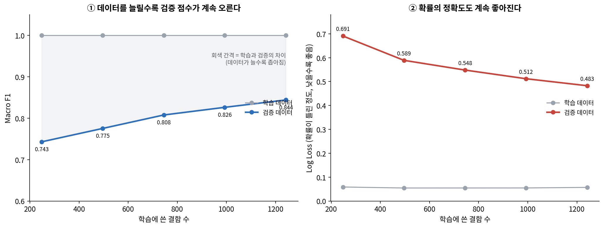

| 학습 데이터 비율 | 검증 Macro F1 | 검증 Log Loss | 학습−검증 차이 |
|---|---:|---:|---:|
| 20% | 0.7430 | 0.6907 | 0.2570 |
| 100% | 0.8441 | 0.4827 | 0.1559 |

데이터를 늘릴수록 검증 점수는 계속 오르고, 확률 예측의 오차를 보는 손실(Log Loss)은 계속 내려가며, 학습과 검증의 차이도 줄어들었습니다. 이는 **현재 모델에 학습-검증 성능 차이는 존재하지만, 데이터가 증가하면서 일반화 성능이 개선되고 있음을 보여줍니다.** 따라서 추가 데이터를 확보할 경우 성능이 더 개선될 여지가 있다고 해석할 수 있습니다.

**③ 손실 곡선 — 트리를 더 쌓을수록 어떻게 되나**

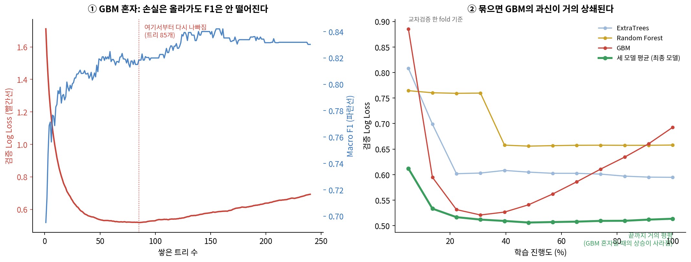

구성 모델 중 GBM 하나만 보면, 트리를 일정 개수 이상 쌓은 뒤부터 검증 손실이 다시 올라갑니다. 이미 맞히던 결함뿐 아니라 틀린 결함에도 점점 더 강하게 확신하게 되는 **"확률 과신"** 현상입니다. 그런데 F1은 같은 구간에서 떨어지지 않습니다. 어느 유형을 고르는지는 그대로이고 확신의 크기만 커지기 때문입니다. 세 모델을 묶은 최종 모델에서는 이 상승이 거의 사라져 **끝까지 평평하게 유지됩니다.** 배깅 계열 두 모델의 부드러운 확률이 GBM의 과신을 눌러 준 결과입니다. 교차검증 전체로 보면 학습이 끝나는 지점에서 검증 손실이 가장 낮았습니다.

**④ 정답을 섞어 보기 · 복잡도를 바꿔 보기**

| 점검 | 과적합·누수가 있다면 | 실제 결과 |
|---|---|---|
| 정답을 무작위로 섞고 똑같이 학습 | 점수가 남아 있음 (어딘가에서 정답이 새고 있다는 뜻) | 무작위로 찍는 수준까지 떨어짐 |
| 트리를 아주 단순하게 ~ 아주 복잡하게 바꿔 가며 검증 | 단순하게 할수록 검증 점수가 올라감 | 단순할수록 떨어지고, 채택한 설정 근처부터는 평평함 |

**결론**

| 측면 | 판단 |
|---|---|
| 분류 성능 (어느 유형을 고르나) | 학습-검증 격차는 존재하지만, 데이터 증가에 따라 검증 성능과 격차가 개선됨 |
| 검증 절차의 누수 | 정답 무작위화 실험에서는 명백한 Target 누수 징후가 확인되지 않음 |
| 남는 위험 | 절차가 아니라 **데이터 구조**(같은 조건·같은 롤의 쌍둥이 결함)에서 오는 낙관 → 8.4절 |

> **→ 주장 ②를 뒷받침합니다.**

---

## 8. 최종 모델 및 결과 분석

### 8.1 최종 모델 선정

| 항목 | 내용 |
|---|---|
| 최종 모델 | ExtraTrees + Random Forest + GBM 소프트보팅 (세 모델의 예측 확률을 같은 비중으로 평균) |
| 불균형 처리 | 클래스 가중치 (ExtraTrees: 균형 가중치, GBM: 균형 샘플 가중치, Random Forest: 없음) |
| 입력 변수 | 원본 26개 + 파생변수 10개 = 36개 |
| 스케일링 | 없음 (트리 계열) |

**주요 하이퍼파라미터**

| 구성 모델 | 설정 |
|---|---|
| ExtraTrees | 트리 438개, 최대 깊이 15, 분기마다 변수 70% 사용 |
| Random Forest | 트리 483개, 깊이 제한 없음, 분기마다 변수 30% 사용 |
| GBM | 반복 240회, 학습률 0.0879, 최대 깊이 4, 데이터 90.8% 표본 사용, 분기마다 변수 50% 사용, 잎 최소 5건 |

불균형 처리는 ExtraTrees에 균형 클래스 가중치를, GBM에는 같은 취지의 샘플 가중치(가장 많은 유형의 건수 ÷ 해당 유형의 건수)를 적용했습니다. Random Forest는 튜닝 결과 가중치를 쓰지 않는 쪽이 선택되었습니다.

**선정 이유**

| 근거 | 내용 |
|---|---|
| 미리 정한 기준 충족 | "반복 교차검증 평균이 더 높고, 15번 중 과반에서 이전 최고 모델을 이김" |
| 교차검증에서 1위 | 선정 당시 후보 중 일반 CV, 반복 CV가 가장 높음(7.4절). 선정 후 확인한 Test에서도 가장 높았음 |
| 다양성 | 부스팅(GBM)과 배깅(ExtraTrees·RF)은 틀리는 결함이 서로 달라, 평균하면 실수가 상쇄됨. 비슷한 부스팅끼리 묶은 조합은 GBM 하나보다도 낮았음 |

**다른 팀원 모델과 합치면 더 좋아질까**

| 비교 | Macro F1 | 비고 |
|---|---:|---|
| LightGBM + XGBoost + ExtraTrees | 0.8316 | 박태상 환경에서 재측정 |
| 두 앙상블의 구성 모델 6개로 만든 63가지 조합 중 1등 | 0.8381 | 모든 조합을 재 보고 고른 값 |
| **ET + RF + GBM (최종)** | **0.8432** | 같은 환경 재측정 (공식 값 0.8441과의 차이는 실행 환경 차이) |

모든 조합 중 1등을 고르는 방식은 "여러 번 재서 가장 잘 나온 것"이라 운이 섞입니다. 조합을 고를 때 쓰지 않은 fold로 따로 점수를 매겨 보니, **fold마다 1등 조합이 모두 달랐고** 최종 모델보다 나아지지 않았습니다. 진짜 최적 조합이 있다면 어느 fold에서 골라도 비슷한 구성이 뽑혀야 합니다. 두 앙상블이 **같은 결함에서 같이 틀리기 때문에** 섞어도 얻을 것이 없었고, 이는 남은 한계가 모델이 아니라 데이터 쪽에 있다는 신호입니다(8.2절).

### 8.2 최종 모델 평가

**Test 성능**

| Macro F1 | Accuracy | Macro Precision | Macro Recall | Weighted F1 | Macro ROC-AUC |
|---:|---:|---:|---:|---:|---:|
| **0.8324** (95% 신뢰구간 0.7904 ~ 0.8686) | 0.8098 | 0.8486 | 0.8182 | 0.8123 | 0.9686 |

| 비교 | 일반 CV | 반복 CV | Test |
|---|---:|---:|---:|
| 최종 모델 Macro F1 | 0.8441 | 0.8389 | 0.8324 |

| 유형 | Other_Faults | Bumps | K_Scratch | Z_Scratch | Pastry | Stains | Dirtiness |
|---|---:|---:|---:|---:|---:|---:|---:|
| Test F1 (최종) | 0.7714 | 0.7421 | 0.9536 | 0.9730 | **0.5455** | 0.8889 | 0.9524 |
| Test F1 (Baseline XGBoost) | — | — | — | — | 0.5846 | — | 0.8182 |
| Test 건수 | 135 | 81 | 78 | 38 | 32 | 14 | 11 |

Test 점수는 교차검증 점수보다 조금 낮지만 신뢰구간 안에 있어, **교차검증이 Test 성능을 크게 부풀리지 않았다**고 볼 수 있습니다. 다만 Test도 무작위로 나눈 것이라 Train과 같은 생산 조건의 결함이 대부분이므로, 이 일치는 "이미 본 조건"에 대한 일치입니다(8.4절).

Stains와 Dirtiness는 Test 건수가 매우 적어서 한 건만 틀려도 점수가 크게 움직입니다. 이 두 유형의 점수 변화는 신뢰구간과 함께 조심스럽게 읽어야 합니다.

**Confusion Matrix**

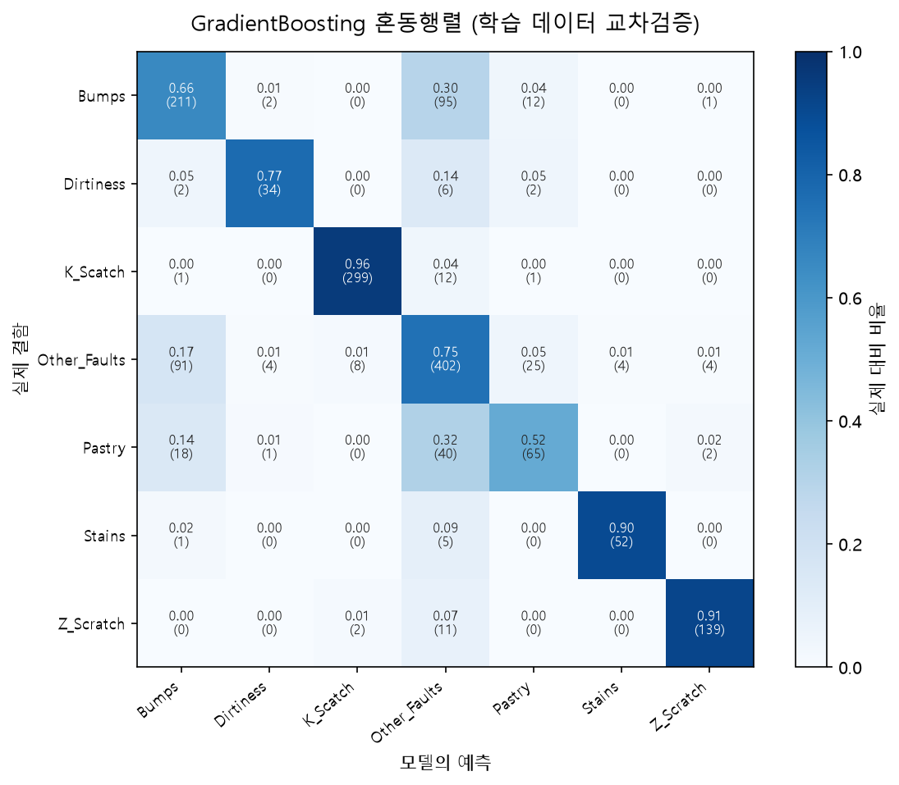

| 오류 종류 | Test 건수 |
|---|---:|
| 전체 오분류 | 74 |
| Bumps ↔ Other_Faults | 32 |
| Other_Faults ↔ Pastry | 21 |
| 소수 유형을 Other_Faults·Bumps로 놓침 | 17 |
| Other_Faults를 소수 유형으로 잘못 경보 | 12 |

**오류는 대부분 세 유형 안에서 돈다**

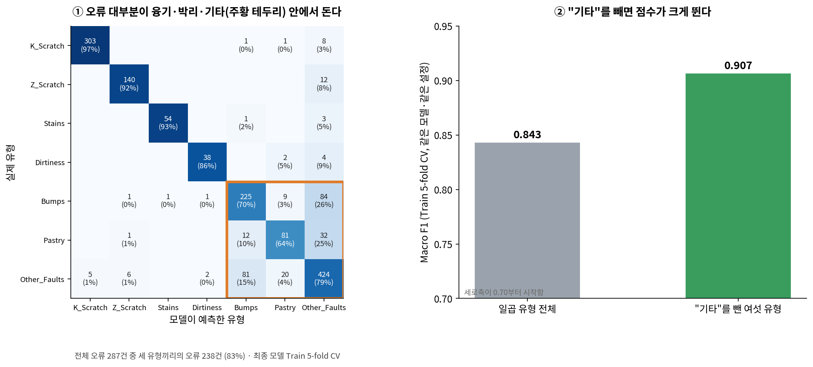

①은 Train 교차검증에서 최종 모델(재현)이 어디서 틀리는지를 보여 줍니다. 오류가 **Bumps·Pastry·Other_Faults 세 유형이 만나는 칸에 대부분** 몰려 있고, 나머지 칸은 거의 비어 있습니다. 모델이 전반적으로 흔들리는 것이 아니라 주로 이 세 유형의 경계에서 무너진다는 뜻입니다.

왜 하필 이 셋일까요? "Other_Faults"는 다른 여섯 유형에 속하지 않는 결함을 묶은 범주입니다. 따라서 내부에 약한 Bumps, 초기 단계의 Pastry, 분류하기 애매한 결함 등과 같이 서로 다른 특성을 가진 결함이 포함되어 있을 가능성이 있습니다. 정답 이름 자체가 일관되지 않으면 모델이 아무리 좋아져도 넘을 수 없는 천장이 생깁니다. 이를 확인하기 위해 ②처럼 **"Other_Faults"를 빼고 나머지 여섯 유형만 분류**해 봤습니다. 모델과 설정은 그대로인데 점수가 크게 오릅니다. 이 결과는 **Other_Faults가 현재 모델의 주요 혼동 원인 중 하나**임을 보여 줍니다. 다만 Other_Faults 내부에 실제로 여러 하위 결함이 섞여 있는지는 현재 데이터만으로 확인할 수 없습니다. 따라서 정답 체계의 내부 이질성이 성능을 제한했을 가능성을 가설로 두고 추가 검증할 필요가 있습니다.

**활용 시나리오에서 고려할 오류**

| 오류 | 활용 시 예상되는 문제 | 
|---|---|
| Bumps·Pastry를 **Other_Faults로** 분류 (놓침) | 특정 결함 유형을 놓쳐 해당 결함에 대한 추가 점검이 이루어지지 않을 가능성이 있음 |
| Other_Faults를 Bumps·Pastry로 분류 (잘못된 경보) | 실제 해당 결함이 아닌 사례가 추가 점검 대상으로 포함될 가능성이 있음 |

데이터에는 결함 유형별 오분류 비용이나 실제 설비 점검 과정에 대한 정보가 포함되어 있지 않으므로, 어느 오류가 더 심각한지는 본 데이터만으로 판단할 수 없습니다. 다만 **결함 유형에 따라 후속 점검이 이루어지는 활용 상황을 가정하면**, Bumps·Pastry·Other_Faults 간 오분류는 별도의 확인이 필요한 영역으로 볼 수 있습니다.
따라서 실제 활용 시에는 **모델이 Bumps·Pastry·Other_Faults로 예측했거나 확신이 낮은 결함을 검사자가 다시 확인하는 2차 검토 경로**를 고려할 수 있습니다.

**한계: Pastry와 Other_Faults의 구분이 일관되게 어려웠다**

Pastry는 어떤 모델을 써도 가장 낮았습니다. Baseline도, 불균형 처리를 한 후보도, 최종 모델도 모두 Pastry에서 막혔습니다. 모델을 바꿔서 해결될 문제였다면 여러 모델 중 하나는 눈에 띄게 잘했어야 합니다.

여러 모델과 판정 기준 조정에서도 Pastry와 Other_Faults의 혼동이 반복되었으므로, **모델 자체의 한계뿐 아니라 현재 정답 체계의 영향도 함께 검토할 필요가 있다고 판단했습니다.** 근거는 세 가지입니다. Pastry를 틀린 경우가 거의 전부 Other_Faults와 뒤바뀌는 형태이고, "Other_Faults"를 빼면 점수가 크게 뛰며(위 ②), 판정 기준을 Pastry 쪽으로 옮기는 실험은 모두 실패했습니다(8.5절). 즉 현재 제공된 변수만으로는 Pastry와 Other_Faults를 구분하는 경계가 충분히 뚜렷하지 않은 것으로 나타났습니다. 만약 "Other_Faults" 안에 초기 단계의 Pastry나 약한 Pastry가 섞여 있다면, 이러한 혼동의 한 원인이 될 수 있습니다.

그래서 Pastry를 제대로 잡으려면 추가적인 모델 개선과 함께 **데이터와 정답 체계를 점검할 필요가 있습니다.** "Other_Faults"에 무엇이 들어 있는지 군집 분석으로 확인하고, 현장과 함께 정답 체계를 다시 정하거나, 수치만으로는 구분되지 않는 표면 질감을 볼 수 있는 이미지를 확보하는 것이 순서입니다. 당장은 Pastry로 예측된 결함과 확신이 낮은 결함을 검사자가 다시 보게 하는 쪽이 현실적입니다.

> **→ 주장 ①을 뒷받침합니다.**

### 8.3 Feature Importance 및 모델 해석

중요도는 **순열 중요도(Permutation Importance)** 로 쟀습니다. 변수 하나의 값을 무작위로 섞었을 때 점수가 얼마나 떨어지는지 보는 방법입니다. 트리 모델이 기본으로 주는 중요도는 값의 종류가 많은 변수를 부풀리는 경향이 있어서, 실제 예측에 얼마나 쓰였는지를 직접 재는 방법을 택했습니다.

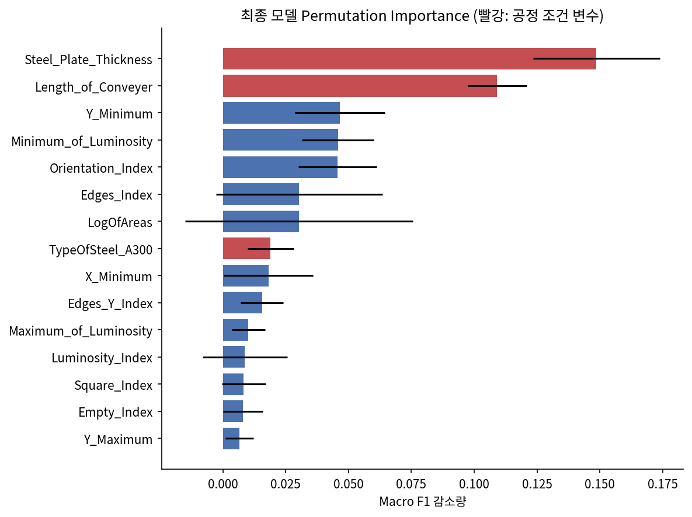

| 순위 | 변수 | 묶음 | 섞었을 때 Test Macro F1 감소량 |
|---:|---|---|---:|
| 1 | `Steel_Plate_Thickness` | 공정 조건 | 0.150 |
| 2 | `Length_of_Conveyer` | 공정 조건 | 0.127 |
| 3 | `TypeOfSteel_A300` | 공정 조건 | 0.098 |
| 4 | `X_Maximum` | 위치 | 0.034 |
| 5 | `X_Minimum` | 위치 | 0.033 |
| 6 | `Y_Perimeter` | 결함 측정값 | 0.018 |

중요도는 **원본 26개 열**을 기준으로 쟀습니다. 파생변수는 이 열들로 계산되므로, 예를 들어 `Steel_Plate_Thickness`를 뒤섞으면 그것으로 만든 파생변수까지 함께 망가집니다. 즉 위 수치는 "그 정보를 통째로 못 쓰게 되면 얼마나 손해인가"를 뜻합니다.

**해석**

- **상위 세 개가 모두 공정 조건**이고, 1위 `Steel_Plate_Thickness`의 감소량(0.150)은 4위 변수 `X_Maximum`의 감소량(0.034)의 네 배가 넘습니다. 모델에게는 결함이 어떻게 생겼는지보다 **어느 강판에서 나왔는지**가 훨씬 강한 단서입니다. 6.1절 발견 2·3에서 데이터만 보고 예상한 것과 같은 결과입니다.
- 그다음은 결함의 가로 위치입니다. K_Scratch가 강판 가장자리에 몰려 있다는 사실(6.1절 발견 4)을 모델이 쓰고 있는 것으로 보입니다.
- 결함 자체의 측정값(면적·둘레·밝기·모양)은 모두 하위권입니다. 하나씩 빼도 큰 타격이 없다는 뜻이지, 쓸모없다는 뜻은 아닙니다. 비슷한 변수가 여럿이라 하나를 망가뜨려도 다른 변수가 대신하기 때문입니다.
- 중요도는 "모델이 이 정보를 얼마나 활용했나"이지 **"이 변수가 결함의 원인이다"라는 뜻이 아닙니다.** 두께가 결함을 만든다는 것이 아니라, 두께를 알면 어떤 제품을 만들던 중인지 알 수 있다는 의미입니다.

> **→ 주장 ③을 뒷받침합니다.**
### 8.4 일반화 점검: 처음 보는 생산 조건에서도 통할까

6.1절에서 같은 생산 조건의 결함이 Train과 Test에 섞여 있다는 것을 확인했습니다. 그렇다면 지금까지의 점수는 "이미 본 조건의 다른 결함"을 맞히는 성능입니다. 실제 공장에서 새 규격의 강판을 생산하기 시작하면 모델은 **처음 보는 조건**을 만나게 됩니다. 이 상황을 흉내 내기 위해 **그룹 교차검증**을 했습니다. 같은 생산 조건 묶음(강종·두께·폭)은 학습과 검증 중 한쪽에만 들어가도록 나누는 방법입니다.

팀원이 Baseline과 BorderlineSMOTE 후보에서 이 점검을 먼저 했고, 취합 단계에서 최종 모델을 재현해 같은 방식으로 다시 쟀습니다. 재현한 Baseline 점수가 팀원의 기록과 같게 나와, 분할 방식이 같다는 것을 확인했습니다.

**변수 묶음별 일반 CV와 그룹 CV (반복 교차검증 평균)**

| 모델 / 입력 변수 | 일반 CV | 그룹 CV | 하락폭 |
|---|---:|---:|---:|
| 공정 조건 3개만 (강종·두께·폭) | 0.6725 ± 0.0264 | 0.5591 ± 0.0644 | 0.1133 |
| 공정 조건 제외 (생김새·위치만) | 0.7633 ± 0.0255 | 0.7021 ± 0.0453 | 0.0611 |
| Baseline XGBoost | 0.8143 ± 0.0226 | 0.7277 ± 0.0364 | 0.0866 |
| 최종 모델 − 파생변수 전체 | 0.8270 ± 0.0222 | 0.7696 ± 0.0364 | 0.0574 |
| **최종 모델** | 0.8405 ± 0.0222 | 0.7400 ± 0.0427 | 0.1005 |
| 개선안: 최종 모델 − `plate_defect_count` | 0.8397 ± 0.0200 | 0.7802 ± 0.0424 | 0.0595 |
| GB + XGBoost + BorderlineSMOTE | 0.8219 ± 0.0181 | 0.7440 ± 0.0231 | 0.0779 |

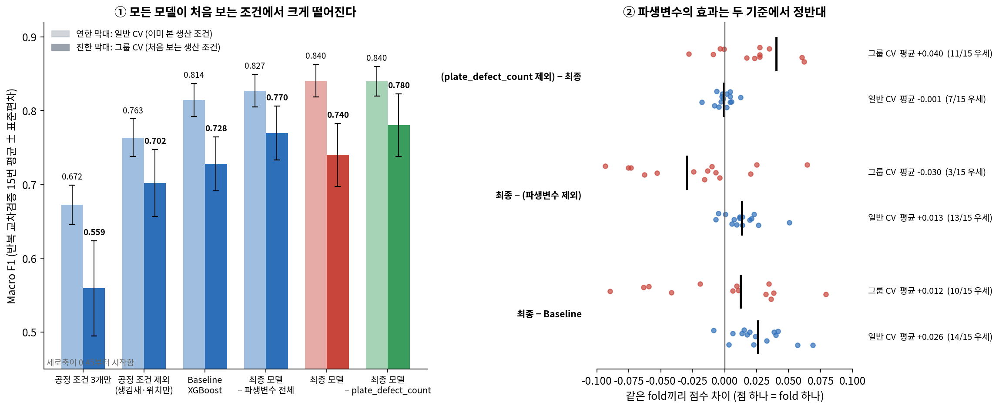

**같은 fold끼리 짝지어 비교**

| 비교 | 일반 CV: 평균 차이 | 일반 CV: 앞쪽이 이긴 횟수 | 그룹 CV: 평균 차이 | 그룹 CV: 앞쪽이 이긴 횟수 |
|---|---:|---:|---:|---:|
| 최종 모델 vs Baseline | +0.0261 | 14/15 | +0.0123 | 10/15 |
| 최종 모델 vs 파생변수 제외 | +0.0135 | 13/15 | -0.0297 | 3/15 |
| `plate_defect_count` 제외 vs 최종 모델 | -0.0008 | 7/15 | +0.0403 | 11/15 |

**Y 좌표를 빼면**

| 입력 변수 | 일반 CV | 그룹 CV |
|---|---:|---:|
| Y 좌표 포함 (최종 모델) | 0.8405 | 0.7400 |
| Y 좌표 제외 | 0.8178 | 0.7177 |
| 차이 | -0.0227 | -0.0223 |

**해석**

- **모든 모델이 처음 보는 조건에서 크게 떨어집니다.** 하락폭이 모델 사이의 차이보다 훨씬 큽니다. 일반 교차검증이 "처음 보는 조건"의 성능을 부풀린다는 문제는 모델을 바꿔서 해결되지 않습니다.
- **최종 모델의 우위는 이미 본 조건에서 훨씬 뚜렷합니다.** 짝 비교를 보면 이미 본 조건에서는 거의 모든 fold에서 Baseline을 이기지만, 처음 보는 조건에서는 이기는 비율이 절반을 조금 넘는 수준으로 줄어듭니다. 우위가 사라지지는 않지만 상당 부분이 깎입니다.
- **파생변수는 두 기준에서 정반대로 작동합니다.** 이미 본 조건에서는 점수를 올리고, 처음 보는 조건에서는 오히려 깎습니다. Ablation 결과, 이러한 성능 하락은 주로 `plate_defect_count`에서 발생했습니다. 이 변수는 "학습 데이터에서 같은 생산 조건의 결함이 몇 건이었나"를 세는데, 이미 본 조건에서는 그 조건의 이름표처럼 쓰이고 처음 보는 조건에서는 항상 0이 되어 잘못된 단서를 줍니다.
- **이 변수 하나만 빼면 양쪽을 다 얻습니다.** 이미 본 조건의 점수는 사실상 그대로이고(차이가 반올림 수준), 처음 보는 조건의 점수는 크게 올라 비교한 모든 모델 중 가장 높아집니다. 나머지 파생변수 아홉 개는 그대로 두어도 됩니다.
- **공정 조건을 통째로 빼면 두 기준 모두 나빠집니다.** 강종처럼 처음 보는 조건에서도 통하는 진짜 정보가 들어 있기 때문입니다. 문제는 "공정 조건"이 아니라 **특정 조건 조합을 외우게 만드는 변수**입니다. 반대로 공정 조건 세 개만 쓴 모델도 결함 모양을 하나도 보지 않고 꽤 높은 점수를 내는데, 이는 모델 점수의 적지 않은 부분이 "어느 강판인가"에서 나온다는 뜻입니다.
- **Y 좌표를 빼면 두 조건에서 비슷한 폭으로 떨어집니다.** 이미 본 조건과 처음 보는 조건의 하락폭이 거의 같아, Y가 주는 도움은 "이미 본 강판의 어느 구간인가"라는 지름길에만 기대는 것으로 보기 어렵습니다. 6.1절 발견 4에서 세운 가설(Y가 같은 강판 안의 구간을 알려주는 맥락으로 쓰인다)은 이 실험으로는 뒷받침되지 않았습니다.

**그래서 어떻게 하나:** 팀의 공식 최종 모델은 프로젝트 기준(이미 본 조건)으로 정한 그대로 둡니다. 다만 실제 공장처럼 새 규격이 계속 들어오는 환경이라면 `plate_defect_count`를 뺀 구성이 더 안전하므로, 재학습과 Test 평가를 거쳐 교체하는 것을 개선안으로 제시합니다(10.2절).

**이 점검의 한계**

| 한계 | 내용 |
|---|---|
| 그룹을 추정으로 정함 | 데이터에 강판 번호가 없어 강종·두께·폭이 같으면 같은 묶음으로 봤음 |
| 그룹 CV도 여전히 낙관적일 수 있음 | 6.1절 발견 4처럼 폭이 조금 다른 묶음도 같은 롤을 거친 같은 라인일 수 있음 |
| 측정 환경 차이 | 최종 코드를 그대로 썼지만 실행 환경이 달라, 같은 설정에서도 소수점 셋째 자리에서 차이가 날 수 있음. 비교는 모두 같은 환경 안에서만 함 |

> **→ 주장 ③, ④를 뒷받침합니다.**

### 8.5 기각한 실험

결과가 좋지 않아 채택하지 않았지만, 같은 실수를 반복하지 않기 위해 기록합니다.

| 시도 | 세운 가설 | 결과 | 판단 |
|---|---|---|---|
| 유형별 확률에 가중치 곱하기 | 드문 유형 쪽 확률을 키우면 Macro F1이 오름 | 검증 데이터에서는 올랐지만 손대지 않은 데이터에서는 개선 없음 | 기각 |
| 2단계 전담 모델 | 헷갈리는 세 유형만 따로 학습한 모델이 더 잘 가름 | 같은 구간에서 전체 모델보다 낮음 | 기각 |
| 판정 기준(임계값) 조정 | Pastry·Bumps는 조금만 그럴듯해도 그 유형으로 판정하면 덜 놓침 | 중첩 교차검증에서 효과 없음. fold마다 "최적" 기준이 제각각 | 기각 |
| 두 앙상블의 구성 모델 섞기 | 서로 다른 모델을 섞으면 더 좋아짐 | fold마다 1등 조합이 다르고 최종 모델보다 나아지지 않음 | 기각 |
| Stacking | 모델들의 예측을 또 다른 모델로 묶으면 더 좋아짐 | 데이터가 적어 묶는 모델이 불안정, 소프트보팅보다 낮음 | 기각 |
| 언더샘플링 | 많은 유형을 줄여 균형을 맞추면 좋아짐 | 학습 데이터가 크게 줄어 성능 급락 | 기각 |

**실패에서 얻은 것**

| 실패 | 배운 점 |
|---|---|
| 확률 가중치·임계값 조정 | 검증 점수를 보고 무언가를 조정하면 검증 데이터의 우연까지 함께 맞추게 된다. 조정에 쓰지 않은 데이터로 다시 확인해야 한다 (중첩 교차검증) |
| 임계값 조정 | Pastry·Bumps는 확률이 아슬아슬해서 틀리는 게 아니라 애초에 Other_Faults와 구분이 안 되어서 틀린다. 경계선의 **위치**가 아니라 경계선 **자체**가 흐린 것이 문제다 |
| 2단계 전담 모델 | 전체 모델은 "이건 K_Scratch·Z_Scratch도 Stains도 아니다"라는 소거 정보도 함께 배운다. 문제를 쪼개는 것이 항상 이득은 아니다 |

> **→ 주장 ①을 뒷받침합니다.**

---

## 9. Streamlit 대시보드

분석 결과와 최종 모델 선정 근거를 한 화면에서 확인하기 위한 결과 공유용 대시보드입니다. **현재 제작 중이며, 아래는 구현 중인 화면 구성입니다.**

### 9.1 주요 기능

| 화면 | 보여 주는 것 | 사용하는 파일 |
|---|---|---|
| 데이터 | 결함 유형별 건수, 건수와 F1의 관계 | `figures/target_distribution.png` |
| 데이터 구조 | 생산 조건 묶음 구조, 롤 마크 주기 | `figures/process_condition.png`, `figures/roll_mark_period.png` |
| 모델 비교 | 단계별 개선, 불균형 처리 전후 비교, 후보 모델 비교 | `results/model_scores.csv`, `figures/improvement_steps.png`, `figures/imbalance_comparison.png` |
| 최종 모델 평가 | Test 성능, 유형별 F1, Confusion Matrix | `models/Taegyeom_final_model_trained.pkl` |
| 일반화 점검 | 일반 CV와 그룹 CV의 차이, 활용 시 주의사항 | `figures/generalization.png` |
| 예측 체험 | 측정값을 입력하면 유형별 확률과 "검사자 재확인 필요" 여부 표시 | `models/Taegyeom_final_model_trained.pkl` |

### 9.2 실행 화면

*대시보드 완성 후 실행 화면을 캡처해 `figures/dashboard.png`로 첨부합니다.*

---

## 10. 결론 및 회고

### 10.1 프로젝트 주요 결과

| 목표 | 결과 | 달성 |
|---|---|---|
| 일곱 유형 분류 모델 개발 | ET + RF + GBM 소프트보팅 | 달성 |
| Baseline보다 높은 성능 | 일반 CV, 반복 CV, Test 모두 Baseline보다 높음 | 달성 (이미 본 생산 조건 기준) |
| 불균형 처리 전후 비교 | 다섯 가지 방법을 같은 조건에서 비교, 개선의 성격까지 확인 | 달성 |
| 처음 보는 생산 조건에서의 성능 | Baseline보다는 낫지만 우위가 크게 줄어듦 | 한계로 확인, 개선안 도출 |

**주장별로 정리하면**

- **주장 ①** 이 데이터의 어려움은 건수가 적은 유형이 아니었습니다. Bumps·Pastry·Other_Faults 세 유형이 서로 닮았고, 특히 Other_Faults가 주요 혼동 원인으로 나타났습니다. Other_Faults 내부의 이질성이 성능을 제한했을 가능성이 있으나, 실제로 여러 하위 결함이 섞여 있는지는 추가 검증이 필요합니다. 그래서 불균형 처리의 주된 효과는 판별력의 뚜렷한 증가보다는 **세 유형 사이의 판정 경계를 이동시키는 형태로 나타났으며**, Pastry는 여러 모델에서 일관되게 낮은 성능을 보였습니다.
- **주장 ②** 클래스 가중치, 튜닝, 파생변수와 재튜닝, 앙상블을 차례로 거쳐 Baseline보다 나아졌고, 이 개선은 다른 분할과 Test에서도 유지되었습니다. 학습곡선과 정답 무작위화 실험에서는 단순한 Target 누수나 학습 데이터 암기만으로 성능이 설명되지는 않았습니다.
- **주장 ③** 모델은 결함의 생김새뿐 아니라 강종·두께·폭과 같은 생산 조건 정보를 예측에 크게 활용했습니다. 그 결과 처음 보는 생산 조건에서는 최종 모델의 우위가 크게 줄었고, 원인을 추적해 보니 생산 조건을 이름표처럼 외우게 만드는 파생변수 하나였습니다. 그 변수를 빼면 이미 본 조건의 성능은 그대로 유지하면서, 처음 보는 조건에서는 가장 좋은 구성이 됩니다.
- **주장 ④** 같은 생산 조건의 유사한 결함이 반복되는 구조 때문에, 무작위로 나눈 교차검증과 Test는 "이미 본 조건" 기준의 성능을 보여 줍니다. 이 모델을 실제로 쓰려면 이 점을 전제로 해야 합니다.

### 10.2 한계점 및 개선 방향

**데이터 측면**

| 한계 | 영향 | 개선 방향 |
|---|---|---|
| Other_Faults의 내부 이질성 가능성 | Bumps·Pastry와의 혼동, 성능의 천장 | Other_Faults를 군집 분석 및 현장 라벨 확인을 통해 하위 유형 존재 여부 검증 |
| 강판·코일 번호가 없음 | 그룹을 추정으로 정할 수밖에 없음 | 실제 생산 데이터로 같은 코일 단위 분할 검증 |
| 측정값만 있고 이미지가 없음 | Bumps·Pastry처럼 수치가 겹치는 결함을 질감으로 구분할 수 없음 | 이미지가 있다면 CNN 계열로 확장 |
| Test의 드문 유형 건수가 매우 적음 | Stains·Dirtiness 점수가 크게 흔들림 | 신뢰구간과 함께 보고, 데이터 추가 확보 |
| 유형별 오류 비용 정보가 없음 | 모든 유형을 똑같이 중요하게 가정 | 현장 비용을 알면 지표와 판정 기준을 다시 설정 |
| 유사 중복 의심 1쌍이 Train과 Test에 나뉨 | Test 한 건이 사실상 이미 본 결함일 수 있음 | 강판 번호가 있는 데이터라면 같은 결함인지 확인 후 처리 |

**모델 측면**

| 한계 | 개선 방향 |
|---|---|
| 처음 보는 생산 조건에서 우위가 크게 줄어듦 | 생산 조건을 외우게 만드는 파생변수(`plate_defect_count`)를 빼고 재학습·Test 평가. 그룹 CV를 모델 선택의 보조 기준으로 추가 |
| Pastry를 어떤 모델로도 구분하지 못함 | 정답 체계의 영향 가능성을 우선 검토할 필요가 있음(8.2절). "Other_Faults"의 구성을 먼저 확인해야 함 |
| BorderlineSMOTE를 최종 모델 구성에서 검증하지 못함 | 다른 모델 조합에서는 가장 좋아 보였던 방법이므로, 최종 모델의 튜닝 탐색 범위에 넣고 같은 조건에서 다시 비교 (7.3절) |
| 단계별로 확정된 모델을 Test로 여러 번 확인 | 선택에는 쓰지 않았지만, 다음 실험부터는 모든 단계가 끝난 뒤 한 번만 열기 |

**추가로 시도하고 싶은 것**

| 실험 | 기대 |
|---|---|
| 확신이 낮은 결함을 검사자에게 넘기는 기준 설계 | 자동화 비율과 놓침 사이의 균형점 찾기 |
| 시간 순서 분할 (앞 기간 학습, 뒤 기간 평가) | 실제 운영 상황 재현 |
| 공정 조건을 뺀 모델과 함께 운영하며 두 예측이 갈리는 결함 모니터링 | 생산 구성이 바뀌었을 때 빨리 알아채기 |

### 10.3 프로젝트를 통해 배운 점

| 배운 점 | 계기 |
|---|---|
| **점수는 재는 방법과 함께 읽어야 한다** | 한 번의 교차검증에서 보인 개선이 다른 분할에서는 사라졌고, 무작위 분할과 그룹 분할의 점수 차이가 모델 간 차이보다 훨씬 컸다 |
| **"적은 유형"과 "어려운 유형"은 다르다** | 드문 유형을 늘리는 것보다 헷갈리는 경계를 보는 것이 중요했다 |
| **잘 안 된 실험도 결과다** | 파생변수가 트리 모델에서 효과가 작았던 이유를 따라가다 트리 모델의 작동 방식을 이해했고, 기각한 실험들이 "문제는 데이터 쪽"이라는 결론을 함께 가리켰다 |
| **데이터를 받으면 "무엇끼리 묶여 있는가"부터 확인해야 한다** | 동일·유사한 생산 조건의 결함이 반복되는 구조를 모델링 뒤에 발견해 많은 실험을 다시 해석해야 했다. 검증 설계를 먼저 했어야 했다 |
| **기준은 미리 정하고 과정은 기록한다** | Test를 여러 번 보게 되는 상황에서도, 선택 기준을 먼저 정하고 경위를 남겨 두니 결과를 투명하게 설명할 수 있었다 |
| **팀원의 결과는 서로의 검증 도구가 된다** | 한 사람의 데이터 구조 발견(롤 마크)이 다른 사람의 의문(Y 좌표가 왜 중요한가)에 대한 가설을 만들었고, 그 가설을 다른 실험(8.4절)으로 검증할 수 있었다 |

---

## 11. 팀원 및 역할

| 이름 | 담당 내용 | GitHub |
|---|---|---|
| 박태상 | 변수 명세 역산, 부스팅·배깅 비교, 파생변수 19개, 불균형 처리 비교, 과적합 검증, 정답 체계 천장 실험, 기각 실험, 팀원 모델 결합 검증 | [takkoyakki143](https://github.com/takkoyakki143) |
| 서윤하 | Train 기준 EDA, 공통 코드(`src/`), Baseline 비교, 불균형 처리 비교, Ablation·반복 교차검증, 생산 조건 그룹 구조와 그룹 교차검증 | |
| 김태겸 | 6개 모델 × 10개 불균형 조건 비교, 하이퍼파라미터 튜닝, 파생변수 10개, 앙상블 조합 비교, **최종 모델 개발과 Test 평가**, 학습·손실 곡선 | |
| 안동진 | 데이터 품질 점검(유사 중복), 형상 유사도 분석, 롤 마크 주기 결함 발견, 결과 취합과 교차 검증 | |
| 남승원 | | |

---

## 부록. 주요 의사결정 기록

| 결정 | 근거 | 결과 / 주의사항 |
|---|---|---|
| Macro F1을 핵심 지표로 사용 | 유형별 오류 비용 정보가 없고 유형별 건수 차이가 큼 | 유형별 F1과 Confusion Matrix를 함께 확인 |
| 정답 열 7개를 하나로 합침 | 모든 행에서 정답이 정확히 하나, 정답 열이 입력에 남으면 누수 | — |
| `TypeOfSteel_A400` 삭제 | A300과 합이 항상 1 | 정보 손실 없음 |
| 극단값 유지 | 대부분 K_Scratch의 고유한 특징, 측정 오류 근거 없음 | 트리 계열 중심으로 실험 |
| 유사 중복 의심 1쌍 유지 | 밝기 등 민감한 변수가 모두 같아 이중 기록으로 의심되나 확정 불가 | 전체 데이터 기준으로 학습. 측정 기록 데이터의 특성을 보여 주는 사례로 남김 |
| 공통 분할·교차검증·지표를 `src/`로 고정 | 팀원 결과를 같은 조건에서 비교 | 분할 파일 임의 재생성 금지 |
| 오버샘플링·가중치는 학습 fold 안에서만 | 검증 정보가 학습에 섞이는 것 방지 | Pipeline 사용 |
| 불균형 처리는 클래스 가중치 | 오버샘플링과 차이가 흔들림 폭 안이고, 오버샘플링의 주된 효과가 판별력 증가보다는 판정 경계 이동으로 나타남 | BorderlineSMOTE는 최종 모델 구성에서 검증하지 못함 (7.3절) |
| 모델 교체는 반복 교차검증으로 판단 | 튜닝 점수는 낙관적 | 15번 중 과반에서 이겨야 교체 |
| 최종 모델: ET + RF + GBM | 일반 CV·반복 CV 모두 1위(Test는 선정 후 확인용) | 처음 보는 생산 조건에서는 우위가 크게 줄어듦 → 개선안 도출 |
| 그룹 교차검증을 보조 기준으로 보고 | 같은 생산 조건 결함이 Train·Test에 섞여 있음 | 그룹 정의가 추정이라 이것도 낙관적일 수 있음 |
