# 강판 표면 결함 자동 분류 — 불균형 다중분류 문제 해결

제철 공정에서 촬영된 강판 표면 결함 이미지의 측정값만으로 결함의 종류를 7가지 중 하나로 자동 판별하는 모델을 만든다.

육안 검사에 의존하던 결함 분류를 측정 데이터 기반으로 자동화하기 위해, 공개 데이터 1,941건을 사용해 트리 계열 모델 여섯 종과 앙상블을 비교했다. 최종 앙상블 모델은 목표 성능을 달성했고, 그 과정에서 이 데이터가 가진 두 가지 구조적 함정(공간적 군집에 의한 정보 누수, 공정 조건 변수에 대한 과도한 의존)을 발견해 정량적으로 보고한다.

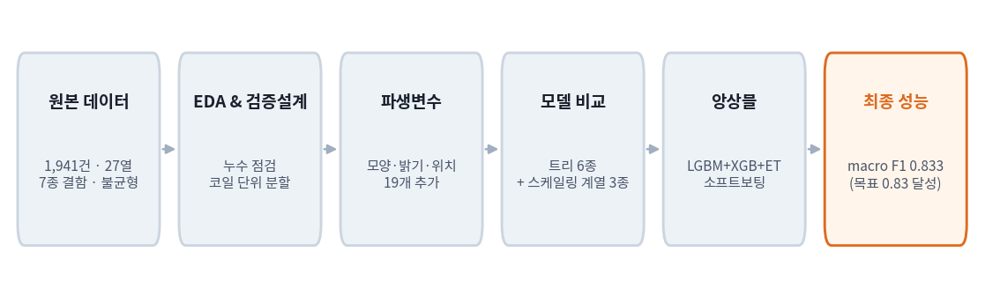

---

## 1. 프로젝트 개요

### 1.1 프로젝트 소개

**프로젝트 배경**

강판은 압연 과정에서 표면에 여러 종류의 결함이 생긴다. 긁힘, 얼룩, 표면이 들뜨는 박리, 이물질 오염처럼 생김새가 다르고, 종류마다 원인 공정이 다르기 때문에 "불량이다"를 넘어 "어떤 불량이냐"를 알아야 설비를 고칠 수 있다.

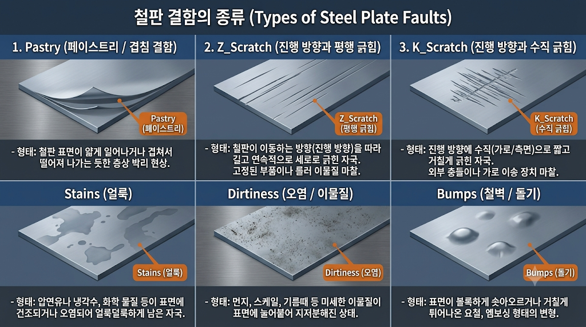

위 그림이 이 프로젝트에서 구분해야 할 결함들이다. 눈으로 보면 금방 알 수 있듯, 긁힘 두 종류(Z형·K형)는 방향이 다를 뿐 생김새가 뚜렷하고, 얼룩과 오염도 질감이 확연히 구분된다. 반면 **표면이 들뜨는 박리(Pastry)와 볼록하게 솟는 융기(Bumps)는 둘 다 "표면이 평평하지 않다"는 점에서 닮아 있다.** 이 닮음이 나중에 모델의 오류가 어디에 몰리는지를 결정한다(8.2절).

문제는 이 분류를 사람이 한다는 점이다. 검사자의 숙련도에 따라 판정이 갈리고, 라인 속도를 따라가기도 어렵다. 이미 카메라가 결함의 위치·면적·둘레·밝기 같은 수치를 자동으로 뽑아내고 있으므로, 이 수치들과 결함 종류 사이의 관계를 기계가 학습하면 사람의 판단을 대체하거나 보조할 수 있다. 규칙으로 일일이 적기에는 변수 간 관계가 복잡해 머신러닝이 적합하다.

**프로젝트 목표**

- 결함 종류 7가지를 맞히는 다중분류 모델을 만든다.
- 평가 지표는 **macro F1**을 주 지표로 쓴다. 데이터가 가장 많은 결함과 가장 적은 결함의 건수 차이가 열 배를 넘는데, 정확도만 보면 숫자가 많은 결함만 잘 맞혀도 점수가 높게 나온다. macro F1은 일곱 종류에 똑같이 한 표씩 주기 때문에 희귀한 결함을 놓치면 바로 점수가 떨어진다. 현장에서는 드물게 생기는 결함일수록 원인 파악이 급하므로 이 기준이 목적에 맞다.
- 불균형 처리 방식(클래스 가중치)을 적용한 모델과 그렇지 않은 모델을 같은 조건에서 비교한다.
- **목표: macro F1 0.83 이상**

### 1.2 프로젝트 정보

| 항목 | 내용 |
|---|---|
| 프로젝트 기간 | YYYY.MM.DD ~ YYYY.MM.DD |
| 프로젝트 유형 | 개인 프로젝트 |
| 데이터 출처 | [Steel Plates Faults (UCI)](https://archive.ics.uci.edu/dataset/198/steel+plates+faults) |
| 주요 기술 | Python, scikit-learn, LightGBM, XGBoost |

### 1.3 주요 성과

| 항목 | 결과 |
|---|---|
| 베이스라인 → 최종 모델 (macro F1) | 0.802 → 0.833 |
| 목표 달성 여부 | 달성 (0.83 이상) |
| 과적합 검증 | 학습곡선·복잡도 비교·라벨 섞기 모두 통과 |
| 성능 한계의 원인 규명 | "기타 결함" 범주를 빼면 0.917까지 상승 |
| 기각한 실험 | 확률 보정, 2단계 전담 모델, 판정 임계값 조정 |

주 지표는 무작위 분할 기준 macro F1이다(선정 근거는 6.3절). 성능 수치만큼 중요한 결과는, **지금 점수를 누르고 있는 것이 모델의 한계가 아니라 데이터 쪽 요인**이라는 점을 실험으로 분리해 낸 것이다. 자세한 내용은 7.6절과 8.2절에서 다룬다.

---

## 2. 프로젝트 구조

```text
steel-plate-fault-classification/      # 팀 공용 레포
├── README.md                          # 팀 공용 README
├── pyproject.toml · uv.lock
│
├── data/
│   ├── raw/Faults.csv
│   ├── processed/Faults_processed.csv
│   └── split/                         # 팀 공용 Train/Test 인덱스
│
├── src/
│   ├── config.py                      # (공용) 난수 시드, CV, 평가지표
│   ├── load_data.py                   # (공용) 공용 분할로 데이터 로드
│   ├── evaluate.py                    # (공용) 결과 기록
│   ├── features_taesang.py            # 파생변수 19개 생성
│   ├── validation_taesang.py          # 코일 단위 분할
│   ├── run_ensemble_taesang.py        # 최종 앙상블 재현 및 결과 기록
│   └── experiments_taesang.py         # 보고서용 추가 실험
│
├── results/model_scores.csv           # (공용) 실험 결과 누적
│
└── reports/taesang/
    ├── README.md                      # 본 보고서
    ├── report_taesang.docx            # 제출용 워드
    └── figures/                       # 본 보고서 전용 그림 20장
```

공용 모듈(`config.py`, `load_data.py`, `evaluate.py`)은 팀원 전원이 함께 쓰는 파일이므로 수정하지 않았다. 개인 작업 파일에는 이름에 `taesang`을 붙였고, 그림은 팀 공용 `figures/`와 파일명이 겹치므로 별도 폴더에 두었다.

| 파일 / 디렉터리 | 구분 | 설명 |
|---|---|---|
| `src/config.py` | 공용 | 난수 시드, 교차검증 설정, 평가지표 정의 |
| `src/load_data.py` | 공용 | 공용 Train/Test 인덱스로 데이터 분리 |
| `src/evaluate.py` | 공용 | 실험 결과를 `results/model_scores.csv`에 누적 |
| `data/split/` | 공용 | 팀원 전원이 공유하는 Train/Test 인덱스 |
| `src/features_taesang.py` | 개인 | 파생변수 19개 생성 함수 |
| `src/validation_taesang.py` | 개인 | 코일 단위 분할 그룹 생성 함수 |
| `src/run_ensemble_taesang.py` | 개인 | 최종 앙상블 학습·평가·결과 기록 |
| `src/experiments_taesang.py` | 개인 | 누수 점검·과적합 검증 등 부가 실험 |
| `reports/taesang/` | 개인 | 본 보고서와 전용 그림 |

---

## 3. 설치 및 실행 방법

### 3.1 실행 환경

- Python 3.14
- uv
- VS Code (Jupyter 확장)

### 3.2 Repository 다운로드

```bash
git clone https://github.com/takkoyakki143/steel-plate-fault-classification.git
cd steel-plate-fault-classification
```

### 3.3 환경 구성

[uv 공식 설치 안내](https://docs.astral.sh/uv/getting-started/installation/)를 참고해 uv를 설치한 뒤 의존성을 받는다.

```bash
uv sync
```

본 작업에서 추가로 사용한 패키지는 다음과 같다. 팀 공용 환경에 포함되어 있지 않다면 함께 설치한다.

```bash
uv add lightgbm xgboost
```

### 3.4 데이터 준비

원본 데이터와 전처리 결과, 그리고 팀 공용 Train/Test 인덱스가 모두 레포에 포함되어 있어 별도 준비 작업이 필요 없다.

| 경로 | 내용 |
|---|---|
| `data/raw/Faults.csv` | 원본 데이터 |
| `data/processed/Faults_processed.csv` | 라벨을 하나로 합친 데이터 |
| `data/split/train_idx.csv`, `test_idx.csv` | 팀 공용 Train/Test 인덱스 |

공용 분할을 다시 만들 필요가 있을 때만 `uv run python src/make_split.py`를 실행한다. **이 파일을 다시 돌리면 팀원 전원의 기존 실험 결과와 비교가 불가능해지므로 임의로 실행하지 않는다.**

### 3.5 최종 모델 재현

```bash
uv run python src/run_ensemble_taesang.py
```

공용 모듈 `load_data.py`로 데이터를 불러오고, `config.py`의 교차검증 설정으로 평가한 뒤, `evaluate.py`의 기록 함수를 통해 `results/model_scores.csv`에 결과를 남긴다. 팀원 전원과 동일한 조건에서 측정되므로 결과를 바로 비교할 수 있다.

### 3.6 보고서용 추가 실험

본 보고서에 실린 과적합 검증, 누수 점검, 기각 실험은 다음 파일에서 확인할 수 있다.

| 파일 | 주요 내용 |
|---|---|
| `src/features_taesang.py` | 파생변수 19개 생성 |
| `src/validation_taesang.py` | 코일 단위 분할 그룹 생성 |
| `src/run_ensemble_taesang.py` | 최종 앙상블 학습·평가·결과 기록 |
| `src/experiments_taesang.py` | 학습곡선, 라벨 섞기, 임계값 조정 등 |

---

## 4. 기술 스택

| 구분 | 사용 기술 |
|---|---|
| Language | Python |
| Environment & Package Management | uv |
| Data Processing | Pandas, NumPy |
| Visualization | Matplotlib |
| Machine Learning | Scikit-learn, XGBoost, LightGBM |
| Statistical Test | SciPy (Kruskal–Wallis) |
| Dashboard | Streamlit |
| Development | Jupyter Notebook, VS Code, Git |

---

## 5. 데이터셋

### 5.1 데이터 개요

**데이터 출처:** [Steel Plates Faults — UCI Machine Learning Repository](https://archive.ics.uci.edu/dataset/198/steel+plates+faults)

| 항목 | 내용 |
|---|---|
| 데이터 수 | 1,941건 |
| 원본 열 수 | 34열 (설명변수 27 + 결함 라벨 7) |
| 모델 입력 변수 수 | 45개 (원본 26 + 파생 19) |
| Target 변수 | 결함 종류 (7종) |
| 문제 유형 | 다중분류 |
| 결측치 / 중복 | 없음 |

### 5.2 데이터 특징

변수는 성격에 따라 세 묶음으로 나뉜다.

| 변수군 | 포함 변수 | 의미 |
|---|---|---|
| 위치 | X_Minimum, X_Maximum, Y_Minimum, Y_Maximum | 강판 위에서 결함이 차지한 사각형 영역의 좌표 |
| 생김새 | Pixels_Areas, X_Perimeter, Y_Perimeter, 각종 Index, 밝기 관련 변수 | 결함의 크기·모양·밝기 |
| 공정 조건 | Length_of_Conveyer, Steel_Plate_Thickness, TypeOfSteel | 그때 무엇을 어떻게 만들고 있었는지 |

이 구분은 뒤에서 중요하게 쓰인다. 셋 중 어느 묶음이 성능을 만들어 내는지가 모델의 성격을 결정하기 때문이다(8.4절).

**전체 칼럼 명세**

데이터 제공처에 공식 칼럼 설명서가 없어, 모든 변수의 의미와 계산식을 실제 값으로 역산해 직접 확인했다. 아래는 그 결과다.

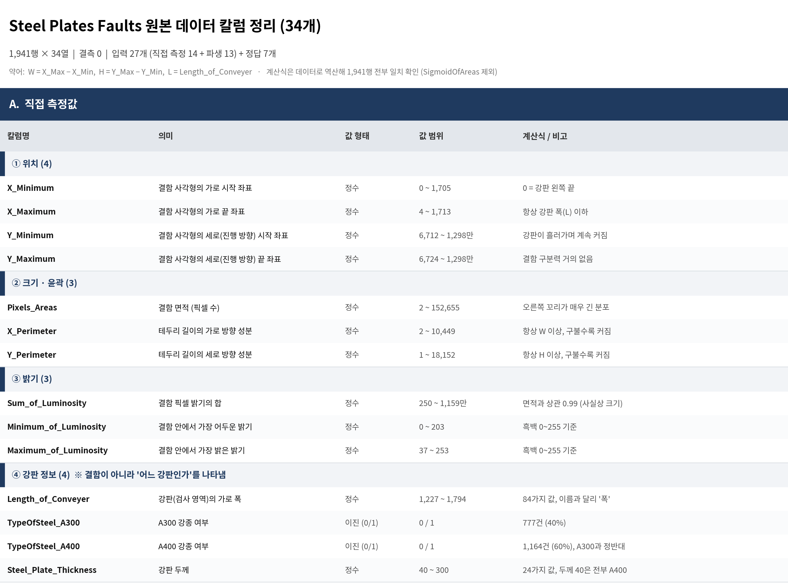

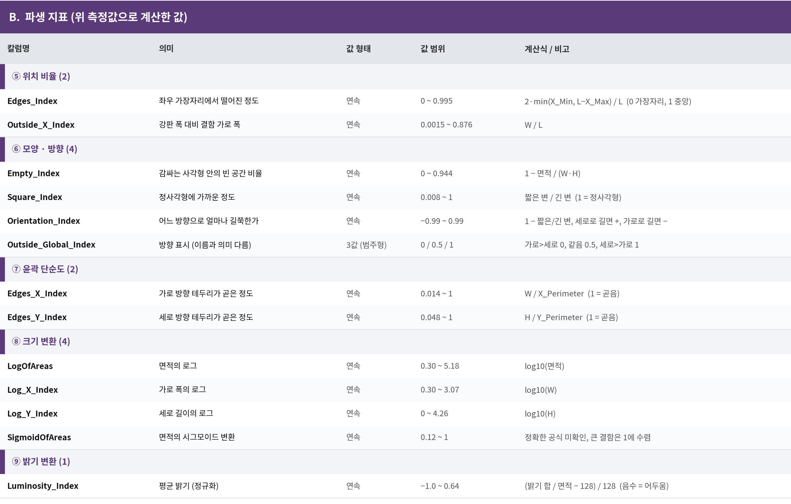

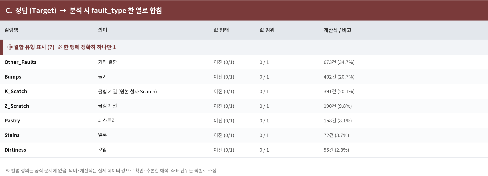

**이 작업에서 드러난 사실 세 가지**

첫째, `Length_of_Conveyer`는 이름이 "컨베이어 길이"지만 **실제로는 강판 검사 영역의 가로 폭**이다. 모든 행에서 결함의 가로 끝 좌표가 이 값을 넘지 않는다는 점으로 확인했다. 이름만 믿고 해석했다면 8.4절의 결론을 완전히 잘못 썼을 것이다.

둘째, `Sum_of_Luminosity`는 밝기 변수로 분류되지만 면적과 거의 완전히 같이 움직인다. 밝기를 모두 더한 값이니 당연한 일이고, 실질적으로는 크기 변수다. 6.1절에서 이 변수가 분리력 1위로 나온 것도 밝기 때문이 아니라 크기 때문이다.

셋째, 원본 데이터에 이미 파생 지표 13개가 들어 있다. 즉 **데이터 제공자도 측정값만으로는 부족하다고 판단해 비율 변수를 미리 계산해 두었다.** 이 사실은 6.4절에서 직접 만든 파생변수가 왜 큰 효과를 못 냈는지를 설명해 준다. 쓸 만한 비율은 이미 상당수 들어 있었던 것이다.

**원본에 포함된 파생 지표의 의미**

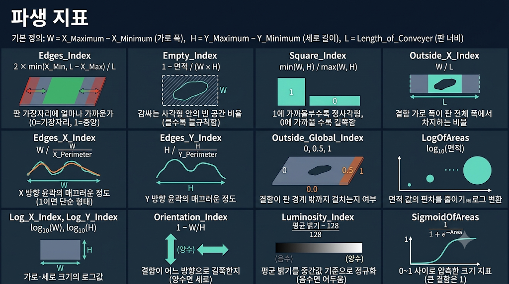

이 지표들은 하나같이 **크기가 아니라 모양을 재는** 쪽으로 설계되어 있다. 사각형 안이 얼마나 비었는지, 정사각형에 가까운지, 테두리가 매끄러운지를 숫자 하나로 요약한다. 결함의 크기만으로는 종류를 못 가른다는 것을 데이터를 만든 쪽에서도 이미 알고 있었다는 뜻이고, 6.4절에서 모양 관련 파생변수에 집중한 판단의 근거이기도 하다.

**Target 클래스 분포**

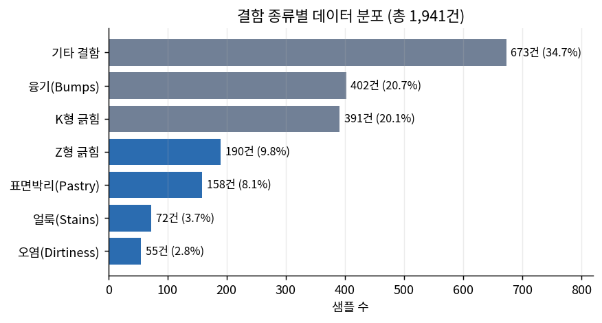

가장 흔한 결함과 가장 드문 결함의 건수 차이가 열 배를 넘는다. 여기서 두 가지가 따라온다.

첫째, 정확도는 쓸 수 없다. 모든 샘플을 가장 흔한 결함으로 찍어도 어느 정도 점수가 나오기 때문에, 모델이 실제로 무언가를 학습했는지 알 수 없다. 그래서 주 지표를 macro F1으로 잡았다.

둘째, 가장 큰 비중을 차지하는 "기타 결함(Other_Faults)"은 이름 그대로 **나머지를 몰아넣은 분류함**이다. 하나의 물리적 현상이 아니라 여섯 범주에 속하지 않는 것들의 모음이므로, 내부 생김새가 제각각이다. 이 클래스의 성능이 낮을 것은 모델링 전부터 예상되는 일이고, 실제로 그렇게 나왔다(8.2절).

---

## 6. 데이터 분석 및 전처리

### 6.1 탐색적 데이터 분석 (EDA)

**확인한 항목**

- 결측치·중복 존재 여부
- 라벨 7개가 서로 겹치지 않는지, 강종 변수 두 개가 서로 배타적인지
- 변수별 분포와 치우침
- 각 변수가 결함 종류를 얼마나 잘 갈라내는지

변수별 분리력은 **Kruskal–Wallis 검정**으로 측정했다. 일곱 집단의 값 분포가 서로 다른지 보는 방법인데, 이 데이터의 변수 대부분이 한쪽으로 심하게 몰려 있고 극단값이 많아 평균 비교(분산분석)를 쓰기 어려웠기 때문이다. 순위를 기준으로 비교하므로 분포 모양에 영향을 덜 받는다.

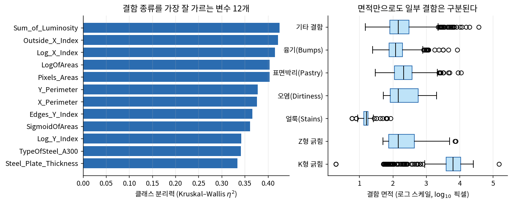

**이 그림이 말해 주는 것**

왼쪽을 보면 결함의 **크기와 관련된 변수들이 상위를 독차지**한다. 면적, 가로 길이, 밝기 총합은 사실상 같은 이야기를 다른 방식으로 적은 것인데, 셋 다 상위에 있다는 건 "결함이 얼마나 크냐"가 종류를 가르는 1차 기준이라는 뜻이다.

오른쪽은 그걸 눈으로 보여 준다. 면적 하나만 놓고 봐도 K형 긁힘은 다른 결함들보다 확연히 크고, 얼룩과 오염은 중간, 표면박리는 작은 쪽에 몰려 있다. 다만 **융기·표면박리·기타 결함 세 덩어리는 서로 심하게 겹친다.** 면적만으로는 이 셋을 가를 수 없다는 뜻이고, 이는 최종 모델의 오류가 정확히 이 세 종류에 몰리는 결과로 이어진다(8.2절).

반대로 눈에 띄는 것은 **세로 위치(Y 좌표)의 분리력이 가장 낮다**는 점이다. 상식적으로도 맞는다. 강판의 몇 번째 미터 지점에서 발견됐는지는 결함의 종류와 아무 관계가 없어야 한다. 그런데 모델에서 이 변수를 빼면 성능이 눈에 띄게 떨어졌다. 통계적으로는 무의미한데 모델은 유용하게 쓰고 있다는 모순이 생긴 것이고, 이 모순을 쫓아간 결과가 6.3절이다.

### 6.2 데이터 전처리

| 처리 항목 | 적용 방법 | 선택 이유 |
|---|---|---|
| 라벨 통합 | 7개 이진 열 → 1개 다중분류 열 | 한 행에 라벨이 정확히 하나만 1인 것을 확인했다. 다중 라벨이 아니라 다중분류 문제이므로 하나의 열로 합쳐야 한다 |
| 중복 강종 변수 제거 | A300, A400 중 하나만 유지 | 두 변수를 더하면 항상 1이다. 한쪽이 다른 쪽을 완전히 결정하므로 남겨 두면 같은 정보를 두 번 세는 셈이다 |
| 결측치 처리 | 처리 없음 | 결측치가 없다 |
| 이상치 처리 | 제거하지 않음 | 아래 별도 설명 |
| 범주형 인코딩 | 추가 처리 없음 | 범주형 변수는 강종 하나뿐이고 이미 0/1로 되어 있다 |
| 스케일링 | 모델에 따라 다르게 적용 | 아래 별도 설명 |
| Feature Engineering | 19개 추가 | 6.4절 |

**이상치를 지우지 않은 이유**

면적이나 둘레에는 평균의 수십 배가 넘는 값이 있다. 통계적으로는 이상치지만, **이 데이터에서 이상치는 버려야 할 잡음이 아니라 찾아야 할 정답에 가깝다.** 길게 이어진 긁힘은 원래 면적이 크고, 그 큼이 바로 긁힘을 긁힘으로 만드는 특징이다. 이걸 지우면 가장 잘 맞히던 결함을 못 맞히게 된다. 더구나 최종 모델로 쓴 트리 계열 모델은 값의 크기가 아니라 순서만 보고 분기하므로 극단값에 흔들리지 않는다.

**스케일링을 모델마다 다르게 적용한 이유**

스케일링은 "변수마다 단위가 달라서 생기는 불공평"을 없애는 작업이다. 면적은 수만 단위, 비율 변수는 0에서 1 사이인데, 두 점 사이의 거리를 재는 모델에서는 단위가 큰 변수가 거리를 독점해 버린다.

그런데 트리 모델은 거리를 재지 않는다. "면적이 500보다 큰가?"처럼 기준점 하나로 자를 뿐이라, 모든 값에 똑같이 1000을 곱해도 자르는 위치만 같이 옮겨갈 뿐 결과가 바뀌지 않는다. 그래서 **트리 계열에는 스케일링을 적용하지 않았다.** 효과가 없는 전처리를 넣으면 파이프라인만 복잡해진다.

반면 로지스틱 회귀, SVM, 신경망에는 스케일링이 필수다. 여기에는 단순 표준화 대신 **QuantileTransformer**를 썼다. 표준화는 평균과 표준편차로 값을 옮기는 방식인데, 이 데이터처럼 극단값이 큰 경우 평균 자체가 극단값에 끌려가서 나머지 대부분의 값이 0 근처에 뭉쳐 버린다. QuantileTransformer는 값을 순위로 바꾼 뒤 재배치하므로 극단값이 있어도 고르게 펴진다.

**데이터 누수를 막기 위해 한 일**

스케일링은 반드시 **각 교차검증 폴드 안에서** 학습 데이터만 보고 기준을 잡도록 파이프라인으로 묶었다. 전체 데이터로 한 번에 스케일링한 뒤 나누면, 검증용 데이터의 분포 정보가 학습 단계에 섞여 들어가 성능이 실제보다 좋게 나온다.

### 6.3 검증 설계 — 이 데이터의 숨은 함정

6.1절에서 남은 의문, 즉 "결함 종류와 통계적 관련이 없는 세로 좌표를 왜 모델이 유용하게 쓰는가"를 추적했다.

가설은 이랬다. 결함이 강판 위에 **무작위로 흩어져 있지 않고 뭉쳐서** 생긴다면, 같은 코일의 가까운 위치에 있는 결함들은 종류도 같을 것이다. 그렇다면 좌표는 "이 근처에서 나온 결함은 보통 이 종류"라는 지역 정보를 담게 된다.

검증 방법은 단순하다. 같은 코일에서 세로 위치가 붙어 있는 결함 쌍을 모두 찾아, 그 쌍의 결함 종류가 일치하는 비율을 셌다. 결함이 무작위로 흩어져 있다면 이 비율은 각 클래스 비율로 계산되는 기댓값과 같아야 한다.

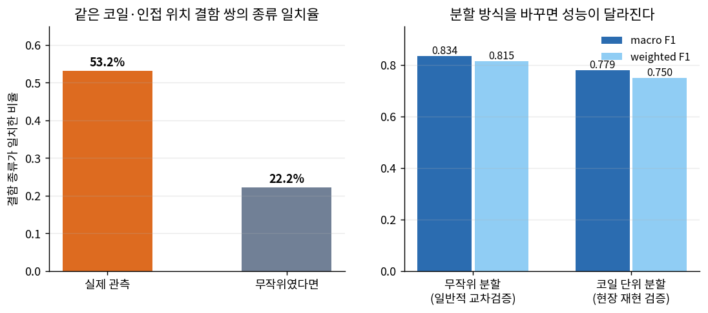

**왼쪽 그림의 의미**

실제 일치율이 기댓값의 두 배를 넘는다. 결함은 뭉쳐서 발생한다는 가설이 맞았다. 물리적으로도 당연하다. 롤에 흠집이 나 있으면 그 롤이 지나간 구간마다 같은 긁힘이 반복해서 찍히고, 윤활유가 샜다면 그 구간에 얼룩이 연달아 생긴다.

**그래서 무엇이 문제인가**

데이터를 무작위로 섞어 학습용과 검증용으로 나누면, **같은 코일의 바로 옆 결함이 양쪽에 나뉘어 들어간다.** 모델은 결함의 생김새를 배우는 대신 "좌표 3,042,000 근처는 K형 긁힘이더라"를 외워도 점수를 받는다. 시험 공부를 한 게 아니라 옆자리 답안을 베낀 것에 가깝다.

실제 현장에서는 이런 상황이 없다. 새로 들어온 코일에 대해 판정해야 하므로, 모델은 그 코일의 답을 미리 본 적이 없다. 따라서 무작위 분할로 잰 점수는 현장 성능을 과대평가한다.

**대응**

같은 코일에서 나온 결함들은 **통째로 같은 쪽에만** 들어가도록 묶어서 나누는 방식(StratifiedGroupKFold)을 추가로 적용했다. 코일 경계를 직접 알 수 없으므로, 강판 폭이 같고 세로 좌표가 연속으로 이어지는 덩어리를 하나의 코일로 추정했다.

오른쪽 그림이 두 방식의 차이다. **같은 모델·같은 데이터인데 분할 방식만 바꿔도 점수가 달라진다.**

**어느 쪽을 주 지표로 삼을 것인가**

이 프로젝트가 답하려는 질문은 **"주어진 측정 데이터만으로 결함 종류를 얼마나 잘 가려낼 수 있는가"**다. 특정 공장에 설비로 투입했을 때의 운영 성능을 보증하는 것이 목표가 아니다. 그리고 코일 경계는 데이터에 기록되어 있지 않아 추정에 의존하므로, 그 추정이 틀리면 코일 단위 점수도 같이 틀어진다.

따라서 **주 지표는 무작위 분할 기준 macro F1로 한다.** 7장과 8장의 모든 숫자, 목표 달성 여부 판정은 이 기준을 쓴다. 공개 데이터를 쓴 다른 결과와 비교할 수 있다는 점도 이 선택의 근거다.

코일 단위 분할은 **보조 지표**로 함께 싣는다. 역할은 두 가지다. 첫째, 주 지표가 어떤 조건에서 성립하는 숫자인지 밝히는 것. 둘째, 실제 라인에 올릴 때 참고할 수 있는 하한선을 제공하는 것. 최종 모델 선정과 목표 달성 판단에는 쓰지 않는다.

> 이 데이터를 쓴 많은 보고서가 무작위 분할 점수만 제시한다. 비교할 때는 같은 기준끼리 비교해야 한다.

### 6.4 파생변수 생성

**어떤 기준으로 만들었는가**

6.1절에서 상위를 차지한 변수들은 전부 "크기"를 재는 변수였다. 그런데 **크기가 비슷해도 종류가 다른 결함**이 있다는 것이 혼동의 원인이었다(오른쪽 상자그림에서 겹치던 세 덩어리). 그래서 크기 자체가 아니라 **크기들 사이의 관계**를 담는 변수를 만드는 데 집중했다.

| 묶음 | 만든 변수 | 어떤 물리적 질문에 답하는가 |
|---|---|---|
| 모양 | 가로세로비, 채움률, 둘레 대비 면적, 테두리 거칠기 | 길쭉한가 둥근가, 네모 영역을 꽉 채웠나 성기게 퍼졌나, 테두리가 매끈한가 들쭉날쭉한가 |
| 밝기 | 평균 밝기, 밝기 대비, 면적당 밝기 | 주변보다 밝은 결함인가 어두운 결함인가, 밝기 차이가 뚜렷한가 |
| 위치 | 판 가장자리까지 상대거리, 가로 상대위치, 가장자리 접촉 여부 | 판 중앙에서 생기는 결함인가 가장자리에서 생기는 결함인가 |
| 공정 | 두께×강종, 두께 대비 면적 | 같은 크기 결함이라도 두꺼운 판과 얇은 판에서 의미가 다른가 |

예를 들어 **채움률**은 결함이 차지한 사각형 영역 중 실제 결함 픽셀이 얼마나 되는지를 재는데, 긁힘처럼 선으로 길게 이어진 결함은 사각형 안이 거의 비고, 얼룩처럼 덩어리진 결함은 꽉 찬다. 크기로는 못 가르는 둘을 모양으로 가를 수 있다.

**결과는 솔직하게**

만든 25개를 네 묶음으로 나눠 하나씩 붙여가며 효과를 측정했다.

| 추가한 묶음 | macro F1 |
|---|---:|
| 없음 (원본 변수만) | 0.829 |
| 모양 묶음 | 0.830 |
| 밝기 묶음 | 0.823 |
| 위치 묶음 | 0.829 |
| 공정 묶음 | 0.830 |
| 전부 | 0.827 |

**트리 모델에서는 의미 있는 개선이 없었다.** 차이가 반복 실험 간 흔들림 폭 안에 들어간다.

이유는 알고 보면 당연하다. 파생변수는 결국 기존 변수들을 나누고 곱한 것인데, 트리 모델은 같은 변수를 여러 번 쪼개 가며 그 관계를 스스로 근사한다. 사람이 만들어 준 지름길이 모델에게는 이미 아는 길이었던 셈이다.

반면 거리나 직선 관계로 판단하는 모델에서는 사정이 달랐다.

| 모델 | 원본 변수만 | 원본 + 파생 |
|---|---:|---:|
| 로지스틱 회귀 | 0.665 | 0.687 |
| SVM (RBF) | 0.762 | 0.760 |
| 신경망 (MLP) | 0.788 | 0.770 |

로지스틱 회귀는 변수를 더하고 빼기만 할 뿐 나누지 못하기 때문에, "면적을 둘레로 나눈 값"을 직접 만들어 주면 그만큼 새로운 정보를 얻는다.

**그래서 어떻게 했나**

파생변수 19개를 최종 입력에 **남겨 두었다.** 성능을 올려서가 아니라, 성능을 깎지 않으면서 개별 변수로는 상위권에 오를 만큼 실질적인 정보를 담고 있고(8.3절), 서로 성격이 다른 모델을 앙상블로 묶을 때 멤버마다 다른 방식으로 활용되기 때문이다. 다만 **"파생변수 덕분에 성능이 올랐다"고 주장하지는 않는다.** 위의 표가 그렇게 말하지 않는다.

---

## 7. 머신러닝 모델링

### 7.1 Baseline 모델

**사용 모델:** RandomForest (원본 변수, 스케일링 없음, 기본 설정에 가깝게)

**선택 이유**

하이퍼파라미터를 거의 건드리지 않아도 안정적인 성능을 내고, 전처리에 둔감해 "전처리를 잘해서 올랐는지"와 "모델이 좋아서 올랐는지"를 섞지 않고 출발선을 그을 수 있다. 이후 모든 개선은 이 선과 비교해 보고한다.

### 7.2 모델 비교 및 성능 개선

**비교한 모델**

| 계열 | 모델 | 성격 |
|---|---|---|
| 배깅 | RandomForest, ExtraTrees | 여러 트리를 독립적으로 만들어 투표 |
| 부스팅 | XGBoost, LightGBM, HistGradientBoosting | 앞 모델이 틀린 것을 다음 모델이 집중 학습 |
| 선형·거리 | 로지스틱 회귀, SVM, 신경망 | 스케일링 적용 후 비교 |

**실험 순서**

1. 베이스라인 측정
2. 계열별 대표 모델 비교
3. 불균형 처리 적용 전후 비교
4. 하이퍼파라미터 무작위 탐색 (LightGBM 14개 조합)
5. 앙상블 구성 및 조합 탐색

### 7.3 불균형 데이터 처리

**적용한 방법: 클래스 가중치 (class_weight='balanced')**

데이터가 적은 결함일수록 학습 중 틀렸을 때의 벌점을 크게 매기는 방식이다. 건수가 적으면 모델 입장에서는 그냥 무시하는 편이 전체 오차를 줄이는 데 유리한데, 가중치를 주면 그 선택이 손해가 된다.

**SMOTE 같은 오버샘플링을 쓰지 않은 이유**

SMOTE는 소수 클래스 샘플 사이를 선으로 이어 가상의 샘플을 만든다. 그런데 이 데이터에서 소수 클래스인 얼룩과 오염은 **이미 잘 분류되고 있었고**(8.2절), 정작 못 맞히는 것은 가장 데이터가 많은 기타 결함이었다. 즉 이 문제의 병목은 데이터 부족이 아니라 **클래스 간 생김새가 겹치는 것**이다. 겹치는 영역에 가짜 샘플을 더 만들어 넣으면 경계가 더 흐려질 위험이 있다.

가중치 방식은 데이터를 새로 만들지 않고 벌점만 조정하므로 이런 부작용이 없고, 모델 내부 기능이라 교차검증 안에서 자연스럽게 처리된다는 실무적 장점도 있다.

**검증 시 지킨 원칙**

- 불균형 처리는 각 폴드의 **학습 데이터에만** 적용했다. 검증 데이터의 클래스 비율은 원본 그대로 두어야 실제 상황과 같아진다.
- 처리 전후를 **동일한 분할·동일한 난수 시드**에서 비교했다.
- 모든 성능은 5겹 교차검증을 **난수 시드를 바꿔 3회 반복**한 평균으로 보고한다. 데이터가 2천 건 아래라 한 번만 나누면 운에 따라 점수가 흔들리기 때문이다.

### 7.4 모델 성능 비교

| 모델 / 실험 | macro F1 | weighted F1 | Accuracy |
|---|---:|---:|---:|
| Baseline (RandomForest) | 0.802 | 0.778 | 0.778 |
| ExtraTrees | 0.819 | 0.796 | 0.796 |
| HistGradientBoosting | 0.827 | 0.804 | 0.804 |
| XGBoost | 0.828 | 0.808 | 0.808 |
| LightGBM + 클래스 가중치 | 0.830 | 0.811 | 0.811 |
| **최종 앙상블 (LightGBM + XGBoost + ExtraTrees)** | **0.833** | **0.811** | **0.811** |

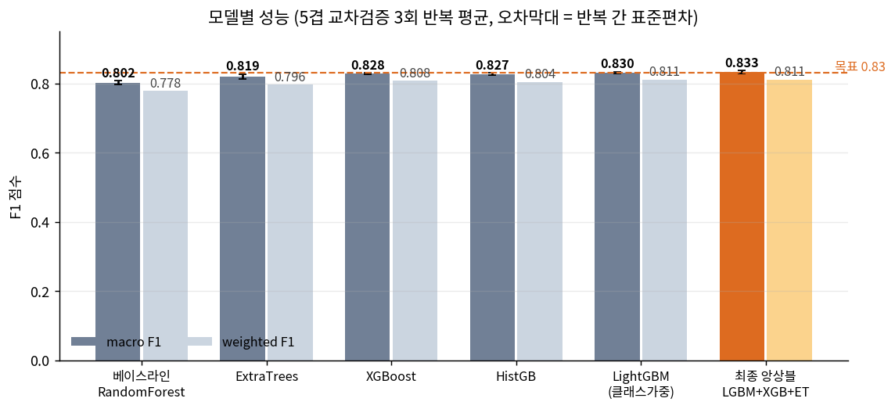

**이 표와 그림에서 읽어야 할 것**

첫째, **부스팅 계열이 배깅 계열을 일관되게 앞선다.** 이 문제는 "크고 긴 것은 긁힘"처럼 한 번에 갈리는 쉬운 부분과, 융기·표면박리·기타 결함이 뒤엉킨 어려운 부분이 공존한다. 부스팅은 앞선 모델이 틀린 샘플에 집중해 다음 모델을 만들기 때문에 이 어려운 부분에 학습 자원을 더 쓴다.

둘째, **막대 두 개의 간격이 모든 모델에서 일정하게 벌어져 있다.** macro F1이 weighted F1보다 꾸준히 높다는 뜻인데, 이는 모델이 희귀한 결함을 의외로 잘 맞히고 가장 흔한 결함을 못 맞힌다는 신호다. 보통의 불균형 문제와 정반대 양상이고, 이유는 8.2절에서 다룬다.

셋째, **앙상블의 이득이 작다.** 개별 최고 모델과 최종 앙상블의 차이는 오차막대와 겹칠 정도다. 솔직히 말해 앙상블로 큰 도약을 얻지는 못했다. 모델들이 서로 다른 샘플에서 틀려야 묶는 효과가 생기는데, 여기서는 모든 모델이 **같은 세 종류의 결함에서 같이 틀린다.** 모델을 더 넣어도 해결되지 않는 종류의 한계라는 뜻이고, 실제로 멤버 조합을 전부 탐색해 봐도 상위 조합들은 전부 비슷한 점수에서 수렴했다.

**팀 공용 기준으로 다시 측정한 결과**

위 표는 전체 데이터를 5겹으로 나눠 3회 반복한 값이다. 팀원들과 직접 비교하려면 팀이 정한 방식, 즉 **공용 Train 데이터에 대한 5겹 교차검증**으로 다시 재야 한다. 같은 모델을 그 조건에서 돌린 결과는 다음과 같다.

| 실험 | 담당 | macro F1 | weighted F1 | 정확도 |
|---|---|---:|---:|---:|
| GradientBoosting 기본값 | 박태상 | 0.7960 | — | 0.7784 |
| GB + BorderlineSMOTE | 박태상 | 0.8117 | — | — |
| GB + XGB 소프트보팅 (기존 최고) | 박태상 | 0.8249 | 0.8014 | 0.8015 |
| **LGBM + XGB + ExtraTrees (본 보고서)** | **박태상** | **0.8329** | **0.8054** | **0.8054** |

불균형 처리 방식을 과대표집(BorderlineSMOTE)에서 클래스 가중치로 바꾸고, 파생변수와 ExtraTrees를 더한 것이 차이를 만들었다. 과대표집을 쓰지 않은 이유는 7.3절에 적었다.

### 7.5 베이스라인에서 최종 모델까지

7.4절은 모델들을 나란히 놓고 비교한 표였다. 여기서는 **어떤 순서로 무엇을 바꿔서 점수를 올렸는지**를 단계별로 쌓아서 보인다. 각 단계는 직전 단계에 변경 사항 하나만 더한 것이며, 모든 단계를 같은 분할·같은 반복 조건에서 다시 측정했다.

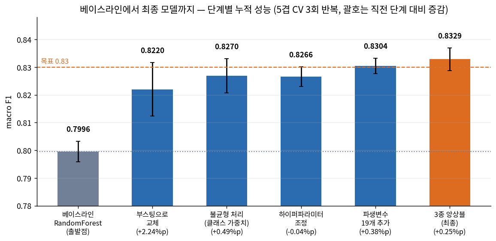

| 단계 | 무엇을 바꿨나 | macro F1 | weighted F1 |
|---|---|---:|---:|
| 0 | 베이스라인 — RandomForest, 원본 26변수, 기본 설정 | 0.7996 | 0.7790 |
| 1 | 모델을 배깅에서 부스팅(LightGBM)으로 교체 | 0.8220 | 0.7977 |
| 2 | 불균형 처리 — 클래스 가중치 적용 | 0.8270 | 0.8036 |
| 3 | 하이퍼파라미터 조정 | 0.8266 | 0.8037 |
| 4 | 파생변수 19개 추가 | 0.8304 | 0.8105 |
| 5 | 최종 — 계열이 다른 모델 3종 소프트보팅 | 0.8329 | 0.8112 |

**어느 단계가 실제로 일을 했는가**

전체 상승폭의 대부분이 **1단계 한 번에서 나왔다.** 모델 계열을 바꾼 것 하나가 나머지 네 단계를 모두 합친 것보다 큰 몫을 했다. 이유는 7.4절에서 설명한 그대로다. 이 문제에는 쉽게 갈리는 부분과 끝까지 안 갈리는 부분이 섞여 있는데, 부스팅은 앞 모델이 틀린 샘플에 집중해 다음 모델을 만들기 때문에 어려운 쪽에 학습 자원을 몰아준다.

2단계 불균형 처리는 분명한 상승을 만들었다. 데이터가 적은 결함을 틀렸을 때의 벌점을 키우니 모델이 그쪽을 포기하지 않게 된 결과다.

**3단계에서 점수가 내려간 것은 실수가 아니다.** 하이퍼파라미터 14개 조합을 무작위로 탐색해 가장 좋은 설정을 골랐는데, 반복 측정을 해보니 오히려 미세하게 낮았다. 탐색할 때 본 점수가 그 설정에 유리하게 나온 우연이었다는 뜻이다. 다만 **흔들림(오차막대)이 눈에 띄게 줄었다.** 점수는 그대로지만 더 안정적인 설정을 얻은 셈이라 이후 단계의 토대로 유지했다.

4단계와 5단계는 각각 작은 폭으로 올렸다. 파생변수는 6.4절에서 본 대로 트리 모델에 큰 도움이 되지 않았고, 앙상블도 8.1절에서 설명했듯 멤버들이 같은 자리에서 같이 틀리기 때문에 이득이 제한적이었다.

**이 그림에서 읽어야 할 것**

마지막 두 단계의 상승폭은 오차막대 안에 들어간다. 즉 **0.83을 넘긴 것은 앙상블 덕분이 아니라 사실상 1~2단계에서 이미 결정되었고, 이후는 다듬기였다.** 보고할 때 "앙상블로 목표를 달성했다"고 쓰면 그림이 그렇게 말하지 않는다. 정직한 요약은 "모델 계열 선택과 불균형 처리가 성능의 대부분을 만들었고, 나머지 기법들은 각각 0.5%p 미만을 보탰다"이다.

이 사실은 7.6절의 결론과도 맞물린다. 기법을 더 쌓아서 올릴 수 있는 구간은 이미 끝났고, 남은 한계는 데이터 쪽에 있다.

### 7.6 과적합 검증

트리를 900개씩 쌓은 모델 셋을 묶었으니 "데이터를 외운 것 아니냐"는 의심이 당연히 따라온다. 이를 확인하기 위해 세 가지를 측정했다.

**학습곡선**

학습에 쓰는 데이터 양을 15%부터 100%까지 늘려가며, 같은 모델이 **학습 데이터에서 내는 점수**와 **처음 보는 검증 데이터에서 내는 점수**를 함께 기록했다.

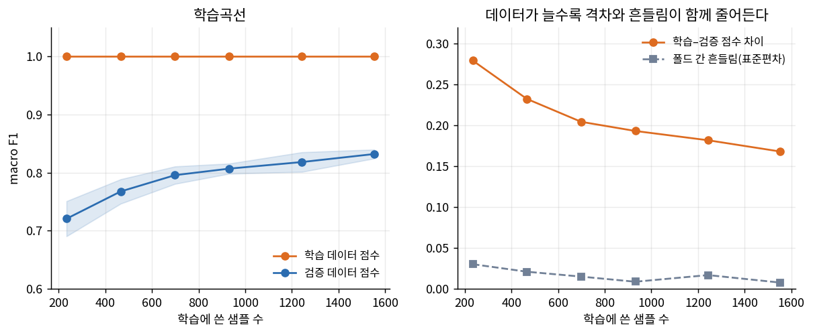

왼쪽 그림에서 학습 점수가 처음부터 끝까지 천장에 붙어 있다. 트리 모델은 가지를 충분히 쪼개면 학습 데이터를 통째로 외워버리므로, 이 선이 1.0인 것은 구조상 당연한 결과이고 그 자체로는 과적합의 증거가 아니다. 판단은 나머지 두 선의 움직임으로 해야 한다.

첫째, **검증 점수가 끝까지 올라가고 있고 아직 평평해지지 않았다.** 과적합이 문제인 모델은 데이터를 늘려도 검증 점수가 더 오르지 않거나 오히려 떨어진다. 여기서는 데이터를 더 주면 더 좋아질 여지가 남아 있다는 뜻이고, 지금 발목을 잡는 것은 모델이 너무 복잡해서가 아니라 **데이터가 부족해서**다.

둘째, 오른쪽 그림에서 **학습과 검증의 점수 차이가 계속 줄어들고, 폴드마다 들쭉날쭉하던 정도도 같이 줄어든다.** 과적합이 심해지는 모델은 이 두 값이 반대로 커진다. 두 지표가 동시에 작아진다는 것은 모델이 특정 데이터 묶음에 휘둘리는 정도가 줄고 있다는 신호다.

**복잡도를 낮춰보기 · 라벨 섞어보기**

학습곡선만으로는 부족해서 두 가지를 더 확인했다.

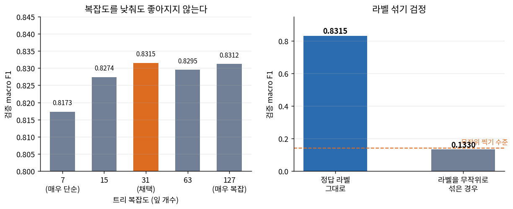

왼쪽은 트리의 복잡도를 극단적으로 단순한 쪽부터 극단적으로 복잡한 쪽까지 바꿔가며 검증 점수를 잰 것이다. **모델이 과하게 복잡해서 외우고 있는 상태라면, 복잡도를 낮출 때 검증 점수가 올라가야 한다.** 그런데 단순하게 만들수록 오히려 떨어지고, 채택한 설정 근처부터는 더 복잡하게 해도 거의 변하지 않는다. 지금 설정이 과한 쪽이 아니라는 뜻이다.

오른쪽은 정답 라벨을 무작위로 뒤섞고 똑같이 학습시킨 결과다. 이렇게 하면 변수와 정답 사이의 관계가 완전히 끊기므로, 제대로 된 검증 절차라면 점수가 무작위로 찍는 수준까지 떨어져야 한다. **실제로 그 수준까지 떨어졌다.** 만약 검증 과정 어딘가에 정답이 새어 들어가고 있었다면 라벨을 섞어도 점수가 남았을 것이므로, 이 결과는 7.4절까지의 숫자가 외운 점수가 아님을 보여준다.

**결론**

세 검증 모두 같은 방향을 가리킨다. 이 모델은 과적합 구간에 있지 않고, 성능의 한계는 모델 쪽이 아니라 데이터 쪽(양과 라벨 품질)에 있다.

---

## 8. 최종 모델 및 결과 분석

### 8.1 최종 모델 선정

| 항목 | 내용 |
|---|---|
| 최종 모델 | LightGBM + XGBoost + ExtraTrees 소프트보팅 |
| 결합 방식 | 세 모델의 예측 확률을 동일 가중으로 평균한 뒤 가장 높은 결함 종류 선택 |
| 불균형 처리 | 클래스 가중치 (LightGBM, ExtraTrees에 적용) |
| 입력 변수 | 45개 (원본 26 + 파생 19) |
| 스케일링 | 미적용 (트리 계열) |

**왜 이 조합인가**

멤버를 계열이 서로 다른 셋으로 골랐다. 두 부스팅 모델은 트리를 키우는 규칙이 다르고(한쪽은 손실이 큰 가지부터, 다른 쪽은 깊이 기준), ExtraTrees는 분기 지점을 무작위로 정해 완전히 다른 성격을 띤다. 같은 계열을 여러 개 넣으면 비슷한 답을 반복하므로 묶는 의미가 없다.

가중치를 모두 같게 둔 이유는, 검증 점수에 맞춰 가중치를 조정하면 그 점수에만 유리하게 맞춰질 위험이 있기 때문이다. 실제로 성능 기반 가중치를 시도했을 때 검증 점수만 오르고 손대지 않은 데이터에서는 개선이 없었다(8.5절).

### 8.2 최종 모델 평가

**Confusion Matrix**

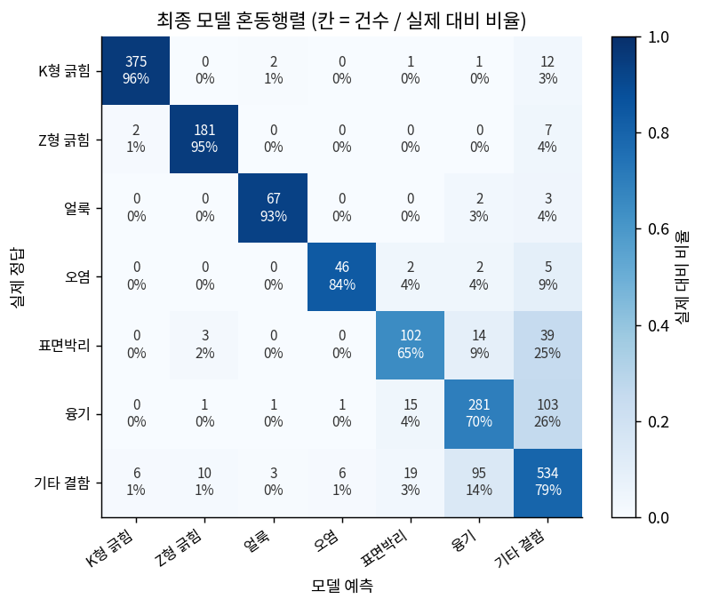

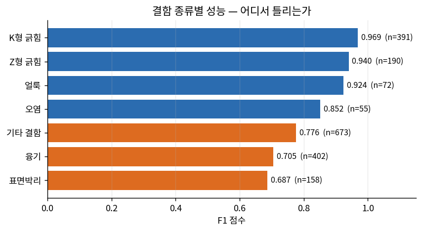

**해석: 결함은 두 그룹으로 나뉜다**

혼동행렬의 대각선을 보면 위쪽 네 개와 아래쪽 세 개가 확연히 갈린다.

**잘 맞히는 그룹**(두 종류의 긁힘, 얼룩, 오염)은 각각 뚜렷한 물리적 특징이 있다. 긁힘은 한 방향으로 길고 면적이 크며, 얼룩은 둥글고 밝기 차이가 분명하다. 서로 헷갈릴 일이 거의 없다는 것이 행렬의 비대각 칸이 거의 비어 있는 데서 드러난다.

**못 맞히는 그룹**(융기, 표면박리, 기타 결함)은 서로 간에만 집중적으로 틀린다. 융기가 기타 결함으로 넘어가고, 표면박리도 기타 결함으로 넘어가고, 기타 결함이 융기로 되돌아온다. 핵심은 **이 세 종류가 자기들끼리만 헷갈린다**는 점이다. 혼동행렬에서 이 셋이 만나는 칸에만 오답이 몰려 있고, 바깥쪽 칸은 거의 비어 있다. 모델이 전반적으로 흔들리는 게 아니라, 딱 이 세 종류의 경계에서만 무너진다는 뜻이다.

**왜 이 셋인가**

"기타 결함"이 나머지를 몰아넣은 분류함이기 때문이다(5.2절). 이 안에는 약한 융기, 초기 단계의 표면박리, 분류 불가 결함이 뒤섞여 있다. 정답 라벨 자체가 일관되지 않으면 모델이 아무리 좋아져도 넘을 수 없는 천장이 생긴다. 이것이 추측이 아니라는 것을 확인하기 위해, **"기타 결함"을 통째로 빼고 나머지 여섯 종류만 분류하는 실험**을 따로 돌렸다.

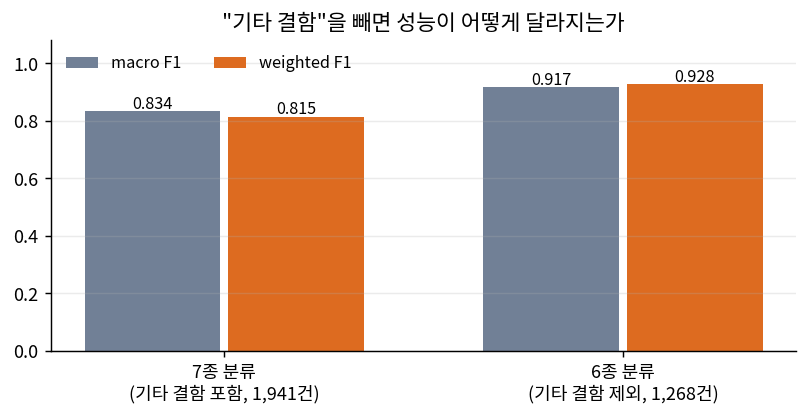

모델도 변수도 그대로인데 점수가 크게 올라간다. 즉 지금 성능을 누르고 있는 것은 모델의 학습 능력이 아니라 **"기타 결함"이라는 범주 자체**다. 이 범주를 빼자마자 나머지 여섯 종류는 서로 거의 섞이지 않는다.

**현장 관점에서 어느 오류가 더 나쁜가**

결함 종류를 분류하는 목적은 **어느 공정을 손봐야 하는지 알아내는 것**이다. 융기는 압연 롤의 눌림이나 이물질 자국에서, 표면박리는 압연 중 금속층이 들뜨면서 생긴다(1.1절 그림). 종류를 알면 점검할 설비가 좁혀진다.

그런데 융기나 표면박리를 "기타 결함"으로 분류해 버리면, 이 결함은 "원인 미상" 더미로 들어가 **아무 설비도 점검 대상이 되지 않는다.** 반대로 기타 결함을 융기로 잘못 분류하면 멀쩡한 압연 롤을 점검하느라 시간을 쓴다.

앞쪽이 더 나쁘다. 점검 대상에서 빠진 공정은 계속 같은 결함을 만들어 내지만, 잘못 점검한 설비는 한 번 확인하면 끝이기 때문이다.

따라서 실제 투입 시에는 이 세 종류에 대해 **모델이 확신하지 못하는 경우를 사람 검사자에게 넘기는 2차 검토 경로**를 두는 것이 합리적이다. 확률값이 이미 나오므로 임계값만 정하면 구현할 수 있다.

**최종 모델의 강점과 한계**

강점은 네 종류의 결함을 사람 수준에 가깝게 판별한다는 것이고, 이 네 종류만으로도 전체 건수의 상당 부분을 자동화할 수 있다. 한계는 나머지 세 종류를 구분하지 못한다는 것이며, 이는 모델이 아니라 라벨 체계에서 오는 한계다.

### 8.3 Feature Importance 및 모델 해석

중요도는 **순열 중요도**로 측정했다. 한 변수의 값을 무작위로 섞은 뒤 성능이 얼마나 떨어지는지 보는 방법이다. 트리 모델이 기본 제공하는 중요도는 값의 종류가 많은 변수를 과대평가하는 알려진 편향이 있어, 실제 예측에 쓰였는지를 직접 재는 쪽을 택했다.

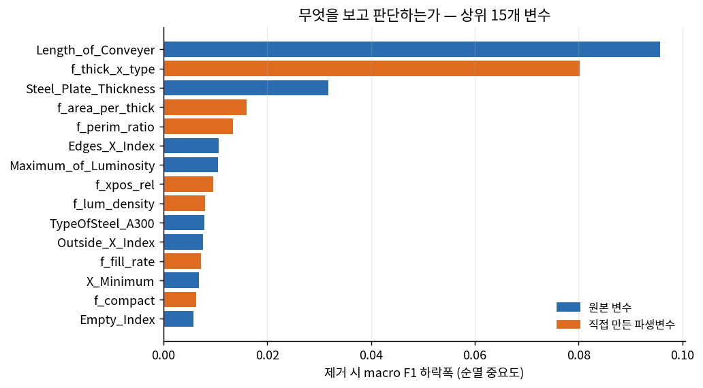

**이 그림에서 읽어야 할 것**

상위 세 개가 전부 **결함의 생김새가 아니라 공정 조건**이다. 강판 폭, 강판 두께, 그리고 둘을 조합한 파생변수다. 결함이 어떻게 생겼는지보다 **그때 무엇을 만들고 있었는지**가 더 강한 단서로 쓰이고 있다.

또 하나, 상위 15개 중 절반 가까이가 직접 만든 파생변수다. 6.4절에서 "파생변수를 더해도 전체 성능은 거의 안 올랐다"고 했던 것과 모순처럼 보이지만 그렇지 않다. **개별 변수로는 유용하지만 기존 변수와 같은 정보를 다른 방식으로 담고 있어서, 더해도 새로 얻는 것이 적었다**는 뜻이다. 중복된 유용함은 중요도에서는 높게 나오고 전체 성능에서는 드러나지 않는다.

### 8.4 성능은 어디서 오는가

8.3절의 발견을 확인하기 위해, 변수군을 떼어내고 다시 학습해 보았다.

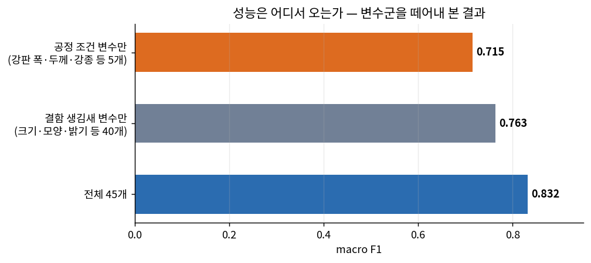

**이 결과의 의미**

공정 조건 변수 다섯 개만으로도 상당한 성능이 나온다. 결함의 생김새를 **하나도 보지 않고** 얻은 점수다. 반대로 생김새 변수 40개를 다 써도 전체보다 낮다.

**결정적인 증거**

결함 종류별로 강판 폭이 어떻게 분포하는지 보면 이유가 눈에 보인다.

| 결함 종류 | 강판 폭 최솟값 | 강판 폭 최댓값 | 폭의 범위 |
|---|---:|---:|---:|
| 얼룩(Stains) | 1,354 | 1,362 | 8 |
| K형 긁힘 | 1,336 | 1,687 | 351 |
| 오염(Dirtiness) | 1,352 | 1,696 | 344 |
| Z형 긁힘 | 1,348 | 1,708 | 360 |
| 표면박리(Pastry) | 1,333 | 1,710 | 377 |
| 기타 결함 | 1,227 | 1,715 | 488 |
| 융기(Bumps) | 1,227 | 1,794 | 567 |

**얼룩은 사실상 한 가지 폭의 강판에서만 나왔다.** 다른 결함들이 300~500 범위에 걸쳐 있는 것과 비교하면 극단적으로 좁다. 즉 모델은 얼룩을 "둥글고 밝기 차이가 뚜렷한 자국"으로 배운 게 아니라, **"폭이 1,358쯤인 강판에서 나온 결함"으로 배워도 거의 다 맞힐 수 있다.** 8.2절에서 얼룩의 성능이 높게 나온 결과에는 이 사정이 섞여 있다.

왜 이런 일이 생기는가. 제철소는 같은 규격의 제품을 한 번에 몰아서 생산한다(캠페인 생산). 두꺼운 후판을 찍는 동안 생기는 결함과 얇은 냉연 강판에서 생기는 결함은 종류 구성이 다르다. 그래서 두께와 강판 폭만 알아도 결함 종류의 후보가 상당히 좁혀진다.

**이것이 왜 문제인가**

모델이 일종의 **제품 규격 분류기**로 작동하고 있다는 뜻이다. 같은 공장, 같은 제품 구성이 유지되는 동안은 잘 맞는다. 하지만 새로운 제품을 도입하거나 설비를 교체해 제품 구성이 바뀌면, 모델이 의존하던 "이 두께에서는 보통 이 결함" 관계가 깨지면서 성능이 급격히 떨어질 수 있다.

6.3절의 공간적 누수와 합치면 이 모델의 성격이 분명해진다. **이 모델은 결함을 보고 판별하는 것이 아니라, 결함이 나타난 맥락을 보고 추측하는 비중이 상당하다.** 이것은 결함이 아니라 데이터가 가진 성질이며, 투입 전에 반드시 알고 있어야 할 사항이다.

### 8.5 기각한 실험

보고할 가치가 있는 실패가 셋 있었다.

| 시도 | 세운 가설 | 결과 | 판단 |
|---|---|---|---|
| 클래스별 확률 보정 | 희귀 결함 쪽 확률에 가중치를 곱하면 macro F1이 오른다 | 검증 데이터에서는 올랐으나 손대지 않은 데이터에서는 개선 없음 | 기각 |
| 2단계 전담 모델 | 헷갈리는 세 종류만 따로 학습한 모델이 더 잘 가른다 | 같은 구간에서 전체 모델보다 낮은 점수 | 기각 |
| 판정 임계값 조정 | 표면박리·융기의 판정 기준을 낮추면 놓치는 양이 줄어든다 | 아래 별도 설명 | 기각 |

**판정 임계값 조정을 따로 검증한 이유**

8.2절에서 표면박리와 융기를 자주 놓치는 것이 확인됐으므로, 이 두 종류는 조금만 그럴듯해도 그 종류로 판정하도록 기준을 낮추는 방법을 생각할 수 있다. 확률에 1보다 큰 배율을 곱하면 된다.

문제는 **이 배율을 어디서 정하느냐**다. 검증 데이터를 보고 정하면 그 검증 점수는 이미 공정하지 않다. 그래서 **중첩 교차검증**으로 검증했다. 데이터를 바깥쪽 다섯 덩어리로 나누고, 각 덩어리를 치워둔 채 **남은 데이터 안에서만** 다시 쪼개 최적 배율을 찾은 뒤, 치워뒀던 덩어리에 그 배율을 적용해 점수를 쟀다. 배율을 정할 때 한 번도 보지 않은 데이터로만 평가한 것이다.

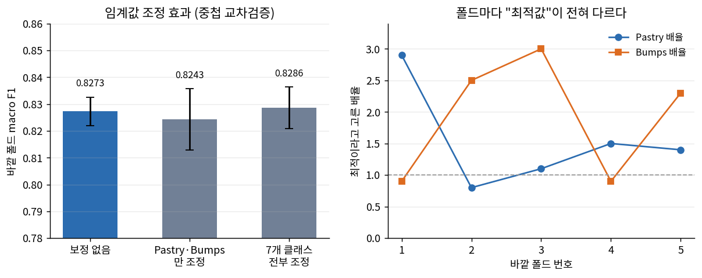

**이 그림이 보여주는 것**

왼쪽에서 세 막대의 차이가 오차막대 안에 들어간다. 두 결함만 조정한 경우는 평균이 오히려 내려갔고 흔들림은 두 배로 커졌다. 즉 **효과가 없다.**

왜 없는지는 오른쪽이 설명한다. 바깥 폴드마다 "최적"이라고 골라낸 배율이 전혀 다르다. 표면박리는 어떤 폴드에서 기준을 크게 낮추라고 하고 다른 폴드에서는 오히려 높이라고 한다. 융기도 마찬가지다. **진짜 최적 기준이 존재한다면 폴드가 바뀌어도 비슷한 값이 나와야 한다.** 매번 다른 값이 나온다는 것은 그때그때 데이터의 우연한 생김새에 맞추고 있다는 뜻이다.

근본 원인은 8.2절에서 본 그대로다. 표면박리와 융기는 **확률이 아슬아슬해서** 틀리는 게 아니라 **애초에 기타 결함과 구분이 안 되어서** 틀린다. 기준선을 옮기면 놓치는 양은 줄지만 엉뚱하게 잡아들이는 양이 그만큼 늘어나 서로 상쇄된다. 경계선의 위치가 아니라 경계선 자체가 흐린 것이 문제이므로, 기준을 옮겨서는 해결되지 않는다.

**첫 번째 실패에서 배운 것**

검증 점수를 보고 무언가를 조정하면, 그 조정은 **검증 데이터의 우연한 패턴까지 함께 학습한다.** 올라간 점수는 진짜 개선이 아니라 검증 데이터에 대한 과적합이었다. 손대지 않은 데이터로 한 번 더 확인하지 않았다면 그대로 보고할 뻔했다.

**두 번째 실패에서 배운 것**

직관과 반대되는 결과였다. 전담 모델이 더 나을 것 같지만, 전체 모델은 나머지 네 종류까지 학습하면서 **"이것은 긁힘이 아니고 얼룩도 아니다"라는 소거법 정보**를 함께 얻는다. 세 종류만 보고 배운 모델은 그 정보가 없다. 문제를 쪼개는 것이 항상 이득은 아니라는 사례다.

---

## 9. Streamlit 대시보드

### 9.1 주요 기능

- 결함 종류별 데이터 분포와 변수별 분리력 확인
- 불균형 처리 적용 전후, 분할 방식별 성능 비교
- 최종 모델의 혼동행렬 및 종류별 성능 확인
- 측정값을 입력해 결함 종류 예측 및 확률 확인

### 9.2 실행 화면


*실제 실행 화면을 캡처해 첨부한다.*

---

## 10. 결론 및 회고

### 10.1 프로젝트 주요 결과

목표였던 macro F1 0.83을 달성했다. 다만 이 프로젝트에서 더 의미 있다고 보는 결과는 성능 수치가 아니라 다음 세 가지다.

**첫째, 지금 성능을 막고 있는 것이 모델이 아니라는 것을 실험으로 분리해 냈다.** 학습곡선·복잡도 비교·라벨 섞기 세 가지로 과적합이 아님을 확인했고, "기타 결함" 범주를 빼자 성능이 크게 뛰는 것을 보였다. 모델을 더 키워서 해결할 문제가 아니라 데이터 쪽을 손봐야 하는 문제다.

**둘째, 성능의 상당 부분이 결함의 생김새가 아니라 공정 조건에서 온다는 것을 확인했다.** 모델이 무엇을 보고 판단하는지 변수군별로 분해한 결과이며, 제품 구성이 바뀌면 성능이 떨어질 수 있다는 운영상의 경고로 이어진다.

**셋째, 분할 방식에 따라 점수가 달라진다는 것을 정량화했다.** 결함이 강판 위에 뭉쳐서 생기므로 무작위 분할 점수에는 위치 정보의 덕이 섞여 있다. 주 지표는 무작위 분할로 두되, 코일 단위 점수를 함께 실어 그 숫자가 성립하는 조건을 밝혔다.

불균형 처리는 클래스 가중치로 충분했다. 오히려 이 데이터의 어려움은 소수 클래스가 아니라 **가장 큰 클래스가 여러 결함의 혼합물**이라는 데 있었다.

### 10.2 한계점 및 개선 방향

**데이터 측면**

가장 큰 한계는 "기타 결함"이 하나의 결함 종류가 아니라는 점이다. 이 범주를 빼고 여섯 종류만 분류하면 성능이 크게 오른다는 것은 8.2절에서 실험으로 확인했다. 다만 그 경우 현장에서 분류 불가 결함을 어떻게 처리할지 따로 정해야 한다.

또한 코일 식별자가 없어 코일 경계를 추정에 의존했다. 실제 생산 데이터라면 코일 번호가 있을 것이므로 더 정확한 검증이 가능하다.

**모델 측면**

측정값만 쓰고 원본 이미지를 쓰지 못했다. 융기와 표면박리처럼 측정 수치가 겹치는 결함도 이미지로는 질감이 다를 가능성이 높다. 이미지가 있다면 CNN 계열로 확장하는 것이 가장 가능성 있는 개선 방향이다.

공정 조건 의존 문제는, 공정 조건 변수를 제외한 모델을 함께 운영하며 두 모델의 예측이 갈리는 경우를 모니터링하는 방식으로 관리할 수 있다.

**추가로 시도하고 싶은 것**

- 확신도가 낮은 예측을 사람에게 넘기는 2차 검토 경로의 임계값 설계
- 시간순 분할 검증(앞 기간으로 학습, 뒤 기간으로 검증)으로 실제 운영 상황 재현
- 기타 결함을 군집화해 숨은 하위 유형이 있는지 확인

### 10.3 프로젝트를 통해 배운 점

**성능 숫자는 측정 방법과 함께 봐야 한다는 것을 체감했다.** 처음에는 교차검증 점수가 나왔으니 끝이라고 생각했는데, 통계적으로 무의미한 변수를 모델이 왜 쓰는지 따라가 보니 분할 방식 자체에 문제가 있었다. 지표를 올리는 것보다 그 지표가 무엇을 재고 있는지 묻는 쪽이 더 중요한 작업이었다.

**잘 안 된 실험도 결과라는 것을 배웠다.** 파생변수를 열심히 만들었는데 성능이 안 올랐을 때 처음에는 숨기고 싶었다. 하지만 "왜 안 올랐는가"를 따져 보니 트리 모델의 작동 방식에 대한 이해로 이어졌고, 선형 모델에서는 효과가 있다는 것까지 확인하면서 오히려 보고할 내용이 늘었다.

**다음에는 검증 설계를 먼저 하겠다.** 이번에는 모델을 다 돌린 뒤에 분할 방식 문제를 발견해 많은 실험을 다시 돌려야 했다. 데이터를 받자마자 "이 데이터에서 같은 샘플끼리 묶이는 단위가 무엇인가"를 먼저 확인하는 것이 순서상 맞다.
